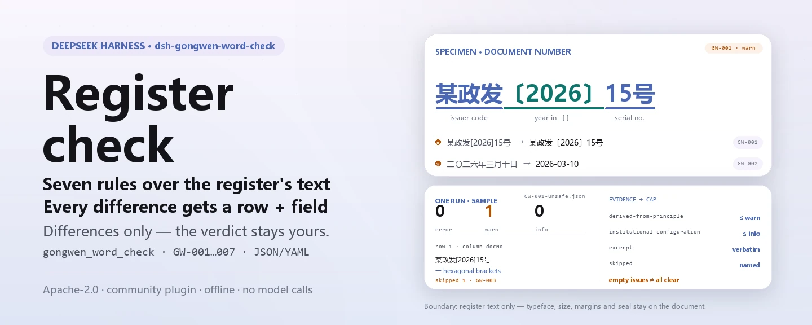

<div align="center">

<picture>
  <source media="(prefers-color-scheme: dark)" srcset="docs/assets/dsh-gongwen-word-check-hero-en-dark.webp">
  
</picture>

# dsh-gongwen-word-check

**Check a document register item by item — you get a list of which row, which column, and what to fix; the verdict stays with the reviewer.**

A data-only checker plugin for DeepSeek Harness: it reads one official-document register (one row per issued document), applies the versioned rule pack it ships (GW-001..GW-007) to the text the register records, and lists only the differences it can point to inside the material — never a compliance verdict, never a liability finding.

[Install](#three-step-setup) · [Configuration](#configuration) · [FAQ](#faq) · [简体中文](README.md) · [English](README.en.md) · [Español](README.es.md) · [Português](README.pt.md) · [हिन्दी](README.hi.md)

[](LICENSE)
[](#compatibility)
[](https://www.npmjs.com/package/dsh-gongwen-word-check)
[](https://github.com/PerryLink/dsh-gongwen-word-check/actions/workflows/ci.yml)
[](#compatibility)

[](https://github.com/PerryLink/dsh-gongwen-word-check/stargazers)
[](https://www.npmjs.com/package/dsh-gongwen-word-check)
[](https://dshfind.com/plugins/PerryLink/dsh-gongwen-word-check?ref=badge)
[](https://securityscorecards.dev/viewer/?uri=github.com/PerryLink/dsh-gongwen-word-check)
[](https://dsh.market/)
[](https://gitee.com/perrylink/dsh-gongwen-word-check)

```sh
dsh plugin --profile <name> add dsh-gongwen-word-check
```

</div>

<sub>Community plugin, not affiliated with DeepSeek. Canonical repository: <https://github.com/PerryLink/dsh-gongwen-word-check> (Gitee is a mirror).</sub>

## What it is

`dsh-gongwen-word-check` reads one official-document register — one row per issued document — and checks the text that register records, element by element: whether the document number follows the 「issuer code 〔year〕 serial」 shape with the year in hexagonal brackets 〔〕; whether the signing date parses and is not later than the check date; whether the document kind comes from the vocabulary your own unit configures; whether a main recipient is recorded; whether the title stays within the configured length; whether a document number repeats anywhere in the register; and whether a title still holds an unreplaced template placeholder.

It checks **the text a register records, not the layout of the document itself** — typeface, size, margins and seal placement can only be judged from the document itself.

The register's own column names are Chinese in the material this plugin is built for; each one maps to a field key the rules operate on:

```text
register column   field key   what the check asks
发文字号           docNo       issuer code 〔year〕 serial, outer uniqueness
成文日期           signedAt    parses, not later than the check date
文种               docKind     from the vocabulary your unit configures
主送机关           recipient   filled in
标题               title       within the configured length, no placeholder
```

- **Who it is for**: document drafters, secretariat staff and reviewers of an issuing office; no command line required — hand the material over in chat.
- **What you give it**: the source material the check works on (a table, register or document); the original is never modified. Excel can be converted to JSON/YAML first, in chat if the platform supports it.
- **What you get back**: a list of "which row, which column, what is missing, how to fix it"; every check that could not run is listed in `skipped` with its reason.

<picture>
  <source media="(prefers-color-scheme: dark)" srcset="docs/assets/dsh-gongwen-word-check-flow-v5-dark.svg">
  
</picture>

## Three-step setup

1. **Install** (pick one channel):

   ```sh
   # git channel (latest main; equivalent to git+https://github.com/PerryLink/dsh-gongwen-word-check.git)
   dsh plugin --profile <name> add github:PerryLink/dsh-gongwen-word-check
   # npm channel (published releases)
   dsh plugin --profile <name> add dsh-gongwen-word-check
   # tarball channel: pnpm pack in this repo, then
   dsh plugin --profile <name> add ./dsh-gongwen-word-check-<version>.tgz
   ```

2. **Minimal config** (sane defaults; a bundle row without `config` uses every default, with the rule-pack path pointing at the bundled `rules/gongwen-word-check.yaml`):

   ```yaml
   - insert:
       - id: dsh-gongwen-word-check
         name: dsh-gongwen-word-check
   ```

3. **Verify it mounts**:

   ```sh
   dsh --profile <name> --dump-config | grep 'dsh-gongwen-word-check'
   ```

   Then run the bundled sample (needs `pnpm run build` first to produce `lib/`):

   ```sh
   node samples/quickstart/run.mjs
   ```

   Output (expected in `samples/quickstart/expected/result.json`; the input lives in `samples/quickstart/input/`):

   ```text
   gongwen_word_check: 1 issue(s) — error 0, warn 1, info 0
   skipped: 1
   ```

   `--json` prints the same summary as JSON. A screenshot is in `docs/assets/quickstart.png`.

**Uninstall**: `dsh plugin --profile <name> remove dsh-gongwen-word-check` (or remove the row from the profile patch).

<details>
<summary>Use it in WorkBuddy / Coze</summary>

Search "Documents and Governance Suite" in WorkBuddy / Coze (this check is one part of it; availability as listed) to call the same checking capability without a command line.

</details>

<details>
<summary>Install from the DSH Desktop market</summary>

Every PerryLink plugin is listed in the built-in DSH Desktop market: **Market → Sources → Add source → paste** `https://perrylink-dsh-catalog.perrylink.workers.dev/catalog-source.json` **→ select**. Installation still requires the market's npm identity check and your confirmation.

</details>

## Core capabilities

`dsh-gongwen-word-check` registers the `gongwen_word_check` tool: it reads one document register (JSON or YAML), applies a versioned rule pack, and returns a report.

- **Seven rules in one data pack** — the rule pack is data, not code (`rules/gongwen-word-check.yaml`); replacing it switches the whole rule set without touching a line of TypeScript.
- **Read-only on the material** — accepts JSON or YAML and never modifies the original; pure ESM, no network requests, no model calls.
- **No fabricated citations** — every rule carries `document` / `number` / `clause` / `excerpt` / `kind` / `source`; `excerpt` must be a verbatim quotation, and a rule whose clause text is not quoted verbatim says so in the `excerpt` itself and stays marked `derived-from-principle`.
- **Severity follows the evidence** — `derived-from-principle` is capped at `warn`, institutional configuration (`institutional-configuration`) at `info`, and a test asserts it.
- **An empty issue list is never "nothing is wrong"** — every check that could not run is reported in `skipped` with its reason; a rule whose required list is unset reports itself in `skipped` rather than passing silently.
- **No adjudicating wording** — the report lists differences and never pronounces on compliance, liability or correctness; a wording guard enforces this and every report carries the disclaimer.

| Rule | Check | Severity | Basis kind |
|---|---|---|---|
| `GW-001` | the document number follows the configured 「issuer code 〔year〕 serial」 shape, year in 〔〕 | warn | principle |
| `GW-002` | the signing date parses and is not later than the check date | warn | principle |
| `GW-003` | the document kind comes from your vocabulary (unset out of the box) | info | local |
| `GW-004` | a main recipient is recorded | warn | principle |
| `GW-005` | the title is not over the configured length | warn | principle |
| `GW-006` | document numbers are unique in the register | warn | principle |
| `GW-007` | the title holds no unreplaced template placeholder | warn | principle |

### Examples

These are the plugin's real entry points; install once, then call one. The first case is the detailed walkthrough, the rest are short cases.

**Detailed example** — tool `gongwen_word_check`, input:

```json
{"rows":[{"发文字号":"某政发〔2026〕15号","成文日期":"二〇二六年三月十日"}]}
```

Output:

```json
{
  "id": "dsh-gongwen-word-check.GW-002.de09b5a6",
  "ruleId": "GW-002",
  "severity": "warn",
  "locator": {
    "field": "signedAt",
    "row": 1
  },
  "found": "第 1 行「signedAt」的值「二〇二六年三月十日」无法解析为日期",
  "expected": "「signedAt」应为 2026-03-15 或 2026-03-15 09:30 这样的可解析日期",
  "fix": "核对日期写法；本条不会因为无法解析而跳过该行"
}
```

*Observed from `dsh-gongwen-word-check/tests/fixtures/GW-002/GW-002-unsafe.json`; `dsh-gongwen-word-check/tests/fixtures/GW-002/cases.json` expects GW-002 count 1; run via `dsh-gongwen-word-check/lib/index.mjs` against `dsh-gongwen-word-check/rules/gongwen-word-check.yaml`*

This is the plugin's real output on its own `GW-002` test fixture, not a mock-up. The finding text is emitted in Chinese because the material is. The rule pack does not invent citations, so every finding names the clause it applies and says whether that clause text was obtained this pass.

| You ask | What it answers |
|---|---|
| The document number was typed with square brackets instead of 〔〕. | `GW-001` reports the row: the pattern it was configured with requires hexagonal brackets 〔〕 around the year, so the 〔〕 form is the one to write. The rule only checks the document number's form — the issuer code itself is set by your unit, so it does not judge whether the code is the right one, nor whether serial numbers are consecutive or reused. |
| The signing date is written the way a document usually carries it, in Chinese numerals. | `GW-002` reports that it cannot parse the value. It reads `2026-03-15` and `2026-03-15 09:30`; a Chinese-numeral date has to be normalised into one of those forms, or the rule switched off. The rule also does not check the signing date against the dispatch date — that is internal to the issuing workflow. |
| We never configured the list of document kinds for our unit. Does `GW-003` quietly pass? | No. `GW-003` carries no built-in list, so with `values` unset it appears in the report's `skipped` rather than passing silently. The regulation lists fifteen main kinds, but the pack does not hard-code them — which kinds your unit may use is your own decision. The rule also does not judge which kind a given document ought to have used. |
| A row leaves the main-recipient column blank. | `GW-004` reports that row, because without a main recipient there is nothing to confirm who the document was sent to. It checks that the column is filled in, not whether the recipient range is the right one — who is addressed and who is copied is a drafting decision. |
| Our title is long. Where does the length limit come from? | `GW-005` reports a title longer than the configured ceiling of 60 characters. That figure is this rule pack's default, not a standard number: the format standard fixes a 2-hao typeface for the title and gives no character limit, so if your unit writes longer titles, raise `maxLength` or switch the rule off. The rule only counts characters — it does not judge the wording of the title. |
| Two rows carry the same document number. | `GW-006` reports the repeated number; it compares values ignoring whitespace, and a hit usually means a reused or mistyped number that a human has to confirm. It does not decide which of the two documents should hold that number. |

## Standards it follows

| Document | Number | Cited by rules |
|---|---|---|
| Format for Official Documents of Party and State Organs (canonical Chinese title in `rules/evidence/`) | GB/T 9704-2012 (recommended national standard; full text read verbatim on 2026-10-07, see `rules/evidence/clause-verification-gbt9704.md`) | GW-001, GW-002, GW-004, GW-005, GW-007 |
| Regulations on the Processing of Official Documents of Party and State Organs (canonical Chinese title in `rules/evidence/`) | Zhongbanfa [2012] No. 14 (in force from 2012-07-01; full text read verbatim) | GW-003, GW-006 |

**Boundary:** this plugin checks a **document register's header and body elements** for what a register can be held to mechanically — that the document number follows its 「issuer code 〔year〕 serial」 shape with the year in hexagonal brackets, that the signing date parses, that the document kind comes from your vocabulary, that a main recipient is recorded, that the title is not over-long, that numbers do not repeat, and that no template placeholder survives. It checks **the text a register records, not the layout** — typeface, size, margins and seal placement (chapter 5, 5.2.2, 5.2.3, 7.3.5.1 of the standard and the like) can only be judged from the document itself, and this plugin checks none of them.

> ### ⚠️ Read this before trusting a citation in the report
>
> **The Regulations were obtained and read verbatim**, and `rules/evidence/clause-verification.md` plus
> `rules/evidence/clause-verification-gongwen-articles.md` record which articles were quoted — article 8 (the
> fifteen document kinds, opening with "document kinds **mainly** include"), article 9 (the format elements,
> including the definitions of the document number and of the main recipient), article 10 (which delegates
> layout to GB/T 9704-2012), article 25(2) (the registration step of issuing) and article 42 (in force from
> 2012-07-01, superseding two earlier documents this pack therefore never cites).
>
> **The format standard's full text has been obtained and checked too** (2026-10-07, see
> `rules/evidence/clause-verification-gbt9704.md`, which explicitly supersedes the earlier "not obtained
> this pass" conclusion): **the hexagonal brackets 〔〕 that `GW-001` requires are now a written requirement
> of clause 7.2.5**, not merely a convention of the layout standard; `GW-002` now records 7.3.5.4 (month and
> day without zero padding); `GW-004` corresponds to 7.3.2. **The standard is a recommended national standard**
> (its number carries `/T`), and chapter 1 states that documents of other organs and units "may be implemented
> by reference".
>
> **Yet every rule's `excerpt` still says the clause text was not obtained this pass, and every rule remains
> `warn` or `info`.** The reason is not that the text is missing but that **the objects differ**: the clauses
> govern the layout of the document itself, while this plugin checks *the text a register records*. Labelling a
> blank column a `direct` breach of 7.3.2 would dress a register gap up as a layout violation. The pack header
> and every rule's `note` state this, and section 5 of `rules/evidence/clause-verification-gbt9704.md` records
> the reasoning rule by rule.
>
> Two thresholds are local, and the pack says so. The title-length ceiling (`GW-005`, 60 characters) is **this
> rule pack's default, not a standard figure** — 7.3.1 fixes only a 2-hao typeface for the title, and **no
> character count appears in either document**. And the document-kind vocabulary (`GW-003`) ships **empty**
> despite article 8 listing fifteen kinds, because the article says "mainly" and units also use names outside
> the list. `GW-006` (uniqueness) and `GW-007` (placeholders) have **no** directly corresponding clause in either
> document; the pack marks them as inferences instead of borrowing the nearest clause.
>
> The placeholder check deliberately **omits the character used as a stand-in for "a certain"** from its term
> list: template titles often read "notice on a certain matter", but that character also appears in legitimate
> titles as a stand-in for a confidential subject.
>
> What is still unobtained is stated as well: the specimen figures of chapter 11 (figures 1–12, images only),
> GB/T 15834 (punctuation usage), GB/T 15835 (numerals in publications) and GB 3100/3101/3102 (quantities and
> units). That is why this plugin **adds no "is the punctuation correct" rule** — it would go beyond the scope of a
> register's text. GB/T 9704-1999 and GB/T 9704-1988 have been superseded and are never cited here.

The clause extracts the pack quotes (Chinese wording kept verbatim, as recorded in `rules/evidence/`):

```text
7.2.5 发文字号   年份、发文顺序号用阿拉伯数字标注；年份应标全称，用六角括号"〔〕"括入；
                 发文顺序号不加"第"字，不编虚位（即 1 不编为 01），在阿拉伯数字后加"号"字。
7.3.1 标题       一般用 2 号小标宋体字……（未规定字数上限）
7.3.2 主送机关   编排于标题下空一行位置，居左顶格……最后一个机关名称后标全角冒号。
7.3.5.4 成文日期 用阿拉伯数字将年、月、日标全，年份应标全称，月、日不编虚位（即 1 不编为 01）。
第九条（五）     发文字号。由发文机关代字、年份、发文顺序号组成。
第九条（八）     主送机关。公文的主要受理机关。
第二十五条（二） 登记。对复核后的公文，应当确定发文字号、分送范围和印制份数并详细记载。
```

## Configuration

All tunables are Schemastery `Config` fields in `src/config.ts` (changeable from cordis.yml); the per-rule thresholds live in the rule pack under `rules/`. An id-targeted override replaces the whole row — restate every key you need.

| Key | Type | Default | Description |
|---|---|---|---|
| `rulesFile` | string | `rules/gongwen-word-check.yaml` | Rule-pack path, relative to the package root |
| `disabledRules` | string[] | `[]` | Rule ids to stop running; each appears in `skipped` |
| `onlyRules` | string[] | `[]` | Run only these rule ids; empty runs every rule |
| `skipNotes` | string | `""` | Note appended to every `skipped` reason |
| `timeoutMs` | number | `120000` | Cooperative tool timeout budget |

Rule-level parameters worth knowing:

- `GW-001` `pattern` — the document-number shape; the default demands the year in hexagonal brackets 〔〕. Widen it for joint issuances or minutes that carry no number, or disable the rule.
- `GW-003` `values` — your unit's document kinds, e.g. the fifteen main kinds enumerated by article 8 of the regulation (its verbatim excerpt ships with the rule pack) plus any names your office uses.
- `GW-005` `maxLength` / `minLength` — **your** title-length bounds; the default ceiling of 60 is a local convention, not a standard figure.
- `GW-007` `terms` — the placeholders to look for; the character standing for "a certain" is deliberately absent.

Example override in your profile patch:

```yaml
- insert:
    - id: dsh-gongwen-word-check
      name: dsh-gongwen-word-check
      config:
        disabledRules: [GW-005]
        onlyRules: [GW-001, GW-002, GW-004]
        timeoutMs: 180000
```

## Material format

The tool accepts JSON or YAML:

```yaml
issuer: 某某机关
year: 2026
rows:
  - { 发文字号: 某政发〔2026〕15号, 标题: 某某机关关于印发某某管理办法的通知, 文种: 通知,
      发文机关: 某某机关, 成文日期: 2026-03-10, 主送机关: 各直属单位,
      抄送机关: 某某办公室, 密级: 公开, 紧急程度: 平件 }
```

Column names are matched case-insensitively and ignoring spaces, underscores and hyphens; the register's own column names are kept, so a finding names the column it actually read. Dates may be `2026-03-10` or `2026-03-10 09:30` — a Chinese-numeral date is reported as unparseable on purpose. Fields are optional at the reader layer and validated by the check engine, so a partially exported register produces "missing item" findings instead of a crash.

## Rule sources

Rule data lives in `rules/gongwen-word-check.yaml`, separated from the code: every rule carries document, number, clause in the source's own numbering, a verbatim excerpt, and a source URL. The pack's header states the citation gap in full, and each rule's `note` repeats the part that matters for that rule. The load-time guard that normally enforces "an excerpt must be a real quotation of at least eight characters" cannot tell a quotation from a description — so this pack leans on the header, the per-rule notes, and a test that asserts every `excerpt` admits the gap. A pack that overstates its basis fails at load time instead of producing a confident-looking report. The boundaries confirmed during verification and the conclusions deliberately **not** drawn ship in the bundled `rules/evidence/` directory.

## FAQ

<details>
<summary>Does it decide compliance for us?</summary>

No. It lists only the differences it can point to inside the material (which row, which column, what is missing, how to fix it) and decides neither facts nor compliance — the conclusion always stays with the reviewer. A wording guard enforces the report's wording, and every report carries the disclaimer. A hit should be read as "this column is empty / the number's shape is wrong / the title is too long", never as "the document's format is non-compliant".

</details>

<details>
<summary>Why is every rule capped at `warn` — where is `error`?</summary>

Because the evidence level decides the severity: a rule resting on a principle rather than a directly applicable clause (`kind: derived-from-principle`) is capped at `warn`, and a check whose threshold comes from your institution (`institutional-configuration`) is capped at `info`. The pack refuses an overstated `error` at load time, and a test asserts the cap.

</details>

<details>
<summary>Can an empty `issues` list be read as "nothing is wrong"?</summary>

No. Every check that could not run is listed in `skipped` with its reason (for example `GW-003` with `values` unset, or a rule disabled through `disabledRules`). Read `issues` and `skipped` together before drawing any conclusion from a report.

</details>

<details>
<summary>Must we rewrite Chinese-numeral dates and square-bracket numbers?</summary>

Not necessarily, but those forms are reported honestly: `GW-001`'s pattern requires the year in hexagonal brackets 〔〕, so a square-bracket number is reported; `GW-002` reads only `2026-03-15` and `2026-03-15 09:30`, so a Chinese-numeral date is reported as unparseable. If your unit keeps the conventional forms, widen `pattern` or disable the rule — the plugin does not dictate your house style.

</details>

<details>
<summary>Our register is an Excel export. Can we use it directly?</summary>

Yes — convert it to JSON or YAML first; in chat the platform can do the conversion for you if supported. The tool only reads the material and never modifies the original. Fields are optional at the reader layer and validated by the check engine, so a partial export yields missing-item findings rather than a crash.

</details>

<details>
<summary>Will it cope with a whole year of documents at once?</summary>

The tool works in both `native` and `ptc` modes; for batch work (a year of registers or a whole directory) use `ptc`, where the schema cost is paid once. The checks themselves are local column matching plus date arithmetic — no network requests, no model calls; `timeoutMs` (default 120 s) is the cooperative timeout budget.

</details>

## Troubleshooting

- **`GW-001` fires on a number I consider correct.** The pattern requires the year in **hexagonal brackets 〔〕**; a number written with `[]`, `（）` or a hyphen fails. Adjust `pattern` to your house style.
- **`GW-002` fires on a Chinese-numeral date.** The reader accepts `2026-03-10`; a date written in Chinese numerals is reported as unparseable on purpose so you can decide whether to normalise the export.
- **`GW-003` never runs.** Its vocabulary ships empty. Which document names count as kinds is your institution's call, and the plugin will not guess.
- **`GW-005` fires on a title that fits on the page.** The ceiling is 60 characters by default and is a local convention. Raise it, or disable the rule.
- **`GW-007` does not fire on a title containing the "a certain" character.** That is deliberate; add the character to `terms` if your templates really use it as a placeholder.
- **The plugin installs but the tool never appears.** Check that `main` resolves to `lib/index.mjs` and that `pnpm run build` produced it; a wrong `main` makes the loader skip the entry silently.
- **`dsh plugin add` refuses the package as incompatible.** The peer range covers `0.1.x` and `0.2.x`; if your runtime sits outside it, grant an explicit exemption: `dsh plugin --profile <name> allow-version dsh-gongwen-word-check@0.1.0 --dsh-version <runtime> --accept-risk`
- **`check` reports `manifest-peers` as failed.** The static checker compares against a hard-coded peer range that predates the 0.2 line. The runtime enforces peer compatibility at install time, so the declared range is the correct one; this is a known upstream issue in `dsh-plugin-dev`.
- **Times look shifted.** All arithmetic is wall-clock on the input strings, with no timezone conversion.

## Compatibility

| Surface | Status |
|---|---|
| Harness | Peer range `>=0.1.2-rc.1 <0.2.0 \|\| >=0.2.0-0 <0.3.0` — verified to accept both `0.2.0-rc.2` and `0.2.1-rc.2`. `engines.dsh` is declared as `>=0.2.1-0 <0.3.0` and is enforced by the host since 0.2.1 |
| Node | `^22.19.0 \|\| >=24.0.0` |
| Platforms | All (plain ESM; no native code, no network, no model call) |
| Tool mode | Works in `native` and `ptc`; for a whole year's register use `ptc` |
| Standard applicability | GB/T 9704-2012 is a **recommended** national standard (its number carries `/T`); chapter 1 states that documents of other organs and units "may be implemented by reference", so enterprise and public-institution documents fall under reference, not obligation |

## Ecosystem & quality

- [Gitee mirror](https://gitee.com/perrylink/dsh-gongwen-word-check) (sync mirror; GitHub is canonical)
- [dshfind plugin page](https://dshfind.com/plugins/PerryLink/dsh-gongwen-word-check) (installs and ranking)
- [OpenSSF Scorecard report](https://securityscorecards.dev/viewer/?uri=github.com/PerryLink/dsh-gongwen-word-check) (driven by [.github/workflows/scorecard.yml](.github/workflows/scorecard.yml))
- [DSH Market](https://dsh.market/) (listed)
- **1024 store channel**: `npm i -g dsh1024` once, then `dsh1024 plugin --profile <name> add dsh-gongwen-word-check` (counts toward the [deepseek1024.com](https://deepseek1024.com) install ranking)
- [Ecosystem knowledge base](https://perrylink.github.io/dsh-plugin-guide/) — plugin development guide · measured selection data · maintenance criteria

## Development

```sh
pnpm install                                        # node ^22.19 || >=24
pnpm run typecheck                                  # tsc --noEmit
pnpm test                                           # vitest: shared table-plugin suite + paired fixtures
pnpm run build                                      # tsdown -> lib/index.mjs + lib/index.d.mts
pnpm run verify:self-contained                      # dependency specs resolve from the registry
pnpm run check:lockfile                             # lockfile drift check
pnpm run check:readmes                              # five-language README consistency
pnpm run check:citations                            # rule-pack citation baseline
node ../scripts/sync-shared.mjs dsh-gongwen-word-check   # refresh src/shared from ../_shared
pnpm pack                                           # the published tarball
```

The plugin is **data-only**: `src/model.ts` declares the table shape, the shared kit supplies the reader and the check engine, and the rule pack declares every check; a check that fits an existing kind needs a rule pack edit and nothing else. Local sample run (needs `pnpm run build` first to produce `lib/`):

```sh
node samples/quickstart/run.mjs --json
# => {"tool":"gongwen_word_check","issueCount":1,"summary":{"error":0,"warn":1,"info":0},"skippedCount":1}
```

The sample input lives in `samples/quickstart/input/`, the expected output in `samples/quickstart/expected/result.json`, and a screenshot in `docs/assets/quickstart.png`. The README images are generated programmatically by [`scripts/gen-readme-assets.py`](scripts/gen-readme-assets.py) (the hero with Python + Pillow, the structure figure as hand-written SVG) and are safe to re-run: `python scripts/gen-readme-assets.py`; the older single-skin flow diagram and demo images stay in `docs/assets/` for external deep links, while the READMEs reference the new hero and the light/dark structure pair.

Topics: `deepseek-harness`, `dsh`, `dsh-plugin`, `cordis`, `gongwen`, `word`

## Family & thanks

This project is part of the DeepSeek Harness plugin family from [PerryLink](https://github.com/PerryLink) (all Apache-2.0). Full family index: [choose a checker by material](https://perrylink.github.io/zh/checkers/choose/) and [all plugins](https://github.com/PerryLink). If it is useful, **a star helps the next person find it** — nothing is gated behind it.

- [@PerryLink](https://github.com/PerryLink) — creator and maintainer: the data-only rule pack (GW-001..GW-007), the `gongwen_word_check` tool, the citation-verification record, and the five-language docs.

<details>
<summary>Expand all plugins</summary>

| Plugin | Status |
|---|---|
| **[dsh-aqua-input-check](https://github.com/PerryLink/dsh-aqua-input-check)** |  |
| **[dsh-archive-check](https://github.com/PerryLink/dsh-archive-check)** |  |
| **[dsh-auto-review](https://github.com/PerryLink/dsh-auto-review)** |  |
| **[dsh-autotier](https://github.com/PerryLink/dsh-autotier)** | 🧊 FROZEN — see the repo README |
| **[dsh-bid-ca-precheck](https://github.com/PerryLink/dsh-bid-ca-precheck)** |  |
| **[dsh-bid-qual-check](https://github.com/PerryLink/dsh-bid-qual-check)** |  |
| **[dsh-cert-mcp](https://github.com/PerryLink/dsh-cert-mcp)** | 🧊 FROZEN — see the repo README |
| **[dsh-checkpoint-rewind](https://github.com/PerryLink/dsh-checkpoint-rewind)** |  |
| **[dsh-click](https://github.com/PerryLink/dsh-click)** |  |
| **[dsh-composer-history](https://github.com/PerryLink/dsh-composer-history)** |  |
| **[dsh-contract-stance](https://github.com/PerryLink/dsh-contract-stance)** |  |
| **[dsh-customs-doc-check](https://github.com/PerryLink/dsh-customs-doc-check)** |  |
| **[dsh-data-quality](https://github.com/PerryLink/dsh-data-quality)** | 🧊 FROZEN — see the repo README |
| **[dsh-demurrage-ledger](https://github.com/PerryLink/dsh-demurrage-ledger)** |  |
| **[dsh-doublecheck](https://github.com/PerryLink/dsh-doublecheck)** |  |
| **[dsh-drill-script-check](https://github.com/PerryLink/dsh-drill-script-check)** |  |
| **[dsh-eia-guide-check](https://github.com/PerryLink/dsh-eia-guide-check)** |  |
| **[dsh-emergency-plan](https://github.com/PerryLink/dsh-emergency-plan)** |  |
| **[dsh-essay-rubric-check](https://github.com/PerryLink/dsh-essay-rubric-check)** |  |
| **[dsh-evidence-check](https://github.com/PerryLink/dsh-evidence-check)** |  |
| **[dsh-export-ctl-check](https://github.com/PerryLink/dsh-export-ctl-check)** |  |
| **[dsh-fast](https://github.com/PerryLink/dsh-fast)** |  |
| **[dsh-fmea-table-check](https://github.com/PerryLink/dsh-fmea-table-check)** |  |
| **[dsh-forecast-penalty](https://github.com/PerryLink/dsh-forecast-penalty)** |  |
| **[dsh-fund-research](https://github.com/PerryLink/dsh-fund-research)** |  |
| **[dsh-github](https://github.com/PerryLink/dsh-github)** |  |
| **[dsh-gongwen-flow-check](https://github.com/PerryLink/dsh-gongwen-flow-check)** |  |
| **[dsh-gongwen-word-check](https://github.com/PerryLink/dsh-gongwen-word-check)** |  |
| **[dsh-guard-plan-qc](https://github.com/PerryLink/dsh-guard-plan-qc)** |  |
| **[dsh-hazchem-check](https://github.com/PerryLink/dsh-hazchem-check)** |  |
| **[dsh-hazplan-check](https://github.com/PerryLink/dsh-hazplan-check)** |  |
| **[dsh-hidden-risk-map](https://github.com/PerryLink/dsh-hidden-risk-map)** |  |
| **[dsh-hs-classify](https://github.com/PerryLink/dsh-hs-classify)** |  |
| **[dsh-icd-rule-check](https://github.com/PerryLink/dsh-icd-rule-check)** |  |
| **[dsh-industry-research](https://github.com/PerryLink/dsh-industry-research)** |  |
| **[dsh-lawcite-adapter](https://github.com/PerryLink/dsh-lawcite-adapter)** |  |
| **[dsh-laya](https://github.com/PerryLink/dsh-laya)** |  |
| **[dsh-lc-doc-check](https://github.com/PerryLink/dsh-lc-doc-check)** |  |
| **[dsh-learning-gap-check](https://github.com/PerryLink/dsh-learning-gap-check)** |  |
| **[dsh-library](https://github.com/PerryLink/dsh-library)** |  |
| **[dsh-local-ai](https://github.com/PerryLink/dsh-local-ai)** |  |
| **[dsh-lsp-actions](https://github.com/PerryLink/dsh-lsp-actions)** |  |
| **[dsh-mask](https://github.com/PerryLink/dsh-mask)** |  |
| **[dsh-mcp-panel](https://github.com/PerryLink/dsh-mcp-panel)** |  |
| **[dsh-medrec-qc](https://github.com/PerryLink/dsh-medrec-qc)** |  |
| **[dsh-memento](https://github.com/PerryLink/dsh-memento)** | 🧊 FROZEN — see the repo README |
| **[dsh-nsfc-form-check](https://github.com/PerryLink/dsh-nsfc-form-check)** |  |
| **[dsh-nurse-record-check](https://github.com/PerryLink/dsh-nurse-record-check)** |  |
| **[dsh-observe](https://github.com/PerryLink/dsh-observe)** |  |
| **[dsh-origin-rvc-check](https://github.com/PerryLink/dsh-origin-rvc-check)** |  |
| **[dsh-ota-review-check](https://github.com/PerryLink/dsh-ota-review-check)** |  |
| **[dsh-output-styles](https://github.com/PerryLink/dsh-output-styles)** |  |
| **[dsh-paper-doc-adapter](https://github.com/PerryLink/dsh-paper-doc-adapter)** |  |
| **[dsh-permission-rules](https://github.com/PerryLink/dsh-permission-rules)** |  |
| **[dsh-permit-report-check](https://github.com/PerryLink/dsh-permit-report-check)** |  |
| **[dsh-pipeline-check](https://github.com/PerryLink/dsh-pipeline-check)** |  |
| **[dsh-pleading-draft](https://github.com/PerryLink/dsh-pleading-draft)** |  |
| **[dsh-plugin-doctor](https://github.com/PerryLink/dsh-plugin-doctor)** | 🚫 RETIRED (repo archived) |
| **[dsh-plugin-guide](https://github.com/PerryLink/dsh-plugin-guide)** |  |
| **[dsh-plugin-kit](https://github.com/PerryLink/dsh-plugin-kit)** | 🚫 RETIRED (repo archived) |
| **[dsh-plugin-upgrade](https://github.com/PerryLink/dsh-plugin-upgrade)** | 🚫 RETIRED (repo archived) |
| **[dsh-policy-brief-draft](https://github.com/PerryLink/dsh-policy-brief-draft)** |  |
| **[dsh-power-loss-split](https://github.com/PerryLink/dsh-power-loss-split)** |  |
| **[dsh-power-ticket-check](https://github.com/PerryLink/dsh-power-ticket-check)** |  |
| **[dsh-ppap-check](https://github.com/PerryLink/dsh-ppap-check)** |  |
| **[dsh-protest-deadline](https://github.com/PerryLink/dsh-protest-deadline)** |  |
| **[dsh-railway-window](https://github.com/PerryLink/dsh-railway-window)** |  |
| **[dsh-repair-order-qc](https://github.com/PerryLink/dsh-repair-order-qc)** |  |
| **[dsh-research-report](https://github.com/PerryLink/dsh-research-report)** |  |
| **[dsh-review-reply-check](https://github.com/PerryLink/dsh-review-reply-check)** |  |
| **[dsh-rulefile-check](https://github.com/PerryLink/dsh-rulefile-check)** |  |
| **[dsh-safety-brief-check](https://github.com/PerryLink/dsh-safety-brief-check)** |  |
| **[dsh-score](https://github.com/PerryLink/dsh-score)** | 🧊 FROZEN — see the repo README |
| **[dsh-session-sync](https://github.com/PerryLink/dsh-session-sync)** |  |
| **[dsh-site-log-check](https://github.com/PerryLink/dsh-site-log-check)** |  |
| **[dsh-skill-pack-security](https://github.com/PerryLink/dsh-skill-pack-security)** |  |
| **[dsh-soe-decision-check](https://github.com/PerryLink/dsh-soe-decision-check)** |  |
| **[dsh-soilwater-check](https://github.com/PerryLink/dsh-soilwater-check)** |  |
| **[dsh-sop-sync-check](https://github.com/PerryLink/dsh-sop-sync-check)** |  |
| **[dsh-spc-gbt-adapter](https://github.com/PerryLink/dsh-spc-gbt-adapter)** |  |
| **[dsh-talk](https://github.com/PerryLink/dsh-talk)** |  |
| **[dsh-tender-extract](https://github.com/PerryLink/dsh-tender-extract)** |  |
| **[dsh-tender-matrix](https://github.com/PerryLink/dsh-tender-matrix)** |  |
| **[dsh-test-drive](https://github.com/PerryLink/dsh-test-drive)** |  |
| **[dsh-ticktick](https://github.com/PerryLink/dsh-ticktick)** | 🚫 RETIRED (repo archived) |
| **[dsh-translate](https://github.com/PerryLink/dsh-translate)** |  |
| **[dsh-warranty-calc](https://github.com/PerryLink/dsh-warranty-calc)** |  |
| **[dsh-budget](https://github.com/PerryLink/dsh-budget)** | 🧊 FROZEN — see the repo README |
| **[dsh-claude-move](https://github.com/PerryLink/dsh-claude-move)** | 🧊 FROZEN — see the repo README |
| **[dsh-defend](https://github.com/PerryLink/dsh-defend)** | 🧊 FROZEN — see the repo README |
| **[dsh-draw](https://github.com/PerryLink/dsh-draw)** | 🧊 FROZEN — see the repo README |
| **[dsh-reach](https://github.com/PerryLink/dsh-reach)** | 🧊 FROZEN — see the repo README |
| **[dsh-background-agents](https://github.com/PerryLink/dsh-background-agents)** | 🚫 RETIRED (repo archived) |
| **[dsh-session-pin](https://github.com/PerryLink/dsh-session-pin)** | 🚫 RETIRED (repo archived) |
| **[dsh-team-rooms](https://github.com/PerryLink/dsh-team-rooms)** | 🚫 RETIRED (repo archived) |

</details>

## License

[LICENSE](LICENSE) (Apache License 2.0) © 2026 dsh-gongwen-word-check contributors

<p align="center"><sub>Apache-2.0 · Community plugin, not affiliated with DeepSeek.</sub></p>
