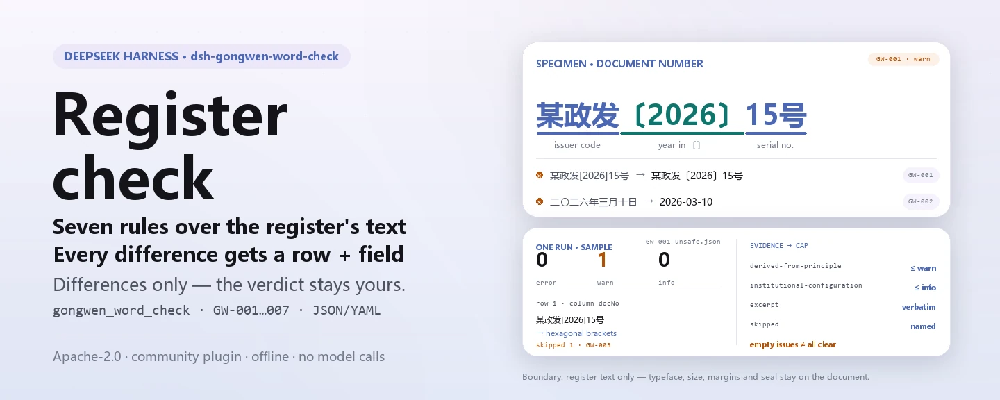

<div align="center">

<picture>
  <source media="(prefers-color-scheme: dark)" srcset="docs/assets/dsh-gongwen-word-check-hero-en-dark.webp">
  
</picture>

# dsh-gongwen-word-check

**Compruebe un registro de documentos oficiales punto por punto: obtiene la lista de qué fila, qué columna y qué corregir; el veredicto queda en manos del revisor.**

Complemento de verificación de datos para DeepSeek Harness: lee un registro de documentos oficiales (una fila por documento emitido), aplica el paquete de reglas versionado que trae (GW-001..GW-007) al texto que el registro anota y solo enumera las divergencias que puede señalar dentro del material — nunca un dictamen de cumplimiento, nunca una atribución de responsabilidad.

[Instalar](#instalación-en-tres-pasos) · [Configuración](#configuración) · [FAQ](#faq) · [简体中文](README.md) · [English](README.en.md) · [Español](README.es.md) · [Português](README.pt.md) · [हिन्दी](README.hi.md)

[](LICENSE)
[](#compatibilidad)
[](https://www.npmjs.com/package/dsh-gongwen-word-check)
[](https://github.com/PerryLink/dsh-gongwen-word-check/actions/workflows/ci.yml)
[](#compatibilidad)

[](https://github.com/PerryLink/dsh-gongwen-word-check/stargazers)
[](https://www.npmjs.com/package/dsh-gongwen-word-check)
[](https://dshfind.com/plugins/PerryLink/dsh-gongwen-word-check?ref=badge)
[](https://securityscorecards.dev/viewer/?uri=github.com/PerryLink/dsh-gongwen-word-check)
[](https://dsh.market/)
[](https://gitee.com/perrylink/dsh-gongwen-word-check)

```sh
dsh plugin --profile <name> add dsh-gongwen-word-check
```

</div>

<sub>Complemento de la comunidad, sin relación con DeepSeek. Repositorio canónico: <https://github.com/PerryLink/dsh-gongwen-word-check> (Gitee es un espejo).</sub>

## Qué es

`dsh-gongwen-word-check` lee un registro de documentos oficiales —una fila por documento emitido— y comprueba el texto que ese registro anota, elemento por elemento: si `发文字号` (el número de documento) respeta la forma 「sigla del organismo 〔año〕 número de orden」 con el año entre corchetes hexagonales 〔〕; si `成文日期` (la fecha de firma) se puede analizar como fecha y no es posterior al día de la comprobación; si `文种` (la clase de documento) procede del vocabulario que configura su propia unidad; si `主送机关` (el destinatario principal) está rellenado; si `标题` (el título) se mantiene dentro de la longitud configurada; si un número de documento se repite en el registro; y si un título conserva algún marcador de plantilla sin sustituir.

Comprueba **el texto que anota el registro, no la maquetación del documento original**: la tipografía, el cuerpo, los márgenes y la posición del sello solo pueden juzgarse sobre el documento mismo.

Los nombres de columna del registro son chinos en el material para el que se construyó este complemento; cada uno corresponde a una clave de campo sobre la que operan las reglas:

```text
columna del registro   clave     qué pregunta la comprobación
发文字号                docNo     sigla 〔año〕 número de orden; unicidad en el registro
成文日期                signedAt  se analiza y no es posterior a la fecha de comprobación
文种                    docKind   procede del vocabulario que configura su unidad
主送机关                recipient está rellenado
标题                    title     dentro de la longitud configurada, sin marcadores
```

- **Para quién es**: para quien redacta documentos oficiales, para la secretaría y para quien revisa en una oficina emisora; no hace falta la línea de comandos, basta con entregar el material en el chat.
- **Qué le entrega**: el material de origen sobre el que trabaja la comprobación (una tabla, un registro o un documento); el original nunca se modifica. Excel puede convertirse antes a JSON/YAML, también en el chat si la plataforma lo permite.
- **Qué recibe de vuelta**: una lista de «qué fila, qué columna, qué falta, cómo subsanarlo»; cada comprobación que no pudo ejecutarse aparece en `skipped` con su motivo.

<picture>
  <source media="(prefers-color-scheme: dark)" srcset="docs/assets/dsh-gongwen-word-check-flow-v5-dark.svg">
  
</picture>

## Instalación en tres pasos

1. **Instalar** (elija un canal):

   ```sh
   # canal git (última main; equivale a git+https://github.com/PerryLink/dsh-gongwen-word-check.git)
   dsh plugin --profile <name> add github:PerryLink/dsh-gongwen-word-check
   # canal npm (versiones publicadas)
   dsh plugin --profile <name> add dsh-gongwen-word-check
   # canal tarball: tras pnpm pack en este repositorio
   dsh plugin --profile <name> add ./dsh-gongwen-word-check-<version>.tgz
   ```

2. **Configuración mínima** (los valores por defecto bastan; una fila de bundle sin `config` usa todos los valores por defecto, con la ruta del paquete de reglas apuntando al `rules/gongwen-word-check.yaml` incluido):

   ```yaml
   - insert:
       - id: dsh-gongwen-word-check
         name: dsh-gongwen-word-check
   ```

3. **Verificar que se monta**:

   ```sh
   dsh --profile <name> --dump-config | grep 'dsh-gongwen-word-check'
   ```

   Después ejecute el ejemplo incluido (requiere `pnpm run build` antes, para producir `lib/`):

   ```sh
   node samples/quickstart/run.mjs
   ```

   Salida (lo esperado está en `samples/quickstart/expected/result.json`; la entrada vive en `samples/quickstart/input/`):

   ```text
   gongwen_word_check: 1 issue(s) — error 0, warn 1, info 0
   skipped: 1
   ```

   `--json` imprime el mismo resumen en JSON. Captura en `docs/assets/quickstart.png`.

**Desinstalar**: `dsh plugin --profile <name> remove dsh-gongwen-word-check` (o elimine la fila del patch del perfil).

<details>
<summary>Usarlo en WorkBuddy / Coze</summary>

Busque «Documents and Governance Suite» («文书与治理核对包») en WorkBuddy / Coze (esta comprobación es una parte; disponibilidad según el catálogo) para invocar la misma capacidad sin línea de comandos.

</details>

<details>
<summary>Instalar desde el mercado de DSH Desktop</summary>

Todos los complementos de PerryLink están en el mercado integrado de DSH Desktop: **Mercado → Fuentes → Añadir fuente → pegar** `https://perrylink-dsh-catalog.perrylink.workers.dev/catalog-source.json` **→ seleccionar**. La instalación sigue requiriendo la verificación de identidad npm del mercado y su confirmación.

</details>

## Capacidades clave

`dsh-gongwen-word-check` registra la herramienta `gongwen_word_check`: lee un registro de documentos (JSON o YAML), aplica un paquete de reglas versionado y devuelve un informe.

- **Siete reglas en un paquete de datos** — el paquete de reglas es dato, no código (`rules/gongwen-word-check.yaml`); sustituirlo cambia todo el conjunto sin tocar una línea de TypeScript.
- **Solo lectura sobre el material** — acepta JSON o YAML y nunca modifica el original; ESM puro, sin peticiones de red, sin llamadas al modelo.
- **Citas no inventadas** — cada regla lleva `document` / `number` / `clause` / `excerpt` / `kind` / `source`; `excerpt` debe ser una cita literal, y la regla cuyo texto no se citó literalmente lo dice en su propio `excerpt` y queda marcada `derived-from-principle`.
- **La gravedad sigue a la evidencia** — `derived-from-principle` tiene tope `warn` y la configuración institucional (`institutional-configuration`) tope `info`; una prueba lo verifica.
- **Una lista de incidencias vacía no es «no hay nada mal»** — cada comprobación que no pudo ejecutarse se informa en `skipped` con su motivo; una regla cuya lista obligatoria no está definida se declara a sí misma en `skipped` en lugar de pasar en silencio.
- **Sin redacción que sentencie** — el informe enumera divergencias y nunca se pronuncia sobre cumplimiento, responsabilidad o corrección; un guardián de redacción lo impone y todo informe lleva su aviso.

| Regla | Comprobación | Gravedad | Tipo de fundamento |
|---|---|---|---|
| `GW-001` | el número de documento sigue la forma «sigla 〔año〕 número de orden», año entre 〔〕 | warn | principio |
| `GW-002` | la fecha de firma se analiza y no es posterior a la fecha de comprobación | warn | principio |
| `GW-003` | la clase de documento procede de su vocabulario (sin definir de fábrica) | info | local |
| `GW-004` | hay un destinatario principal registrado | warn | principio |
| `GW-005` | el título no supera la longitud configurada | warn | principio |
| `GW-006` | los números de documento son únicos en el registro | warn | principio |
| `GW-007` | el título no conserva marcadores de plantilla | warn | principio |

### Ejemplos

Estos son los puntos de entrada reales del complemento; instale una vez y llame a uno. El primer caso es el recorrido detallado; los demás son casos breves.

**Ejemplo detallado** — herramienta `gongwen_word_check`, entrada:

```json
{"rows":[{"发文字号":"某政发〔2026〕15号","成文日期":"二〇二六年三月十日"}]}
```

Salida:

```json
{
  "id": "dsh-gongwen-word-check.GW-002.de09b5a6",
  "ruleId": "GW-002",
  "severity": "warn",
  "locator": {
    "field": "signedAt",
    "row": 1
  },
  "found": "第 1 行「signedAt」的值「二〇二六年三月十日」无法解析为日期",
  "expected": "「signedAt」应为 2026-03-15 或 2026-03-15 09:30 这样的可解析日期",
  "fix": "核对日期写法；本条不会因为无法解析而跳过该行"
}
```

*Observed from `dsh-gongwen-word-check/tests/fixtures/GW-002/GW-002-unsafe.json`; `dsh-gongwen-word-check/tests/fixtures/GW-002/cases.json` expects GW-002 count 1; run via `dsh-gongwen-word-check/lib/index.mjs` against `dsh-gongwen-word-check/rules/gongwen-word-check.yaml`*

Es la salida real del complemento sobre su propio fixture de prueba `GW-002`, no un montaje. El texto de los hallazgos se emite en chino porque el material lo está. El paquete de reglas no inventa citas, así que cada hallazgo nombra la cláusula aplicada e indica si su texto se obtuvo en esta pasada.

| Usted pregunta | Qué responde |
|---|---|
| El número de documento se escribió con corchetes cuadrados en lugar de 〔〕. | `GW-001` señala esa fila: el patrón con el que se configuró exige corchetes hexagonales 〔〕 alrededor del año, de modo que la forma 〔〕 es la que corresponde escribir. La regla solo comprueba la forma del número; la sigla la fija su unidad, así que no juzga si es la correcta ni si los números de orden son consecutivos o se repiten. |
| La fecha de firma está escrita como suele llevarla el documento, con numerales chinos. | `GW-002` informa de que no puede analizar ese valor. Reconoce `2026-03-15` y `2026-03-15 09:30`; una fecha con numerales chinos debe normalizarse a una de esas dos formas, o desactivar la regla. La regla tampoco contrasta la fecha de firma con la de expedición: eso es interno al flujo de emisión. |
| Nunca configuramos la lista de clases de documento de nuestra unidad. ¿`GW-003` pasa en silencio? | No. `GW-003` no lleva ninguna lista incorporada, así que con `values` sin definir aparece en el apartado `skipped` del informe en lugar de pasar en silencio. La norma enumera quince clases principales, pero el paquete no las fija en el código: qué clases puede usar su unidad es decisión suya. La regla tampoco juzga qué clase debería haber empleado un documento concreto. |
| Una fila deja en blanco la columna del destinatario principal. | `GW-004` señala esa fila, porque sin destinatario principal no hay con qué confirmar a quién se envió el documento. Comprueba que la columna esté rellenada, no que el alcance de los destinatarios sea el adecuado: a quién se dirige y a quién se copia es una decisión de redacción. |
| Nuestro título es largo. ¿De dónde sale el límite de longitud? | `GW-005` señala un título que supera el límite configurado de 60 caracteres. Esa cifra es el valor por defecto de este paquete de reglas, no un número de la norma: la norma de formato fija un cuerpo 2-hao para el título y no da ningún límite de caracteres, así que si su unidad redacta títulos más largos, aumente `maxLength` o desactive la regla. La regla solo cuenta caracteres: no juzga la redacción del título. |
| Dos filas llevan el mismo número de documento. | `GW-006` señala el número repetido; compara los valores ignorando los espacios y un acierto suele significar un número reutilizado o mal copiado que una persona debe confirmar. No decide cuál de los dos documentos debería llevar ese número. |

## Normas que sigue

| Documento | Número | Reglas que lo citan |
|---|---|---|
| Formato de los documentos oficiales de los órganos del Partido y del Estado (título chino canónico en `rules/evidence/`) | GB/T 9704-2012 (norma nacional **recomendada**; texto completo leído literalmente el 2026-10-07, véase `rules/evidence/clause-verification-gbt9704.md`) | GW-001, GW-002, GW-004, GW-005, GW-007 |
| Reglamento de tramitación de documentos oficiales de los órganos del Partido y del Estado (título chino canónico en `rules/evidence/`) | Zhongbanfa [2012] nº 14 (en vigor desde el 2012-07-01; texto completo leído literalmente) | GW-003, GW-006 |

**Límite:** este complemento comprueba los **elementos de encabezado y de cuerpo de un registro de documentos** en aquello que un registro puede sostener mecánicamente: que el número de documento respete la forma «sigla 〔año〕 número de orden» con el año entre corchetes hexagonales, que la fecha de firma se analice, que la clase de documento proceda de su vocabulario, que haya destinatario principal, que el título no sea demasiado largo, que los números no se repitan y que no quede ningún marcador de plantilla. Comprueba **el texto que anota el registro, no la maquetación**: la tipografía, el cuerpo, los márgenes y la posición del sello (capítulo 5, 5.2.2, 5.2.3 y 7.3.5.1 de la norma, entre otros) solo pueden juzgarse sobre el documento mismo, y este complemento no comprueba ninguno de ellos.

> ### ⚠️ Lea esto antes de fiarse de una cita del informe
>
> **El Reglamento se obtuvo y se leyó literalmente**, y `rules/evidence/clause-verification.md` junto con
> `rules/evidence/clause-verification-gongwen-articles.md` registran qué artículos se citaron: el artículo 8
> (las quince clases de documento, que empieza con «principalmente»), el artículo 9 (los elementos de formato,
> incluidas las definiciones del número de documento y del destinatario principal), el artículo 10 (que remite
> la maquetación a GB/T 9704-2012), el artículo 25(2) (el paso de registro de la emisión) y el artículo 42
> (en vigor desde el 2012-07-01, que sustituyó a dos documentos anteriores que este paquete nunca cita).
>
> **El texto completo de la norma de formato también se ha obtenido y verificado** (2026-10-07, véase
> `rules/evidence/clause-verification-gbt9704.md`, que sustituye expresamente la conclusión anterior de «no
> obtenido en esta pasada»): **los corchetes hexagonales 〔〕 que exige `GW-001` son ahora una exigencia escrita
> de la cláusula 7.2.5**, no solo una convención de la norma de maquetación; `GW-002` incorpora 7.3.5.4 (mes y
> día sin cero a la izquierda); `GW-004` corresponde a 7.3.2. **La norma es una norma nacional recomendada**
> (su número lleva `/T`) y su capítulo 1 declara que los documentos de otros órganos y unidades «pueden
> aplicarse por referencia».
>
> **Sin embargo, el `excerpt` de cada regla sigue diciendo que el texto no se obtuvo en esta pasada, y cada
> regla sigue siendo `warn` o `info`.** El motivo no es que falte el texto, sino que **los objetos difieren**:
> las cláusulas regulan la maquetación del documento mismo, mientras que este complemento comprueba *el texto
> que anota un registro*. Calificar una columna vacía de incumplimiento `direct` de 7.3.2 sería disfrazar una
> carencia del registro de una infracción de maquetación. La cabecera del paquete y el `note` de cada regla lo
> dicen, y la sección 5 de `rules/evidence/clause-verification-gbt9704.md` registra el razonamiento regla por
> regla.
>
> Dos umbrales son locales y el paquete lo dice. El techo de longitud del título (`GW-005`, 60 caracteres) es
> **el valor por defecto de este paquete de reglas, no una cifra de la norma**: 7.3.1 solo fija un cuerpo 2-hao
> para el título y **no aparece ningún recuento de caracteres en ninguno de los dos documentos**. Y el
> vocabulario de clases de documento (`GW-003`) se entrega **vacío** pese a que el artículo 8 enumera quince
> clases, porque el artículo dice «principalmente» y las unidades también usan nombres fuera de la lista.
> `GW-006` (unicidad) y `GW-007` (marcadores) **no** tienen cláusula directamente correspondiente en ninguno de
> los dos documentos; el paquete los marca como inferencias en lugar de tomar prestada la cláusula más próxima.
>
> La comprobación de marcadores **omite deliberadamente** el carácter que se usa como equivalente de «cierto»
> en su lista de términos: los títulos de plantilla suelen leerse «aviso sobre cierto asunto», pero ese carácter
> también aparece en títulos legítimos como sustituto de un asunto confidencial.
>
> También se declara lo que sigue sin obtenerse: las figuras de ejemplo del capítulo 11 (figuras 1–12, solo
> imágenes), GB/T 15834 (puntuación), GB/T 15835 (numerales en publicaciones) y GB 3100/3101/3102 (magnitudes y
> unidades). Por eso este complemento **no añade ninguna regla de «¿está bien la puntuación?»**: saldría del
> ámbito del texto de un registro. GB/T 9704-1999 y GB/T 9704-1988 fueron sustituidas y aquí nunca se citan.

Los extractos de cláusulas que cita el paquete (redacción china literal, tal como se registra en `rules/evidence/`):

```text
7.2.5 发文字号   年份、发文顺序号用阿拉伯数字标注；年份应标全称，用六角括号"〔〕"括入；
                 发文顺序号不加"第"字，不编虚位（即 1 不编为 01），在阿拉伯数字后加"号"字。
7.3.1 标题       一般用 2 号小标宋体字……（未规定字数上限）
7.3.2 主送机关   编排于标题下空一行位置，居左顶格……最后一个机关名称后标全角冒号。
7.3.5.4 成文日期 用阿拉伯数字将年、月、日标全，年份应标全称，月、日不编虚位（即 1 不编为 01）。
第九条（八）     主送机关。公文的主要受理机关。
第二十五条（二） 登记。对复核后的公文，应当确定发文字号、分送范围和印制份数并详细记载。
```

## Configuración

Todos los parámetros ajustables son campos Schemastery `Config` de `src/config.ts` (modificables desde cordis.yml); los umbrales de cada regla viven en el paquete de reglas bajo `rules/`. Una anulación dirigida por id sustituye la fila entera: vuelva a declarar todas las claves que necesite.

| Clave | Tipo | Predeterminado | Descripción |
|---|---|---|---|
| `rulesFile` | string | `rules/gongwen-word-check.yaml` | Ruta del paquete de reglas, relativa a la raíz del paquete |
| `disabledRules` | string[] | `[]` | Ids de reglas que se dejan de ejecutar; cada una aparece en `skipped` |
| `onlyRules` | string[] | `[]` | Ejecutar solo estas reglas; vacío ejecuta todas |
| `skipNotes` | string | `""` | Nota añadida a cada motivo de `skipped` |
| `timeoutMs` | number | `120000` | Presupuesto de tiempo de espera cooperativo de la herramienta |

Parámetros por regla que conviene conocer:

- `GW-001` `pattern` — la forma del número de documento; por defecto exige el año entre corchetes hexagonales 〔〕. Amplíelo para emisiones conjuntas o actas sin número, o desactive la regla.
- `GW-003` `values` — las clases de documento de su unidad, p. ej. las quince clases principales que enumera la norma (`决议`, `决定`, `命令`, etc.) más los nombres que use su oficina.
- `GW-005` `maxLength` / `minLength` — los límites de longitud del título de **su** unidad; el techo de 60 por defecto es una convención local, no una cifra de la norma.
- `GW-007` `terms` — los marcadores que se buscan; el carácter equivalente de «cierto» falta a propósito.

Ejemplo de anulación en el patch del perfil:

```yaml
- insert:
    - id: dsh-gongwen-word-check
      name: dsh-gongwen-word-check
      config:
        disabledRules: [GW-005]
        onlyRules: [GW-001, GW-002, GW-004]
        timeoutMs: 180000
```

## Formato del material

La herramienta acepta JSON o YAML:

```yaml
issuer: 某某机关
year: 2026
rows:
  - { 发文字号: 某政发〔2026〕15号, 标题: 某某机关关于印发某某管理办法的通知, 文种: 通知,
      发文机关: 某某机关, 成文日期: 2026-03-10, 主送机关: 各直属单位,
      抄送机关: 某某办公室, 密级: 公开, 紧急程度: 平件 }
```

Los nombres de columna se comparan sin distinguir mayúsculas y sin tener en cuenta espacios, guiones bajos ni guiones; se conservan los nombres propios del registro, así que un hallazgo nombra la columna que realmente leyó. Las fechas pueden ser `2026-03-10` o `2026-03-10 09:30`; una fecha con numerales chinos se informa como no analizable a propósito. Los campos son opcionales en la capa de lectura y los valida el motor, de modo que una exportación parcial produce hallazgos de «falta esto» en lugar de un fallo.

## Fuentes de las reglas

Los datos de las reglas viven en `rules/gongwen-word-check.yaml`, separados del código: cada regla lleva documento, número, cláusula en la numeración propia de la fuente, extracto literal y URL de origen. La cabecera del paquete expone por completo la laguna de citas, y el `note` de cada regla repite la parte que le concierne. El guardián de carga que normalmente exige «un extracto debe ser una cita real de al menos ocho caracteres» no distingue una cita de una descripción, así que este paquete se apoya en la cabecera, en los `note` por regla y en una prueba que afirma que cada `excerpt` reconoce la laguna. Un paquete que exagera su fundamento falla al cargar en lugar de producir un informe de apariencia sólida. Los límites confirmados en la verificación y las conclusiones deliberadamente **no** afirmadas se incluyen en el directorio `rules/evidence/`.

## FAQ

<details>
<summary>¿Decide el cumplimiento por nosotros?</summary>

No. Solo enumera las divergencias que puede señalar dentro del material (qué fila, qué columna, qué falta, cómo subsanarlo) y no decide hechos ni cumplimiento: la conclusión siempre queda en manos de quien revisa. Un guardián de redacción impone el texto del informe y todo informe lleva su aviso. Un hallazgo debe leerse como «esta columna está vacía / la forma del número es incorrecta / el título es demasiado largo», nunca como «el formato del documento es incumplidor».

</details>

<details>
<summary>¿Por qué toda regla tiene tope `warn`? ¿Dónde está `error`?</summary>

Porque el nivel de evidencia decide la gravedad: una regla que se apoya en un principio y no en una cláusula directamente aplicable (`kind: derived-from-principle`) tiene tope `warn`, y una comprobación cuyo umbral proviene de su institución (`institutional-configuration`) tiene tope `info`. El paquete rechaza un `error` exagerado al cargar y una prueba afirma ese tope.

</details>

<details>
<summary>¿Puede leerse una lista `issues` vacía como «no hay nada mal»?</summary>

No. Cada comprobación que no pudo ejecutarse aparece en `skipped` con su motivo (por ejemplo `GW-003` con `values` sin definir, o una regla desactivada con `disabledRules`). Lea `issues` y `skipped` juntos antes de sacar cualquier conclusión.

</details>

<details>
<summary>¿Hay que reescribir las fechas con numerales chinos y los números con corchetes?</summary>

No necesariamente, pero esas formas se informan con honestidad: el patrón de `GW-001` exige el año entre corchetes hexagonales 〔〕, así que un número con corchetes cuadrados se señala; `GW-002` solo lee `2026-03-15` y `2026-03-15 09:30`, así que una fecha con numerales chinos se informa como no analizable. Si su unidad mantiene las formas convencionales, amplíe `pattern` o desactive la regla: el complemento no dicta el estilo de su casa.

</details>

<details>
<summary>Nuestro registro es una exportación de Excel. ¿Podemos usarlo directamente?</summary>

Sí: conviértalo antes a JSON o YAML; en el chat la plataforma puede hacer la conversión si lo permite. La herramienta solo lee el material y nunca modifica el original. Los campos son opcionales en la capa de lectura y los valida el motor, de modo que una exportación parcial produce hallazgos de «falta esto» en lugar de un fallo.

</details>

<details>
<summary>¿Aguantará un año entero de documentos de una vez?</summary>

La herramienta funciona en los modos `native` y `ptc`; para trabajo por lotes (un año de registros o un directorio entero) use `ptc`, donde el coste del esquema se paga una sola vez. Las comprobaciones son coincidencia de columnas y aritmética de fechas en local: sin peticiones de red, sin llamadas al modelo; `timeoutMs` (120 s por defecto) es el presupuesto cooperativo de tiempo de espera.

</details>

## Solución de problemas

- **`GW-001` salta con un número que considero correcto.** El patrón exige el año entre **corchetes hexagonales 〔〕**; un número escrito con `[]`, `（）` o un guion falla. Ajuste `pattern` al estilo de su casa.
- **`GW-002` salta con una fecha en numerales chinos.** El lector acepta `2026-03-10`; una fecha escrita con numerales chinos se informa como no analizable a propósito para que usted decida si normaliza la exportación.
- **`GW-003` nunca se ejecuta.** Su vocabulario se entrega vacío. Qué nombres cuentan como clases es decisión de su institución y el complemento no adivina.
- **`GW-005` salta con un título que cabe en la página.** El techo es de 60 caracteres por defecto y es una convención local. Súbalo o desactive la regla.
- **`GW-007` no salta con un título que contiene el carácter de «cierto».** Es deliberado; añada el carácter a `terms` si sus plantillas realmente lo usan como marcador.
- **El complemento se instala pero la herramienta no aparece nunca.** Compruebe que `main` resuelve a `lib/index.mjs` y que `pnpm run build` lo generó; un `main` equivocado hace que el cargador omita la entrada en silencio.
- **`dsh plugin add` rechaza el paquete como incompatible.** El rango de peers cubre `0.1.x` y `0.2.x`; si su runtime queda fuera, conceda una exención explícita: `dsh plugin --profile <name> allow-version dsh-gongwen-word-check@0.1.0 --dsh-version <runtime> --accept-risk`
- **`check` informa `manifest-peers` como fallo.** El comprobador estático compara con un rango de peers fijado en el código que es anterior a la generación 0.2. El runtime aplica la compatibilidad de peers al instalar, así que el rango declarado es el correcto; es un problema conocido de `dsh-plugin-dev`.
- **Las horas parecen desplazadas.** Toda la aritmética es de hora local sobre las cadenas de entrada, sin conversión de zona horaria.

## Compatibilidad

| Superficie | Estado |
|---|---|
| Harness | Rango de peers `>=0.1.2-rc.1 <0.2.0 \|\| >=0.2.0-0 <0.3.0` — verificado para aceptar tanto `0.2.0-rc.2` como `0.2.1-rc.2`. `engines.dsh` se declara como `>=0.2.1-0 <0.3.0` y el host lo aplica desde 0.2.1 |
| Node | `^22.19.0 \|\| >=24.0.0` |
| Plataformas | Todas (ESM puro; sin código nativo, sin red, sin llamada al modelo) |
| Modo de herramienta | Funciona en `native` y `ptc`; para el registro de un año entero use `ptc` |
| Aplicabilidad de la norma | GB/T 9704-2012 es una norma nacional **recomendada** (su número lleva `/T`); el capítulo 1 declara que los documentos de otros órganos y unidades «pueden aplicarse por referencia», así que los documentos de empresas e instituciones quedan bajo referencia, no bajo obligación |

## Ecosistema y calidad

- [Espejo en Gitee](https://gitee.com/perrylink/dsh-gongwen-word-check) (espejo sincronizado; GitHub es el canónico)
- [Página del complemento en dshfind](https://dshfind.com/plugins/PerryLink/dsh-gongwen-word-check) (instalaciones y clasificación)
- [Informe OpenSSF Scorecard](https://securityscorecards.dev/viewer/?uri=github.com/PerryLink/dsh-gongwen-word-check) (impulsado por [.github/workflows/scorecard.yml](.github/workflows/scorecard.yml))
- [DSH Market](https://dsh.market/) (publicado)
- **Canal de la tienda 1024**: `npm i -g dsh1024` una vez y luego `dsh1024 plugin --profile <name> add dsh-gongwen-word-check` (cuenta para la clasificación de instalaciones de [deepseek1024.com](https://deepseek1024.com))
- [Base de conocimiento del ecosistema](https://perrylink.github.io/dsh-plugin-guide/): guía de desarrollo de complementos · datos de selección medidos · criterios de mantenimiento

## Desarrollo

```sh
pnpm install                                        # node ^22.19 || >=24
pnpm run typecheck                                  # tsc --noEmit
pnpm test                                           # vitest: suite compartida de tablas + fixtures emparejados
pnpm run build                                      # tsdown -> lib/index.mjs + lib/index.d.mts
pnpm run verify:self-contained                      # las dependencias resuelven desde el registry
pnpm run check:lockfile                             # comprobación de deriva del lockfile
pnpm run check:readmes                              # coherencia de los README en cinco idiomas
pnpm run check:citations                            # línea base de citas del paquete de reglas
node ../scripts/sync-shared.mjs dsh-gongwen-word-check   # refrescar src/shared desde ../_shared
pnpm pack                                           # el tarball publicado
```

El complemento es **solo datos**: `src/model.ts` declara la forma de la tabla, el kit compartido aporta el lector y el motor de comprobación, y el paquete de reglas declara cada comprobación; una comprobación que encaje en un tipo existente solo necesita editar el paquete de reglas. Ejecución local del ejemplo (requiere `pnpm run build` antes para producir `lib/`):

```sh
node samples/quickstart/run.mjs --json
# => {"tool":"gongwen_word_check","issueCount":1,"summary":{"error":0,"warn":1,"info":0},"skippedCount":1}
```

La entrada del ejemplo está en `samples/quickstart/input/`, la salida esperada en `samples/quickstart/expected/result.json` y una captura en `docs/assets/quickstart.png`. Las imágenes del README las genera [`scripts/gen-readme-assets.py`](scripts/gen-readme-assets.py) de forma programática (el banner con Python + Pillow y la figura de estructura como SVG escrito a mano) y se puede volver a ejecutar: `python scripts/gen-readme-assets.py`; el diagrama de flujo de una sola piel y las imágenes de demostración anteriores se conservan en `docs/assets/` para enlaces externos, mientras que los README citan el nuevo banner y el par claro/oscuro de la estructura.

Temas: `deepseek-harness`, `dsh`, `dsh-plugin`, `cordis`, `gongwen`, `word`

## Familia y agradecimientos

Este proyecto forma parte de la familia de complementos de DeepSeek Harness de [PerryLink](https://github.com/PerryLink) (todos Apache-2.0). Índice completo de la familia: [elegir un verificador por material](https://perrylink.github.io/zh/checkers/choose/) y [todos los complementos](https://github.com/PerryLink). Si le resulta útil, **una estrella ayuda a que la siguiente persona lo encuentre**; no desbloquea nada.

- [@PerryLink](https://github.com/PerryLink) — creador y mantenedor: el paquete de reglas solo datos (GW-001..GW-007), la herramienta `gongwen_word_check`, el registro de verificación de citas y la documentación en cinco idiomas.

<details>
<summary>Desplegar todos los plugins</summary>

| Plugin | Estado |
|---|---|
| **[dsh-aqua-input-check](https://github.com/PerryLink/dsh-aqua-input-check)** |  |
| **[dsh-archive-check](https://github.com/PerryLink/dsh-archive-check)** |  |
| **[dsh-auto-review](https://github.com/PerryLink/dsh-auto-review)** |  |
| **[dsh-autotier](https://github.com/PerryLink/dsh-autotier)** | 🧊 CONGELADO — ver el README del repo |
| **[dsh-bid-ca-precheck](https://github.com/PerryLink/dsh-bid-ca-precheck)** |  |
| **[dsh-bid-qual-check](https://github.com/PerryLink/dsh-bid-qual-check)** |  |
| **[dsh-cert-mcp](https://github.com/PerryLink/dsh-cert-mcp)** | 🧊 CONGELADO — ver el README del repo |
| **[dsh-checkpoint-rewind](https://github.com/PerryLink/dsh-checkpoint-rewind)** |  |
| **[dsh-click](https://github.com/PerryLink/dsh-click)** |  |
| **[dsh-composer-history](https://github.com/PerryLink/dsh-composer-history)** |  |
| **[dsh-contract-stance](https://github.com/PerryLink/dsh-contract-stance)** |  |
| **[dsh-customs-doc-check](https://github.com/PerryLink/dsh-customs-doc-check)** |  |
| **[dsh-data-quality](https://github.com/PerryLink/dsh-data-quality)** | 🧊 CONGELADO — ver el README del repo |
| **[dsh-demurrage-ledger](https://github.com/PerryLink/dsh-demurrage-ledger)** |  |
| **[dsh-doublecheck](https://github.com/PerryLink/dsh-doublecheck)** |  |
| **[dsh-drill-script-check](https://github.com/PerryLink/dsh-drill-script-check)** |  |
| **[dsh-eia-guide-check](https://github.com/PerryLink/dsh-eia-guide-check)** |  |
| **[dsh-emergency-plan](https://github.com/PerryLink/dsh-emergency-plan)** |  |
| **[dsh-essay-rubric-check](https://github.com/PerryLink/dsh-essay-rubric-check)** |  |
| **[dsh-evidence-check](https://github.com/PerryLink/dsh-evidence-check)** |  |
| **[dsh-export-ctl-check](https://github.com/PerryLink/dsh-export-ctl-check)** |  |
| **[dsh-fast](https://github.com/PerryLink/dsh-fast)** |  |
| **[dsh-fmea-table-check](https://github.com/PerryLink/dsh-fmea-table-check)** |  |
| **[dsh-forecast-penalty](https://github.com/PerryLink/dsh-forecast-penalty)** |  |
| **[dsh-fund-research](https://github.com/PerryLink/dsh-fund-research)** |  |
| **[dsh-github](https://github.com/PerryLink/dsh-github)** |  |
| **[dsh-gongwen-flow-check](https://github.com/PerryLink/dsh-gongwen-flow-check)** |  |
| **[dsh-gongwen-word-check](https://github.com/PerryLink/dsh-gongwen-word-check)** |  |
| **[dsh-guard-plan-qc](https://github.com/PerryLink/dsh-guard-plan-qc)** |  |
| **[dsh-hazchem-check](https://github.com/PerryLink/dsh-hazchem-check)** |  |
| **[dsh-hazplan-check](https://github.com/PerryLink/dsh-hazplan-check)** |  |
| **[dsh-hidden-risk-map](https://github.com/PerryLink/dsh-hidden-risk-map)** |  |
| **[dsh-hs-classify](https://github.com/PerryLink/dsh-hs-classify)** |  |
| **[dsh-icd-rule-check](https://github.com/PerryLink/dsh-icd-rule-check)** |  |
| **[dsh-industry-research](https://github.com/PerryLink/dsh-industry-research)** |  |
| **[dsh-lawcite-adapter](https://github.com/PerryLink/dsh-lawcite-adapter)** |  |
| **[dsh-laya](https://github.com/PerryLink/dsh-laya)** |  |
| **[dsh-lc-doc-check](https://github.com/PerryLink/dsh-lc-doc-check)** |  |
| **[dsh-learning-gap-check](https://github.com/PerryLink/dsh-learning-gap-check)** |  |
| **[dsh-library](https://github.com/PerryLink/dsh-library)** |  |
| **[dsh-local-ai](https://github.com/PerryLink/dsh-local-ai)** |  |
| **[dsh-lsp-actions](https://github.com/PerryLink/dsh-lsp-actions)** |  |
| **[dsh-mask](https://github.com/PerryLink/dsh-mask)** |  |
| **[dsh-mcp-panel](https://github.com/PerryLink/dsh-mcp-panel)** |  |
| **[dsh-medrec-qc](https://github.com/PerryLink/dsh-medrec-qc)** |  |
| **[dsh-memento](https://github.com/PerryLink/dsh-memento)** | 🧊 CONGELADO — ver el README del repo |
| **[dsh-nsfc-form-check](https://github.com/PerryLink/dsh-nsfc-form-check)** |  |
| **[dsh-nurse-record-check](https://github.com/PerryLink/dsh-nurse-record-check)** |  |
| **[dsh-observe](https://github.com/PerryLink/dsh-observe)** |  |
| **[dsh-origin-rvc-check](https://github.com/PerryLink/dsh-origin-rvc-check)** |  |
| **[dsh-ota-review-check](https://github.com/PerryLink/dsh-ota-review-check)** |  |
| **[dsh-output-styles](https://github.com/PerryLink/dsh-output-styles)** |  |
| **[dsh-paper-doc-adapter](https://github.com/PerryLink/dsh-paper-doc-adapter)** |  |
| **[dsh-permission-rules](https://github.com/PerryLink/dsh-permission-rules)** |  |
| **[dsh-permit-report-check](https://github.com/PerryLink/dsh-permit-report-check)** |  |
| **[dsh-pipeline-check](https://github.com/PerryLink/dsh-pipeline-check)** |  |
| **[dsh-pleading-draft](https://github.com/PerryLink/dsh-pleading-draft)** |  |
| **[dsh-plugin-doctor](https://github.com/PerryLink/dsh-plugin-doctor)** | 🚫 RETIRADO (repo archivado) |
| **[dsh-plugin-guide](https://github.com/PerryLink/dsh-plugin-guide)** |  |
| **[dsh-plugin-kit](https://github.com/PerryLink/dsh-plugin-kit)** | 🚫 RETIRADO (repo archivado) |
| **[dsh-plugin-upgrade](https://github.com/PerryLink/dsh-plugin-upgrade)** | 🚫 RETIRADO (repo archivado) |
| **[dsh-policy-brief-draft](https://github.com/PerryLink/dsh-policy-brief-draft)** |  |
| **[dsh-power-loss-split](https://github.com/PerryLink/dsh-power-loss-split)** |  |
| **[dsh-power-ticket-check](https://github.com/PerryLink/dsh-power-ticket-check)** |  |
| **[dsh-ppap-check](https://github.com/PerryLink/dsh-ppap-check)** |  |
| **[dsh-protest-deadline](https://github.com/PerryLink/dsh-protest-deadline)** |  |
| **[dsh-railway-window](https://github.com/PerryLink/dsh-railway-window)** |  |
| **[dsh-repair-order-qc](https://github.com/PerryLink/dsh-repair-order-qc)** |  |
| **[dsh-research-report](https://github.com/PerryLink/dsh-research-report)** |  |
| **[dsh-review-reply-check](https://github.com/PerryLink/dsh-review-reply-check)** |  |
| **[dsh-rulefile-check](https://github.com/PerryLink/dsh-rulefile-check)** |  |
| **[dsh-safety-brief-check](https://github.com/PerryLink/dsh-safety-brief-check)** |  |
| **[dsh-score](https://github.com/PerryLink/dsh-score)** | 🧊 CONGELADO — ver el README del repo |
| **[dsh-session-sync](https://github.com/PerryLink/dsh-session-sync)** |  |
| **[dsh-site-log-check](https://github.com/PerryLink/dsh-site-log-check)** |  |
| **[dsh-skill-pack-security](https://github.com/PerryLink/dsh-skill-pack-security)** |  |
| **[dsh-soe-decision-check](https://github.com/PerryLink/dsh-soe-decision-check)** |  |
| **[dsh-soilwater-check](https://github.com/PerryLink/dsh-soilwater-check)** |  |
| **[dsh-sop-sync-check](https://github.com/PerryLink/dsh-sop-sync-check)** |  |
| **[dsh-spc-gbt-adapter](https://github.com/PerryLink/dsh-spc-gbt-adapter)** |  |
| **[dsh-talk](https://github.com/PerryLink/dsh-talk)** |  |
| **[dsh-tender-extract](https://github.com/PerryLink/dsh-tender-extract)** |  |
| **[dsh-tender-matrix](https://github.com/PerryLink/dsh-tender-matrix)** |  |
| **[dsh-test-drive](https://github.com/PerryLink/dsh-test-drive)** |  |
| **[dsh-ticktick](https://github.com/PerryLink/dsh-ticktick)** | 🚫 RETIRADO (repo archivado) |
| **[dsh-translate](https://github.com/PerryLink/dsh-translate)** |  |
| **[dsh-warranty-calc](https://github.com/PerryLink/dsh-warranty-calc)** |  |
| **[dsh-budget](https://github.com/PerryLink/dsh-budget)** | 🧊 CONGELADO — ver el README del repo |
| **[dsh-claude-move](https://github.com/PerryLink/dsh-claude-move)** | 🧊 CONGELADO — ver el README del repo |
| **[dsh-defend](https://github.com/PerryLink/dsh-defend)** | 🧊 CONGELADO — ver el README del repo |
| **[dsh-draw](https://github.com/PerryLink/dsh-draw)** | 🧊 CONGELADO — ver el README del repo |
| **[dsh-reach](https://github.com/PerryLink/dsh-reach)** | 🧊 CONGELADO — ver el README del repo |
| **[dsh-background-agents](https://github.com/PerryLink/dsh-background-agents)** | 🚫 RETIRADO (repo archivado) |
| **[dsh-session-pin](https://github.com/PerryLink/dsh-session-pin)** | 🚫 RETIRADO (repo archivado) |
| **[dsh-team-rooms](https://github.com/PerryLink/dsh-team-rooms)** | 🚫 RETIRADO (repo archivado) |

</details>

## Licencia

[LICENSE](LICENSE) (Apache License 2.0) © 2026 dsh-gongwen-word-check contributors

<p align="center"><sub>Apache-2.0 · Complemento de la comunidad, sin relación con DeepSeek.</sub></p>
