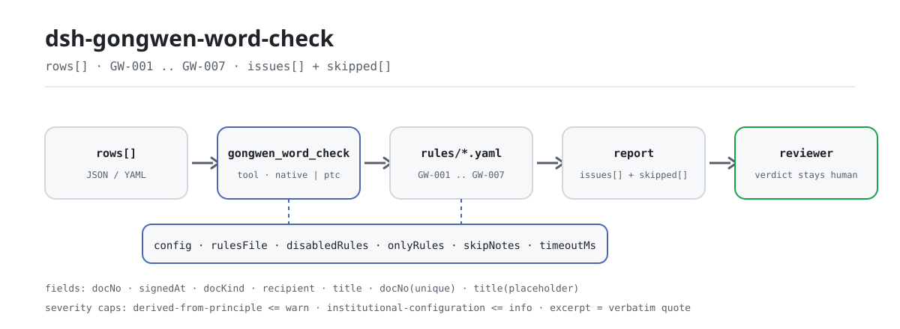

<div align="center">

<picture>
  <source media="(prefers-color-scheme: dark)" srcset="docs/assets/dsh-gongwen-word-check-flow-dark.svg">
  
</picture>

# dsh-gongwen-word-check

**दस्तावेज़ रजिस्टर की एक-एक प्रविष्टि जाँचिए — आपको मिलती है वह सूची जो कहती है कौन-सी पंक्ति, कौन-सा स्तंभ और क्या सुधारना है; अंतिम निर्णय समीक्षक का रहता है।**

DeepSeek Harness के लिए डेटा-आधारित जाँच प्लगइन: यह दस्तावेज़ों का एक रजिस्टर पढ़ता है (हर जारी दस्तावेज़ के लिए एक पंक्ति), रजिस्टर में दर्ज पाठ पर अपने साथ आने वाले संस्करणबद्ध नियम पैक (GW-001..GW-007) लगाता है, और केवल वही अंतर गिनाता है जिन्हें सामग्री के भीतर से इंगित किया जा सके — अनुपालन का निर्णय कभी नहीं, उत्तरदायित्व का निर्धारण कभी नहीं।

[इंस्टॉल](#तीन-चरणों-में-शुरुआत) · [कॉन्फ़िगरेशन](#कॉन्फ़िगरेशन) · [FAQ](#faq) · [简体中文](README.md) · [English](README.en.md) · [Español](README.es.md) · [Português](README.pt.md) · [हिन्दी](README.hi.md)

[](LICENSE)
[](#संगतता)
[](https://www.npmjs.com/package/dsh-gongwen-word-check)
[](https://github.com/PerryLink/dsh-gongwen-word-check/actions/workflows/ci.yml)
[](#संगतता)

[](https://github.com/PerryLink/dsh-gongwen-word-check/stargazers)
[](https://www.npmjs.com/package/dsh-gongwen-word-check)
[](https://dshfind.com/plugins/PerryLink/dsh-gongwen-word-check?ref=badge)
[](https://securityscorecards.dev/viewer/?uri=github.com/PerryLink/dsh-gongwen-word-check)
[](https://dsh.market/)
[](https://gitee.com/perrylink/dsh-gongwen-word-check)

```sh
dsh plugin --profile <name> add dsh-gongwen-word-check
```

</div>

<sub>समुदाय प्लगइन, DeepSeek से संबद्ध नहीं। मानक रिपॉज़िटरी: <https://github.com/PerryLink/dsh-gongwen-word-check> (Gitee एक मिरर है)।</sub>

## यह क्या है

`dsh-gongwen-word-check` दस्तावेज़ों का एक रजिस्टर पढ़ता है — हर जारी दस्तावेज़ के लिए एक पंक्ति — और रजिस्टर में दर्ज पाठ को तत्व-दर-तत्व जाँचता है: क्या `发文字号` (दस्तावेज़ संख्या) 「जारीकर्ता संक्षेप 〔वर्ष〕 क्रम संख्या」 के रूप में है और वर्ष षट्कोणीय कोष्ठक 〔〕 में है; क्या `成文日期` (हस्ताक्षर तिथि) तिथि के रूप में पढ़ी जा सकती है और जाँच के दिन से बाद की नहीं है; क्या `文种` (दस्तावेज़ वर्ग) उसी शब्दावली से आता है जो आपकी इकाई स्वयं कॉन्फ़िगर करती है; क्या `主送机关` (मुख्य प्राप्तकर्ता) भरा है; क्या `标题` (शीर्षक) कॉन्फ़िगर की गई लंबाई के भीतर है; क्या कोई दस्तावेज़ संख्या रजिस्टर में दोहराई गई है; और क्या किसी शीर्षक में टेम्पलेट का अन-प्रतिस्थापित प्लेसहोल्डर बचा है।

यह **रजिस्टर में दर्ज पाठ** जाँचता है, दस्तावेज़ के मूल की छपाई नहीं — लिपि, आकार, हाशिये और मुहर की स्थिति का निर्णय केवल दस्तावेज़ के मूल से ही हो सकता है।

रजिस्टर के अपने स्तंभ नाम उस सामग्री में चीनी हैं जिसके लिए यह प्लगइन बना है; हर एक नियमों द्वारा प्रयुक्त फ़ील्ड कुंजी से जुड़ता है:

```text
रजिस्टर स्तंभ   कुंजी       जाँच क्या पूछती है
发文字号          docNo       संक्षेप 〔वर्ष〕 क्रम संख्या; रजिस्टर में विशिष्टता
成文日期          signedAt    पढ़ी जाती है और जाँच-तिथि के बाद की नहीं है
文种              docKind     आपकी इकाई की शब्दावली से आता है
主送机关          recipient   भरा हुआ है
标题              title       कॉन्फ़िगर लंबाई के भीतर, बिना प्लेसहोल्डर
```

- **किसके लिए है**: दस्तावेज़ लिखने वालों, सचिवालय कर्मियों और जारीकर्ता कार्यालय के समीक्षकों के लिए; कमांड लाइन की ज़रूरत नहीं — सामग्री चैट में सौंप दीजिए।
- **आप क्या देते हैं**: वह मूल सामग्री जिस पर जाँच काम करती है (एक तालिका, रजिस्टर या दस्तावेज़); मूल कभी बदला नहीं जाता। Excel को पहले JSON/YAML में बदला जा सकता है, चैट में भी यदि प्लेटफ़ॉर्म अनुमति दे।
- **आपको क्या मिलता है**: «कौन-सी पंक्ति, कौन-सा स्तंभ, क्या कम है, कैसे सुधारें» की सूची; जो जाँच नहीं चल सकी वह `skipped` में कारण के साथ दर्ज होती है।

## तीन चरणों में शुरुआत

1. **इंस्टॉल करें** (कोई एक माध्यम चुनें):

   ```sh
   # git माध्यम (नवीनतम main; git+https://github.com/PerryLink/dsh-gongwen-word-check.git के समान)
   dsh plugin --profile <name> add github:PerryLink/dsh-gongwen-word-check
   # npm माध्यम (प्रकाशित संस्करण)
   dsh plugin --profile <name> add dsh-gongwen-word-check
   # tarball माध्यम: इस रिपॉज़िटरी में pnpm pack के बाद
   dsh plugin --profile <name> add ./dsh-gongwen-word-check-<version>.tgz
   ```

2. **न्यूनतम कॉन्फ़िगरेशन** (डिफ़ॉल्ट ही काम करते हैं; `config` के बिना bundle पंक्ति सभी डिफ़ॉल्ट लेती है, और नियम पैक का पथ साथ आए `rules/gongwen-word-check.yaml` की ओर इंगित रहता है):

   ```yaml
   - insert:
       - id: dsh-gongwen-word-check
         name: dsh-gongwen-word-check
   ```

3. **जाँचें कि यह माउंट हुआ**:

   ```sh
   dsh --profile <name> --dump-config | grep 'dsh-gongwen-word-check'
   ```

   फिर साथ आया नमूना चलाएँ (पहले `pnpm run build` से `lib/` बनाना आवश्यक):

   ```sh
   node samples/quickstart/run.mjs
   ```

   आउटपुट (अपेक्षित परिणाम `samples/quickstart/expected/result.json` में; इनपुट `samples/quickstart/input/` में):

   ```text
   gongwen_word_check: 1 issue(s) — error 0, warn 1, info 0
   skipped: 1
   ```

   `--json` वही सारांश JSON में छापता है। स्क्रीनशॉट `docs/assets/quickstart.png` में।

**अनइंस्टॉल**: `dsh plugin --profile <name> remove dsh-gongwen-word-check` (या प्रोफ़ाइल पैच से वह पंक्ति हटा दें)।

<details>
<summary>WorkBuddy / Coze में उपयोग</summary>

WorkBuddy / Coze में «Documents and Governance Suite» («文书与治理核对包») खोजें (यह जाँच उसका एक भाग है; उपलब्धता सूची के अनुसार) — वही जाँच क्षमता बिना कमांड लाइन के मिल जाती है।

</details>

<details>
<summary>DSH Desktop मार्केट से इंस्टॉल</summary>

सभी PerryLink प्लगइन DSH Desktop के अंतर्निहित मार्केट में सूचीबद्ध हैं: **मार्केट → स्रोत → स्रोत जोड़ें → चिपकाएँ** `https://perrylink-dsh-catalog.perrylink.workers.dev/catalog-source.json` **→ चुनें**। इंस्टॉल के लिए मार्केट का npm पहचान सत्यापन और आपकी पुष्टि अब भी आवश्यक है।

</details>

## मुख्य क्षमताएँ

`dsh-gongwen-word-check` टूल `gongwen_word_check` पंजीकृत करता है: एक दस्तावेज़ रजिस्टर (JSON या YAML) पढ़ता है, संस्करणबद्ध नियम पैक लगाता है और रिपोर्ट लौटाता है।

- **सात नियम एक डेटा पैक में** — नियम पैक डेटा है, कोड नहीं (`rules/gongwen-word-check.yaml`); उसे बदलने से पूरा नियम-समूह बदल जाता है, TypeScript की एक पंक्ति छुए बिना।
- **सामग्री पर केवल-पठन** — JSON या YAML स्वीकार करता है और मूल कभी नहीं बदलता; शुद्ध ESM, कोई नेटवर्क अनुरोध नहीं, कोई मॉडल कॉल नहीं।
- **कोई गढ़ा हुआ उद्धरण नहीं** — हर नियम में `document` / `number` / `clause` / `excerpt` / `kind` / `source` होते हैं; `excerpt` शब्दशः उद्धरण होना चाहिए, और जिस नियम का पाठ शब्दशः नहीं उद्धृत हुआ वह अपने `excerpt` में यह लिखता है और `derived-from-principle` अंकित रहता है।
- **गंभीरता साक्ष्य के अनुसार** — `derived-from-principle` पर सीमा `warn` है, संस्थागत कॉन्फ़िगरेशन (`institutional-configuration`) पर `info`, और एक परीक्षण इसे सिद्ध करता है।
- **खाली परिणाम-सूची का अर्थ «कुछ गलत नहीं» नहीं** — जो जाँच नहीं चल सकी वह `skipped` में कारण के साथ आती है; जिस नियम की अनिवार्य सूची सेट नहीं है वह चुपचाप पास होने के बजाय स्वयं को `skipped` में दर्ज करता है।
- **कोई निर्णायक शब्दावली नहीं** — रिपोर्ट केवल अंतर गिनाती है, अनुपालन, उत्तरदायित्व या शुद्धता पर कभी निर्णय नहीं देती; शब्दावली गार्ड इसे लागू करता है और हर रिपोर्ट के साथ अस्वीकरण रहता है।

| नियम | जाँच | गंभीरता | आधार प्रकार |
|---|---|---|---|
| `GW-001` | दस्तावेज़ संख्या «संक्षेप 〔वर्ष〕 क्रम संख्या» रूप में है, वर्ष 〔〕 में | warn | सिद्धांत |
| `GW-002` | हस्ताक्षर तिथि पढ़ी जाती है और जाँच-तिथि के बाद की नहीं है | warn | सिद्धांत |
| `GW-003` | दस्तावेज़ वर्ग आपकी शब्दावली से आता है (फ़ैक्टरी में खाली) | info | स्थानीय |
| `GW-004` | मुख्य प्राप्तकर्ता दर्ज है | warn | सिद्धांत |
| `GW-005` | शीर्षक कॉन्फ़िगर लंबाई से अधिक नहीं | warn | सिद्धांत |
| `GW-006` | दस्तावेज़ संख्याएँ रजिस्टर में अद्वितीय हैं | warn | सिद्धांत |
| `GW-007` | शीर्षक में कोई टेम्पलेट प्लेसहोल्डर नहीं बचा | warn | सिद्धांत |

### उदाहरण

ये प्लगइन के वास्तविक प्रवेश-बिंदु हैं; एक बार इंस्टॉल करें और किसी एक को बुलाएँ। पहला मामला विस्तृत पूर्वाभ्यास है, बाकी संक्षिप्त मामले।

**विस्तृत उदाहरण** — टूल `gongwen_word_check`, इनपुट:

```json
{"rows":[{"发文字号":"某政发〔2026〕15号","成文日期":"二〇二六年三月十日"}]}
```

आउटपुट:

```json
{
  "id": "dsh-gongwen-word-check.GW-002.de09b5a6",
  "ruleId": "GW-002",
  "severity": "warn",
  "locator": {
    "field": "signedAt",
    "row": 1
  },
  "found": "第 1 行「signedAt」的值「二〇二六年三月十日」无法解析为日期",
  "expected": "「signedAt」应为 2026-03-15 或 2026-03-15 09:30 这样的可解析日期",
  "fix": "核对日期写法；本条不会因为无法解析而跳过该行"
}
```

*Observed from `dsh-gongwen-word-check/tests/fixtures/GW-002/GW-002-unsafe.json`; `dsh-gongwen-word-check/tests/fixtures/GW-002/cases.json` expects GW-002 count 1; run via `dsh-gongwen-word-check/lib/index.mjs` against `dsh-gongwen-word-check/rules/gongwen-word-check.yaml`*

यह इस प्लगइन का अपने ही `GW-002` परीक्षण फ़िक्स्चर पर वास्तविक आउटपुट है, कोई नकली चित्र नहीं। निष्कर्ष का पाठ चीनी में आता है क्योंकि सामग्री चीनी में है। नियम पैक उद्धरण नहीं गढ़ता, इसलिए हर निष्कर्ष लागू धारा का नाम लेता है और बताता है कि उसका पाठ इस बार प्राप्त हुआ या नहीं।

| आप पूछते हैं | यह क्या उत्तर देता है |
|---|---|
| दस्तावेज़ संख्या 〔〕 के बजाय वर्ग कोष्ठकों में लिखी गई। | `GW-001` उस पंक्ति को दर्शाता है: कॉन्फ़िगर किया गया पैटर्न वर्ष के चारों ओर षट्कोणीय कोष्ठक 〔〕 माँगता है, इसलिए लिखने योग्य रूप 〔〕 ही है। नियम केवल संख्या का रूप जाँचता है — संक्षेप आपकी इकाई तय करती है, इसलिए यह न आपकी संक्षेप की शुद्धता तय करता है, न क्रम संख्याओं के क्रमिक या पुनःप्रयुक्त होने की। |
| हस्ताक्षर तिथि वैसे ही लिखी है जैसे दस्तावेज़ प्रायः रखते हैं, चीनी अंकों में। | `GW-002` बताता है कि वह मान पढ़ा नहीं जा सकता। यह `2026-03-15` और `2026-03-15 09:30` पढ़ता है; चीनी अंकों वाली तिथि को इन दो रूपों में सामान्य करना होगा, या नियम बंद करना होगा। नियम हस्ताक्षर तिथि की तुलना प्रेषण तिथि से भी नहीं करता — वह जारी करने की प्रक्रिया का आंतरिक विषय है। |
| हमने अपनी इकाई के लिए दस्तावेज़ वर्गों की सूची कभी कॉन्फ़िगर नहीं की। क्या `GW-003` चुपचाप पास हो जाता है? | नहीं। `GW-003` में कोई अंतर्निहित सूची नहीं है, इसलिए `values` सेट न होने पर वह चुपचाप पास होने के बजाय रिपोर्ट के `skipped` में आता है। विनियम पंद्रह मुख्य वर्ग गिनाता है, पर पैक उन्हें कोड में नहीं जड़ता — कौन-से वर्ग आपकी इकाई उपयोग कर सकती है, यह आपका निर्णय है। नियम यह भी नहीं तय करता कि किसी दस्तावेज़ के लिए कौन-सा वर्ग होना चाहिए था। |
| किसी पंक्ति में मुख्य प्राप्तकर्ता का स्तंभ खाली है। | `GW-004` उस पंक्ति को दर्शाता है, क्योंकि मुख्य प्राप्तकर्ता के बिना यह पुष्टि नहीं होती कि दस्तावेज़ किसे भेजा गया। यह केवल भरा होना जाँचता है, प्राप्तकर्ता-दायरे की उपयुक्तता नहीं — किसे संबोधित करना और किसे प्रतिलिपि भेजनी है, यह लेखन का निर्णय है। |
| हमारा शीर्षक लंबा है। यह लंबाई-सीमा कहाँ से आती है? | `GW-005` कॉन्फ़िगर की गई 60 अक्षरों की सीमा से अधिक शीर्षक दर्शाता है। वह संख्या इस नियम पैक का डिफ़ॉल्ट है, मानक का आँकड़ा नहीं: प्रारूप मानक शीर्षक के लिए केवल 2-हाओ लिपि तय करता है और अक्षर-सीमा नहीं देता, इसलिए यदि आपकी इकाई लंबे शीर्षक लिखती है तो `maxLength` बढ़ाएँ या नियम बंद करें। नियम केवल अक्षर गिनता है — शीर्षक की शब्दावली का निर्णय नहीं करता। |
| दो पंक्तियों में एक ही दस्तावेज़ संख्या है। | `GW-006` दोहराई गई संख्या दर्शाता है; तुलना में रिक्त स्थान अनदेखे होते हैं, और मिलान प्रायः पुनःप्रयुक्त या गलत लिखी संख्या का संकेत है जिसे कोई व्यक्ति पुष्टि करे। यह नहीं तय करता कि उन दो दस्तावेज़ों में वह संख्या किसके पास होनी चाहिए। |

## यह किन मानकों पर आधारित है

| दस्तावेज़ | संख्या | इसे उद्धृत करने वाले नियम |
|---|---|---|
| पार्टी और राज्य के अंगों के आधिकारिक दस्तावेज़ों का प्रारूप (मानक चीनी शीर्षक `rules/evidence/` में) | GB/T 9704-2012 (**अनुशंसित** राष्ट्रीय मानक; पूरा पाठ 2026-10-07 को शब्दशः पढ़ा गया, देखें `rules/evidence/clause-verification-gbt9704.md`) | GW-001, GW-002, GW-004, GW-005, GW-007 |
| पार्टी और राज्य के अंगों के आधिकारिक दस्तावेज़ों के निपटान का विनियम (मानक चीनी शीर्षक `rules/evidence/` में) | Zhongbanfa [2012] संख्या 14 (2012-07-01 से प्रभावी; पूरा पाठ शब्दशः पढ़ा गया) | GW-003, GW-006 |

**सीमा:** यह प्लगइन **दस्तावेज़ रजिस्टर के शीर्ष और मुख्य तत्वों** को उतने भाग में जाँचता है जितना रजिस्टर यांत्रिक रूप से सह सकता है: संख्या «संक्षेप 〔वर्ष〕 क्रम संख्या» रूप में हो और वर्ष षट्कोणीय कोष्ठक में हो, हस्ताक्षर तिथि पढ़ी जा सके, दस्तावेज़ वर्ग आपकी शब्दावली से आए, मुख्य प्राप्तकर्ता दर्ज हो, शीर्षक अधिक लंबा न हो, संख्याएँ न दोहराएँ और कोई टेम्पलेट प्लेसहोल्डर न बचे। यह **रजिस्टर में दर्ज पाठ** जाँचता है, **छपाई नहीं**: लिपि, आकार, हाशिये और मुहर की स्थिति (मानक का अध्याय 5, 5.2.2, 5.2.3 और 7.3.5.1 आदि) केवल दस्तावेज़ के मूल से तय हो सकते हैं, और यह प्लगइन उनमें से कुछ भी नहीं जाँचता।

> ### ⚠️ रिपोर्ट के किसी उद्धरण पर भरोसा करने से पहले यह पढ़ें
>
> **विनियम प्राप्त किया गया और शब्दशः पढ़ा गया**, और `rules/evidence/clause-verification.md` तथा
> `rules/evidence/clause-verification-gongwen-articles.md` दर्ज करते हैं कि कौन-से अनुच्छेद उद्धृत हुए:
> अनुच्छेद 8 (पंद्रह दस्तावेज़ वर्ग, जिसका आरंभ «मुख्य रूप से» है), अनुच्छेद 9 (प्रारूप तत्व, जिनमें
> दस्तावेज़ संख्या और मुख्य प्राप्तकर्ता की परिभाषाएँ हैं), अनुच्छेद 10 (जो छपाई GB/T 9704-2012 को सौंपता
> है), अनुच्छेद 25(2) (जारी करने का पंजीकरण चरण) और अनुच्छेद 42 (2012-07-01 से प्रभावी, जिसने दो पुराने
> दस्तावेज़ प्रतिस्थापित किए जिन्हें यह पैक कभी उद्धृत नहीं करता)।
>
> **प्रारूप मानक का पूरा पाठ भी प्राप्त और जाँचा गया** (2026-10-07, देखें
> `rules/evidence/clause-verification-gbt9704.md`, जो पहले के «इस बार प्राप्त नहीं हुआ» निष्कर्ष को स्पष्ट
> रूप से प्रतिस्थापित करता है): **`GW-001` जो षट्कोणीय कोष्ठक 〔〕 माँगता है वह अब धारा 7.2.5 की लिखित
> अपेक्षा है**, केवल छपाई मानक की परिपाटी नहीं; `GW-002` में 7.3.5.4 (माह और दिन बिना शून्य-पूर्ति) जुड़ा;
> `GW-004` 7.3.2 के अनुरूप है। **यह मानक अनुशंसित राष्ट्रीय मानक है** (संख्या में `/T` है), और अध्याय 1
> कहता है कि अन्य अंगों और इकाइयों के दस्तावेज़ «संदर्भ के रूप में लागू किए जा सकते हैं»।
>
> **फिर भी हर नियम का `excerpt` यह कहता रहता है कि पाठ इस बार प्राप्त नहीं हुआ, और हर नियम `warn` या
> `info` ही रहता है।** कारण पाठ का अभाव नहीं, बल्कि **वस्तु का भेद** है: धाराएँ दस्तावेज़ के मूल की छपाई
> नियंत्रित करती हैं, जबकि यह प्लगइन *रजिस्टर में दर्ज पाठ* जाँचता है। खाली स्तंभ को 7.3.2 का `direct`
> उल्लंघन कहना रजिस्टर की कमी को छपाई का उल्लंघन बना देना होगा। पैक का शीर्ष और हर नियम का `note` यह
> कहते हैं, और `rules/evidence/clause-verification-gbt9704.md` की धारा 5 नियम-दर-नियम तर्क दर्ज करती है।
>
> दो सीमाएँ स्थानीय हैं और पैक यह लिखता है। शीर्षक-लंबाई की सीमा (`GW-005`, 60 अक्षर) **इस नियम पैक का
> डिफ़ॉल्ट है, मानक का आँकड़ा नहीं** — 7.3.1 शीर्षक के लिए केवल 2-हाओ लिपि तय करता है और **किसी भी
> दस्तावेज़ में अक्षर-गणना नहीं आती**। और दस्तावेज़-वर्ग शब्दावली (`GW-003`) **खाली** आती है, जबकि
> अनुच्छेद 8 पंद्रह वर्ग गिनाता है, क्योंकि अनुच्छेद «मुख्य रूप से» कहता है और इकाइयाँ सूची से बाहर के
> नाम भी उपयोग करती हैं। `GW-006` (विशिष्टता) और `GW-007` (प्लेसहोल्डर) के लिए दोनों दस्तावेज़ों में
> **कोई सीधी धारा नहीं** है; पैक उन्हें अनुमान के रूप में अंकित करता है, निकटतम धारा उधार लेकर नहीं।
>
> प्लेसहोल्डर जाँच अपनी शब्द-सूची से **«कोई एक» के लिए प्रयुक्त अक्षर को जानबूझकर छोड़ती है**: टेम्पलेट
> शीर्षक प्रायः «किसी विषय पर सूचना» जैसे होते हैं, पर वह अक्षर गोपनीय विषय के स्थानापन्न के रूप में
> वैध शीर्षकों में भी आता है।
>
> जो अब भी प्राप्त नहीं हुआ वह भी घोषित है: अध्याय 11 के नमूना चित्र (चित्र 1–12, केवल छवियाँ),
> GB/T 15834 (विराम-चिह्न), GB/T 15835 (प्रकाशनों में अंक) और GB 3100/3101/3102 (मात्राएँ और इकाइयाँ)।
> इसी कारण यह प्लगइन **«विराम-चिह्न सही है या नहीं» जैसा कोई नियम नहीं जोड़ता** — वह रजिस्टर के पाठ के
> दायरे से बाहर होगा। GB/T 9704-1999 और GB/T 9704-1988 प्रतिस्थापित हो चुके हैं और यहाँ कभी उद्धृत नहीं
> होते।

पैक जिन धाराओं के अंश उद्धृत करता है, वे शब्दशः (चीनी पाठ यथावत, जैसा `rules/evidence/` में दर्ज है):

```text
7.2.5 发文字号   年份、发文顺序号用阿拉伯数字标注；年份应标全称，用六角括号"〔〕"括入；
                 发文顺序号不加"第"字，不编虚位（即 1 不编为 01），在阿拉伯数字后加"号"字。
7.3.1 标题       一般用 2 号小标宋体字……（未规定字数上限）
7.3.2 主送机关   编排于标题下空一行位置，居左顶格……最后一个机关名称后标全角冒号。
7.3.5.4 成文日期 用阿拉伯数字将年、月、日标全，年份应标全称，月、日不编虚位（即 1 不编为 01）。
第九条（八）     主送机关。公文的主要受理机关。
第二十五条（二） 登记。对复核后的公文，应当确定发文字号、分送范围和印制份数并详细记载。
```

## कॉन्फ़िगरेशन

सभी समायोज्य विकल्प `src/config.ts` के Schemastery `Config` फ़ील्ड हैं (cordis.yml से बदले जा सकते हैं); हर नियम की सीमा `rules/` के नियम पैक में रहती है। id से ओवरराइड पूरी पंक्ति बदल देता है — जिन कुंजियों की ज़रूरत हो, सब दोबारा लिखें।

| कुंजी | प्रकार | डिफ़ॉल्ट | विवरण |
|---|---|---|---|
| `rulesFile` | string | `rules/gongwen-word-check.yaml` | नियम पैक का पथ, पैकेज रूट के सापेक्ष |
| `disabledRules` | string[] | `[]` | बंद करने वाले नियम id; हर एक `skipped` में आता है |
| `onlyRules` | string[] | `[]` | केवल ये नियम चलाएँ; खाली का अर्थ सभी नियम |
| `skipNotes` | string | `""` | हर `skipped` कारण के आगे जोड़ा जाने वाला नोट |
| `timeoutMs` | number | `120000` | टूल का सहयोगी टाइमआउट बजट |

जानने योग्य नियम-स्तरीय पैरामीटर:

- `GW-001` `pattern` — दस्तावेज़ संख्या का रूप; डिफ़ॉल्ट वर्ष को षट्कोणीय कोष्ठक 〔〕 में माँगता है। संयुक्त जारी या बिना संख्या वाले कार्यवृत्त के लिए इसे ढीला करें, या नियम बंद करें।
- `GW-003` `values` — आपकी इकाई के दस्तावेज़ वर्ग, जैसे विनियम द्वारा गिनाए गए पंद्रह मुख्य वर्ग (`决议`, `决定`, `命令` आदि) और आपके कार्यालय में प्रयुक्त अन्य नाम।
- `GW-005` `maxLength` / `minLength` — **आपकी** इकाई की शीर्षक-लंबाई सीमाएँ; डिफ़ॉल्ट 60 की सीमा स्थानीय परिपाटी है, मानक का आँकड़ा नहीं।
- `GW-007` `terms` — खोजे जाने वाले प्लेसहोल्डर; «कोई एक» वाला अक्षर जानबूझकर अनुपस्थित है।

प्रोफ़ाइल पैच में ओवरराइड का उदाहरण:

```yaml
- insert:
    - id: dsh-gongwen-word-check
      name: dsh-gongwen-word-check
      config:
        disabledRules: [GW-005]
        onlyRules: [GW-001, GW-002, GW-004]
        timeoutMs: 180000
```

## सामग्री प्रारूप

टूल JSON या YAML स्वीकार करता है:

```yaml
issuer: 某某机关
year: 2026
rows:
  - { 发文字号: 某政发〔2026〕15号, 标题: 某某机关关于印发某某管理办法的通知, 文种: 通知,
      发文机关: 某某机关, 成文日期: 2026-03-10, 主送机关: 各直属单位,
      抄送机关: 某某办公室, 密级: 公开, 紧急程度: 平件 }
```

स्तंभ नाम बिना केस-भेद और रिक्त स्थान, अंडरस्कोर व हाइफ़न को अनदेखा करते हुए मिलाए जाते हैं; रजिस्टर के अपने स्तंभ नाम सुरक्षित रहते हैं, इसलिए निष्कर्ष उसी स्तंभ का नाम लेता है जिसे उसने वास्तव में पढ़ा। तिथियाँ `2026-03-10` या `2026-03-10 09:30` हो सकती हैं; चीनी अंकों वाली तिथि जानबूझकर «पढ़ी नहीं जा सकी» बताई जाती है। फ़ील्ड पठन-परत में वैकल्पिक हैं और जाँच-इंजन उन्हें सत्यापित करता है, इसलिए आंशिक निर्यात «कमी» वाले निष्कर्ष देता है, प्रोग्राम गिरता नहीं।

## नियमों के स्रोत

नियम डेटा `rules/gongwen-word-check.yaml` में है, कोड से अलग: हर नियम में दस्तावेज़, संख्या, स्रोत की अपनी क्रमांकन-प्रणाली के अनुसार धारा, शब्दशः अंश और स्रोत URL होते हैं। पैक का शीर्ष उद्धरण-अंतराल पूरा लिखता है, और हर नियम का `note` अपने से जुड़ा भाग दोहराता है। लोड-समय का गार्ड जो सामान्यतः माँगता है कि «अंश कम से कम आठ अक्षरों का वास्तविक उद्धरण हो», वह उद्धरण और विवरण में भेद नहीं कर सकता — इसलिए यह पैक शीर्ष, प्रति-नियम `note` और उस परीक्षण पर टिका है जो सिद्ध करता है कि हर `excerpt` अंतराल स्वीकार करता है। जो पैक अपना आधार बढ़ा-चढ़ाकर बताता है वह भरोसेमंद दिखने वाली रिपोर्ट बनाने के बजाय लोड पर विफल होता है। सत्यापन में पुष्ट सीमाएँ और जानबूझकर **न** निकाले गए निष्कर्ष पैक के साथ `rules/evidence/` में आते हैं।

## FAQ

<details>
<summary>क्या यह हमारी ओर से अनुपालन तय करता है?</summary>

नहीं। यह केवल वे अंतर गिनाता है जिन्हें सामग्री के भीतर इंगित किया जा सके (कौन-सी पंक्ति, कौन-सा स्तंभ, क्या कम है, कैसे सुधारें) और न तथ्य तय करता है, न अनुपालन — निष्कर्ष सदा समीक्षक के पास रहता है। शब्दावली गार्ड रिपोर्ट का पाठ लागू करता है और हर रिपोर्ट अस्वीकरण के साथ आती है। किसी निष्कर्ष को «यह स्तंभ खाली है / संख्या का रूप गलत है / शीर्षक बहुत लंबा है» की तरह पढ़ें, «दस्तावेज़ का प्रारूप अनियमित है» की तरह कभी नहीं।

</details>

<details>
<summary>हर नियम की सीमा `warn` क्यों है? `error` कहाँ है?</summary>

क्योंकि साक्ष्य-स्तर गंभीरता तय करता है: जो नियम सीधे लागू धारा के बजाय सिद्धांत पर टिका है (`kind: derived-from-principle`) उसकी सीमा `warn` है, और जिस जाँच की सीमा आपकी संस्था से आती है (`institutional-configuration`) उसकी सीमा `info`। पैक लोड पर बढ़ा-चढ़ाया `error` अस्वीकार करता है और एक परीक्षण यह सीमा सिद्ध करता है।

</details>

<details>
<summary>खाली `issues` सूची को «कुछ गलत नहीं» माना जा सकता है?</summary>

नहीं। जो जाँच नहीं चल सकी वह `skipped` में कारण के साथ आती है (जैसे `values` सेट न होने पर `GW-003`, या `disabledRules` से बंद नियम)। कोई भी निष्कर्ष निकालने से पहले `issues` और `skipped` दोनों पढ़ें।

</details>

<details>
<summary>क्या चीनी अंकों वाली तिथियाँ और वर्ग कोष्ठक वाली संख्याएँ बदलना ज़रूरी है?</summary>

आवश्यक नहीं, पर वे रूप ईमानदारी से बताए जाते हैं: `GW-001` का पैटर्न वर्ष को षट्कोणीय कोष्ठक 〔〕 में माँगता है, इसलिए वर्ग कोष्ठक वाली संख्या दर्शाई जाती है; `GW-002` केवल `2026-03-15` और `2026-03-15 09:30` पढ़ता है, इसलिए चीनी अंकों वाली तिथि «पढ़ी नहीं जा सकी» बताई जाती है। यदि आपकी इकाई पारंपरिक रूप रखती है तो `pattern` ढीला करें या नियम बंद करें — प्लगइन आपके कार्यालय की शैली तय नहीं करता।

</details>

<details>
<summary>हमारा रजिस्टर Excel निर्यात है। क्या सीधे उपयोग कर सकते हैं?</summary>

हाँ — पहले उसे JSON या YAML में बदलें; चैट में प्लेटफ़ॉर्म अनुमति दे तो वही रूपांतरण कर देता है। टूल केवल सामग्री पढ़ता है और मूल कभी नहीं बदलता। फ़ील्ड पठन-परत में वैकल्पिक हैं और जाँच-इंजन उन्हें सत्यापित करता है, इसलिए आंशिक निर्यात «कमी» वाले निष्कर्ष देता है, प्रोग्राम गिरता नहीं।

</details>

<details>
<summary>पूरे वर्ष का रजिस्टर एक साथ जाँचा जा सकता है?</summary>

टूल `native` और `ptc` दोनों मोड में चलता है; बैच कार्य (पूरे वर्ष का रजिस्टर या पूरी निर्देशिका) के लिए `ptc` उपयोग करें, जहाँ schema लागत एक ही बार चुकाई जाती है। जाँच स्वयं स्थानीय स्तंभ-मिलान और तिथि-गणित है: कोई नेटवर्क अनुरोध नहीं, कोई मॉडल कॉल नहीं; `timeoutMs` (डिफ़ॉल्ट 120 सेकंड) सहयोगी टाइमआउट बजट है।

</details>

## समस्या निवारण

- **`GW-001` उस संख्या पर चेतावनी देता है जिसे मैं सही मानता हूँ।** पैटर्न वर्ष को **षट्कोणीय कोष्ठक 〔〕** में माँगता है; `[]`, `（）` या हाइफ़न से लिखी संख्या विफल होती है। अपने कार्यालय की शैली के अनुसार `pattern` समायोजित करें।
- **`GW-002` चीनी अंकों वाली तिथि पर चेतावनी देता है।** पाठक `2026-03-10` स्वीकार करता है; चीनी अंकों में लिखी तिथि जानबूझकर «पढ़ी नहीं जा सकी» बताई जाती है ताकि आप निर्यात सामान्य करने का निर्णय ले सकें।
- **`GW-003` कभी नहीं चलता।** उसकी शब्दावली खाली आती है। कौन-से नाम आपकी संस्था के दस्तावेज़ वर्ग गिने जाएँ, यह आपकी संस्था का निर्णय है और प्लगइन अनुमान नहीं लगाता।
- **`GW-005` उस शीर्षक पर चेतावनी देता है जो पृष्ठ पर समा जाता है।** सीमा डिफ़ॉल्ट रूप से 60 अक्षर है और स्थानीय परिपाटी है। इसे बढ़ाएँ या नियम बंद करें।
- **`GW-007` «कोई एक» वाले अक्षर वाले शीर्षक पर चेतावनी नहीं देता।** यह जानबूझकर है; यदि आपके टेम्पलेट वास्तव में उस अक्षर को प्लेसहोल्डर की तरह उपयोग करते हैं तो उसे `terms` में जोड़ें।
- **प्लगइन इंस्टॉल होता है पर टूल कभी नहीं दिखता।** जाँचें कि `main` `lib/index.mjs` पर हल होता है और `pnpm run build` ने उसे बनाया है; गलत `main` लोडर को प्रविष्टि चुपचाप छोड़ने पर मजबूर करता है।
- **`dsh plugin add` पैकेज को असंगत कहकर अस्वीकार करता है।** peer सीमा `0.1.x` और `0.2.x` को कवर करती है; यदि आपका रनटाइम उसके बाहर है तो स्पष्ट छूट दें: `dsh plugin --profile <name> allow-version dsh-gongwen-word-check@0.1.0 --dsh-version <runtime> --accept-risk`
- **`check` में `manifest-peers` विफल आता है।** स्थिर जाँचकर्ता एक कोड-जड़ित peer सीमा से तुलना करता है जो 0.2 पीढ़ी से पुरानी है। रनटाइम इंस्टॉल के समय peer संगतता लागू करता है, इसलिए घोषित सीमा ही सही है; यह `dsh-plugin-dev` की ज्ञात अपस्ट्रीम समस्या है।
- **समय खिसका हुआ लगता है।** सारा गणित इनपुट स्ट्रिंग पर दीवार-घड़ी गणना है, कोई समय-क्षेत्र रूपांतरण नहीं।

## संगतता

| सतह | स्थिति |
|---|---|
| Harness | peer सीमा `>=0.1.2-rc.1 <0.2.0 \|\| >=0.2.0-0 <0.3.0` — `0.2.0-rc.2` और `0.2.1-rc.2` दोनों को स्वीकार करने के लिए परीक्षित। `engines.dsh` घोषित है `>=0.2.1-0 <0.3.0` और 0.2.1 से होस्ट इसे लागू करता है |
| Node | `^22.19.0 \|\| >=24.0.0` |
| प्लेटफ़ॉर्म | सभी (शुद्ध ESM; कोई नेटिव कोड नहीं, कोई नेटवर्क नहीं, कोई मॉडल कॉल नहीं) |
| टूल मोड | `native` और `ptc` दोनों में चलता है; पूरे वर्ष के रजिस्टर के लिए `ptc` |
| मानक की प्रयोज्यता | GB/T 9704-2012 **अनुशंसित** राष्ट्रीय मानक है (संख्या में `/T` है); अध्याय 1 कहता है कि अन्य अंगों और इकाइयों के दस्तावेज़ «संदर्भ के रूप में लागू किए जा सकते हैं», इसलिए उद्यमों और संस्थानों के दस्तावेज़ संदर्भ के दायरे में आते हैं, बाध्यता में नहीं |

## इकोसिस्टम और गुणवत्ता

- [Gitee मिरर](https://gitee.com/perrylink/dsh-gongwen-word-check) (समन्वित मिरर; मानक GitHub है)
- [dshfind प्लगइन पृष्ठ](https://dshfind.com/plugins/PerryLink/dsh-gongwen-word-check) (इंस्टॉल और रैंकिंग)
- [OpenSSF Scorecard रिपोर्ट](https://securityscorecards.dev/viewer/?uri=github.com/PerryLink/dsh-gongwen-word-check) ([.github/workflows/scorecard.yml](.github/workflows/scorecard.yml) द्वारा संचालित)
- [DSH Market](https://dsh.market/) (सूचीबद्ध)
- **1024 स्टोर चैनल**: एक बार `npm i -g dsh1024`, फिर `dsh1024 plugin --profile <name> add dsh-gongwen-word-check` ([deepseek1024.com](https://deepseek1024.com) की इंस्टॉल रैंकिंग में गिना जाता है)
- [इकोसिस्टम ज्ञानकोश](https://perrylink.github.io/dsh-plugin-guide/): प्लगइन विकास मार्गदर्शिका · मापे गए चयन-आँकड़े · रखरखाव के निर्णय-मानदंड

## डेवलपमेंट

```sh
pnpm install                                        # node ^22.19 || >=24
pnpm run typecheck                                  # tsc --noEmit
pnpm test                                           # vitest: साझा तालिका-प्लगइन सूट + युग्मित फ़िक्स्चर
pnpm run build                                      # tsdown -> lib/index.mjs + lib/index.d.mts
pnpm run verify:self-contained                      # निर्भरताएँ registry से हल होती हैं
pnpm run check:lockfile                             # lockfile विचलन जाँच
pnpm run check:readmes                              # पाँच भाषा README की एकरूपता
pnpm run check:citations                            # नियम पैक उद्धरण आधार-रेखा
node ../scripts/sync-shared.mjs dsh-gongwen-word-check   # ../_shared से src/shared ताज़ा करें
pnpm pack                                           # प्रकाशित tarball
```

प्लगइन **केवल-डेटा** है: `src/model.ts` तालिका का आकार घोषित करता है, साझा किट पाठक और जाँच-इंजन देता है, और नियम पैक हर जाँच घोषित करता है; जो जाँच मौजूदा प्रकार में बैठती है उसके लिए केवल नियम पैक बदलना पर्याप्त है। स्थानीय नमूना चलाना (पहले `pnpm run build` से `lib/` बनाना आवश्यक):

```sh
node samples/quickstart/run.mjs --json
# => {"tool":"gongwen_word_check","issueCount":1,"summary":{"error":0,"warn":1,"info":0},"skippedCount":1}
```

नमूना इनपुट `samples/quickstart/input/` में, अपेक्षित आउटपुट `samples/quickstart/expected/result.json` में और स्क्रीनशॉट `docs/assets/quickstart.png` में है। README की छवियाँ [`scripts/gen-readme-assets.py`](scripts/gen-readme-assets.py) कार्यक्रम-रूप से बनाता है (Python + Pillow) और उसे दोबारा चलाया जा सकता है: `python scripts/gen-readme-assets.py`; पुराना एकल-रूप प्रवाह चित्र और डेमो छवियाँ बाहरी लिंक के लिए `docs/assets/` में बनी रहती हैं, जबकि README केवल नए हल्के/गहरे युग्म का संदर्भ देते हैं।

विषय: `deepseek-harness`, `dsh`, `dsh-plugin`, `cordis`, `gongwen`, `word`

## परिवार और आभार

यह परियोजना [PerryLink](https://github.com/PerryLink) के DeepSeek Harness प्लगइन परिवार का हिस्सा है (सभी Apache-2.0)। पूरा परिवार सूचकांक: [सामग्री के अनुसार जाँचकर्ता चुनें](https://perrylink.github.io/zh/checkers/choose/) और [सभी प्लगइन](https://github.com/PerryLink)। यदि यह उपयोगी लगे तो **एक स्टार अगले व्यक्ति को इसे खोजने में मदद करता है** — इससे कोई सुविधा अनलॉक नहीं होती।

- [@PerryLink](https://github.com/PerryLink) — निर्माता और अनुरक्षक: केवल-डेटा नियम पैक (GW-001..GW-007), `gongwen_word_check` टूल, उद्धरण-सत्यापन रिकॉर्ड और पाँच-भाषा दस्तावेज़।

<details>
<summary>सभी प्लगइन खोलें</summary>

| प्लगइन | स्थिति |
|---|---|
| **[dsh-aqua-input-check](https://github.com/PerryLink/dsh-aqua-input-check)** |  |
| **[dsh-archive-check](https://github.com/PerryLink/dsh-archive-check)** |  |
| **[dsh-auto-review](https://github.com/PerryLink/dsh-auto-review)** |  |
| **[dsh-autotier](https://github.com/PerryLink/dsh-autotier)** | 🧊 फ़्रोज़न — रेपो README देखें |
| **[dsh-bid-ca-precheck](https://github.com/PerryLink/dsh-bid-ca-precheck)** |  |
| **[dsh-bid-qual-check](https://github.com/PerryLink/dsh-bid-qual-check)** |  |
| **[dsh-cert-mcp](https://github.com/PerryLink/dsh-cert-mcp)** | 🧊 फ़्रोज़न — रेपो README देखें |
| **[dsh-checkpoint-rewind](https://github.com/PerryLink/dsh-checkpoint-rewind)** |  |
| **[dsh-click](https://github.com/PerryLink/dsh-click)** |  |
| **[dsh-composer-history](https://github.com/PerryLink/dsh-composer-history)** |  |
| **[dsh-contract-stance](https://github.com/PerryLink/dsh-contract-stance)** |  |
| **[dsh-customs-doc-check](https://github.com/PerryLink/dsh-customs-doc-check)** |  |
| **[dsh-data-quality](https://github.com/PerryLink/dsh-data-quality)** | 🧊 फ़्रोज़न — रेपो README देखें |
| **[dsh-demurrage-ledger](https://github.com/PerryLink/dsh-demurrage-ledger)** |  |
| **[dsh-doublecheck](https://github.com/PerryLink/dsh-doublecheck)** |  |
| **[dsh-drill-script-check](https://github.com/PerryLink/dsh-drill-script-check)** |  |
| **[dsh-eia-guide-check](https://github.com/PerryLink/dsh-eia-guide-check)** |  |
| **[dsh-emergency-plan](https://github.com/PerryLink/dsh-emergency-plan)** |  |
| **[dsh-essay-rubric-check](https://github.com/PerryLink/dsh-essay-rubric-check)** |  |
| **[dsh-evidence-check](https://github.com/PerryLink/dsh-evidence-check)** |  |
| **[dsh-export-ctl-check](https://github.com/PerryLink/dsh-export-ctl-check)** |  |
| **[dsh-fast](https://github.com/PerryLink/dsh-fast)** |  |
| **[dsh-fmea-table-check](https://github.com/PerryLink/dsh-fmea-table-check)** |  |
| **[dsh-forecast-penalty](https://github.com/PerryLink/dsh-forecast-penalty)** |  |
| **[dsh-fund-research](https://github.com/PerryLink/dsh-fund-research)** |  |
| **[dsh-github](https://github.com/PerryLink/dsh-github)** |  |
| **[dsh-gongwen-flow-check](https://github.com/PerryLink/dsh-gongwen-flow-check)** |  |
| **[dsh-gongwen-word-check](https://github.com/PerryLink/dsh-gongwen-word-check)** |  |
| **[dsh-guard-plan-qc](https://github.com/PerryLink/dsh-guard-plan-qc)** |  |
| **[dsh-hazchem-check](https://github.com/PerryLink/dsh-hazchem-check)** |  |
| **[dsh-hazplan-check](https://github.com/PerryLink/dsh-hazplan-check)** |  |
| **[dsh-hidden-risk-map](https://github.com/PerryLink/dsh-hidden-risk-map)** |  |
| **[dsh-hs-classify](https://github.com/PerryLink/dsh-hs-classify)** |  |
| **[dsh-icd-rule-check](https://github.com/PerryLink/dsh-icd-rule-check)** |  |
| **[dsh-industry-research](https://github.com/PerryLink/dsh-industry-research)** |  |
| **[dsh-lawcite-adapter](https://github.com/PerryLink/dsh-lawcite-adapter)** |  |
| **[dsh-laya](https://github.com/PerryLink/dsh-laya)** |  |
| **[dsh-lc-doc-check](https://github.com/PerryLink/dsh-lc-doc-check)** |  |
| **[dsh-learning-gap-check](https://github.com/PerryLink/dsh-learning-gap-check)** |  |
| **[dsh-library](https://github.com/PerryLink/dsh-library)** |  |
| **[dsh-local-ai](https://github.com/PerryLink/dsh-local-ai)** |  |
| **[dsh-lsp-actions](https://github.com/PerryLink/dsh-lsp-actions)** |  |
| **[dsh-mask](https://github.com/PerryLink/dsh-mask)** |  |
| **[dsh-mcp-panel](https://github.com/PerryLink/dsh-mcp-panel)** |  |
| **[dsh-medrec-qc](https://github.com/PerryLink/dsh-medrec-qc)** |  |
| **[dsh-memento](https://github.com/PerryLink/dsh-memento)** | 🧊 फ़्रोज़न — रेपो README देखें |
| **[dsh-nsfc-form-check](https://github.com/PerryLink/dsh-nsfc-form-check)** |  |
| **[dsh-nurse-record-check](https://github.com/PerryLink/dsh-nurse-record-check)** |  |
| **[dsh-observe](https://github.com/PerryLink/dsh-observe)** |  |
| **[dsh-origin-rvc-check](https://github.com/PerryLink/dsh-origin-rvc-check)** |  |
| **[dsh-ota-review-check](https://github.com/PerryLink/dsh-ota-review-check)** |  |
| **[dsh-output-styles](https://github.com/PerryLink/dsh-output-styles)** |  |
| **[dsh-paper-doc-adapter](https://github.com/PerryLink/dsh-paper-doc-adapter)** |  |
| **[dsh-permission-rules](https://github.com/PerryLink/dsh-permission-rules)** |  |
| **[dsh-permit-report-check](https://github.com/PerryLink/dsh-permit-report-check)** |  |
| **[dsh-pipeline-check](https://github.com/PerryLink/dsh-pipeline-check)** |  |
| **[dsh-pleading-draft](https://github.com/PerryLink/dsh-pleading-draft)** |  |
| **[dsh-plugin-doctor](https://github.com/PerryLink/dsh-plugin-doctor)** | 🚫 रिटायर्ड (रेपो संग्रहीत) |
| **[dsh-plugin-guide](https://github.com/PerryLink/dsh-plugin-guide)** |  |
| **[dsh-plugin-kit](https://github.com/PerryLink/dsh-plugin-kit)** | 🚫 रिटायर्ड (रेपो संग्रहीत) |
| **[dsh-plugin-upgrade](https://github.com/PerryLink/dsh-plugin-upgrade)** | 🚫 रिटायर्ड (रेपो संग्रहीत) |
| **[dsh-policy-brief-draft](https://github.com/PerryLink/dsh-policy-brief-draft)** |  |
| **[dsh-power-loss-split](https://github.com/PerryLink/dsh-power-loss-split)** |  |
| **[dsh-power-ticket-check](https://github.com/PerryLink/dsh-power-ticket-check)** |  |
| **[dsh-ppap-check](https://github.com/PerryLink/dsh-ppap-check)** |  |
| **[dsh-protest-deadline](https://github.com/PerryLink/dsh-protest-deadline)** |  |
| **[dsh-railway-window](https://github.com/PerryLink/dsh-railway-window)** |  |
| **[dsh-repair-order-qc](https://github.com/PerryLink/dsh-repair-order-qc)** |  |
| **[dsh-research-report](https://github.com/PerryLink/dsh-research-report)** |  |
| **[dsh-review-reply-check](https://github.com/PerryLink/dsh-review-reply-check)** |  |
| **[dsh-rulefile-check](https://github.com/PerryLink/dsh-rulefile-check)** |  |
| **[dsh-safety-brief-check](https://github.com/PerryLink/dsh-safety-brief-check)** |  |
| **[dsh-score](https://github.com/PerryLink/dsh-score)** | 🧊 फ़्रोज़न — रेपो README देखें |
| **[dsh-session-sync](https://github.com/PerryLink/dsh-session-sync)** |  |
| **[dsh-site-log-check](https://github.com/PerryLink/dsh-site-log-check)** |  |
| **[dsh-skill-pack-security](https://github.com/PerryLink/dsh-skill-pack-security)** |  |
| **[dsh-soe-decision-check](https://github.com/PerryLink/dsh-soe-decision-check)** |  |
| **[dsh-soilwater-check](https://github.com/PerryLink/dsh-soilwater-check)** |  |
| **[dsh-sop-sync-check](https://github.com/PerryLink/dsh-sop-sync-check)** |  |
| **[dsh-spc-gbt-adapter](https://github.com/PerryLink/dsh-spc-gbt-adapter)** |  |
| **[dsh-talk](https://github.com/PerryLink/dsh-talk)** |  |
| **[dsh-tender-extract](https://github.com/PerryLink/dsh-tender-extract)** |  |
| **[dsh-tender-matrix](https://github.com/PerryLink/dsh-tender-matrix)** |  |
| **[dsh-test-drive](https://github.com/PerryLink/dsh-test-drive)** |  |
| **[dsh-ticktick](https://github.com/PerryLink/dsh-ticktick)** | 🚫 रिटायर्ड (रेपो संग्रहीत) |
| **[dsh-translate](https://github.com/PerryLink/dsh-translate)** |  |
| **[dsh-warranty-calc](https://github.com/PerryLink/dsh-warranty-calc)** |  |
| **[dsh-budget](https://github.com/PerryLink/dsh-budget)** | 🧊 फ़्रोज़न — रेपो README देखें |
| **[dsh-claude-move](https://github.com/PerryLink/dsh-claude-move)** | 🧊 फ़्रोज़न — रेपो README देखें |
| **[dsh-defend](https://github.com/PerryLink/dsh-defend)** | 🧊 फ़्रोज़न — रेपो README देखें |
| **[dsh-draw](https://github.com/PerryLink/dsh-draw)** | 🧊 फ़्रोज़न — रेपो README देखें |
| **[dsh-reach](https://github.com/PerryLink/dsh-reach)** | 🧊 फ़्रोज़न — रेपो README देखें |
| **[dsh-background-agents](https://github.com/PerryLink/dsh-background-agents)** | 🚫 रिटायर्ड (रेपो संग्रहीत) |
| **[dsh-session-pin](https://github.com/PerryLink/dsh-session-pin)** | 🚫 रिटायर्ड (रेपो संग्रहीत) |
| **[dsh-team-rooms](https://github.com/PerryLink/dsh-team-rooms)** | 🚫 रिटायर्ड (रेपो संग्रहीत) |

</details>

## लाइसेंस

[LICENSE](LICENSE) (Apache License 2.0) © 2026 dsh-gongwen-word-check contributors

<p align="center"><sub>Apache-2.0 · समुदाय प्लगइन, DeepSeek से संबद्ध नहीं।</sub></p>
