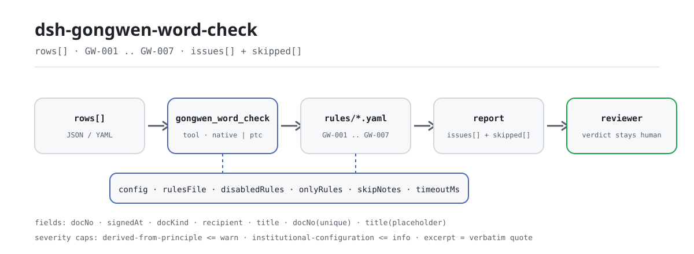

<div align="center">

<picture>
  <source media="(prefers-color-scheme: dark)" srcset="docs/assets/dsh-gongwen-word-check-flow-dark.svg">
  
</picture>

# dsh-gongwen-word-check

**把公文台账逐项核一遍——输出「哪一行、哪一栏、差什么、怎么补」的清单，定性结论留给审核人。**

面向 DeepSeek Harness 的数据型核查插件：读取一份公文台账（每份已发出的公文一行），按随包的版本化规则包（GW-001..GW-007）核对登记的文字，只列材料内部能逐条指认的差异，不判合规、不认定责任。

[安装](#三步上手) · [配置](#配置) · [FAQ](#faq) · [简体中文](README.md) · [English](README.en.md) · [Español](README.es.md) · [Português](README.pt.md) · [हिन्दी](README.hi.md)

[](LICENSE)
[](#兼容性)
[](https://www.npmjs.com/package/dsh-gongwen-word-check)
[](https://github.com/PerryLink/dsh-gongwen-word-check/actions/workflows/ci.yml)
[](#兼容性)

[](https://github.com/PerryLink/dsh-gongwen-word-check/stargazers)
[](https://www.npmjs.com/package/dsh-gongwen-word-check)
[](https://dshfind.com/plugins/PerryLink/dsh-gongwen-word-check?ref=badge)
[](https://securityscorecards.dev/viewer/?uri=github.com/PerryLink/dsh-gongwen-word-check)
[](https://dsh.market/)
[](https://gitee.com/perrylink/dsh-gongwen-word-check)

```sh
dsh plugin --profile <name> add dsh-gongwen-word-check
```

</div>

<sub>社区插件，与 DeepSeek 官方无关。唯一仓库：<https://github.com/PerryLink/dsh-gongwen-word-check>（Gitee 为镜像）。</sub>

## 它是什么

`dsh-gongwen-word-check` 读取一份公文台账——每份已发出的公文占一行——核对台账登记的**版头与主体要素**：`发文字号` 是否符合「机关代字〔年份〕序号」的形式、年份是否用六角括号〔〕括入；`成文日期` 是否可解析、是否不晚于核对日；`文种` 是否落在本机关自己配置的取值清单内；`主送机关` 是否填写；`标题` 是否在配置的长度上限内；`发文字号` 是否在台账内重复；`标题` 里是否残留未替换的模板占位符。

它核对的是**台账里登记的文字，不是公文正本的版式**——字体、字号、页边距与印章位置只能就公文本身判断。

- **给谁用**：文秘、公文起草人、办公室核稿人；不用懂命令行，在对话里把材料交给它即可。
- **你交什么**：这项核对用到的原始材料（表格、清单或文书）；不改原件。Excel 可先转成 JSON/YAML，对话里也能代转。
- **它交什么**：一份「哪一行、哪一栏、差什么、怎么补」的清单；没能执行的检查逐条列入 `skipped` 并写明原因。

## 三步上手

1. **安装**（三选一）：

   ```sh
   # git 通道（最新 main；等价于 git+https://github.com/PerryLink/dsh-gongwen-word-check.git）
   dsh plugin --profile <name> add github:PerryLink/dsh-gongwen-word-check
   # npm 通道（已发布版本）
   dsh plugin --profile <name> add dsh-gongwen-word-check
   # tarball 通道：本仓库 pnpm pack 后
   dsh plugin --profile <name> add ./dsh-gongwen-word-check-<version>.tgz
   ```

2. **最小配置**（默认即可用；bundle 行不带 `config` 时全部走默认值，规则库路径指向随包的 `rules/gongwen-word-check.yaml`）：

   ```yaml
   - insert:
       - id: dsh-gongwen-word-check
         name: dsh-gongwen-word-check
   ```

3. **验证已生效**：

   ```sh
   dsh --profile <name> --dump-config | grep 'dsh-gongwen-word-check'
   ```

   然后用仓内自带样例跑一次（需先 `pnpm run build` 产出 `lib/`）：

   ```sh
   node samples/quickstart/run.mjs
   ```

   输出（对应 `samples/quickstart/expected/result.json`；样例输入在 `samples/quickstart/input/`）：

   ```text
   gongwen_word_check: 1 issue(s) — error 0, warn 1, info 0
   skipped: 1
   ```

   `--json` 打印同一份摘要。截图见 `docs/assets/quickstart.png`。

**卸载**：`dsh plugin --profile <name> remove dsh-gongwen-word-check`（或从 profile patch 删掉该行）。

<details>
<summary>在 WorkBuddy / 扣子中使用</summary>

在 WorkBuddy / 扣子搜「文书与治理核对包」（本检查是其中一项；上架以商城为准）即可调用同一套核对能力，无需命令行。

</details>

<details>
<summary>从 DSH Desktop 市场安装</summary>

所有 PerryLink 插件均可在 DSH Desktop 内置市场中浏览：**市场 → 来源 → 添加来源 → 粘贴** `https://perrylink-dsh-catalog.perrylink.workers.dev/catalog-source.json` **→ 选中**。安装仍需通过市场的 npm 身份校验与你的确认。

</details>

## 核心能力

`dsh-gongwen-word-check` 注册 `gongwen_word_check` 工具：读入一份公文台账（JSON 或 YAML），套用版本化规则包，返回一份报告。

- **七条规则一包带走** —— 规则包是数据不是代码（`rules/gongwen-word-check.yaml`）；换掉规则包即换掉整套检查，不动一行 TypeScript。
- **只读材料** —— 接受 JSON 或 YAML，原件永不修改；纯 ESM，无网络请求、不调用模型。
- **引文不造假** —— 每条规则带 `document` / `number` / `clause` / `excerpt` / `kind` / `source`；`excerpt` 必须是逐字引文，本次未取得原文的规则在 `excerpt` 里如实写明并标为 `derived-from-principle`。
- **严重级跟着证据走** —— `derived-from-principle` 最高 `warn`，本机构配置（`institutional-configuration`）最高 `info`，并有测试断言。
- **空清单 ≠ 没问题** —— 每条没能执行的检查都进 `skipped` 并写明原因；必填清单未配置的规则自我报告 `skipped`，绝不静默通过。
- **措辞不作裁决** —— 报告只列差异，不判定合规、责任或正确性；措辞守卫（wording guard）强制执行，报告永远附带免责声明。

| 规则 | 核对内容 | 严重级 | 依据类别 |
|---|---|---|---|
| `GW-001` | `发文字号` 符合「机关代字〔年份〕序号」，年份用六角括号〔〕 | warn | principle |
| `GW-002` | `成文日期` 可解析，且不晚于核对日 | warn | principle |
| `GW-003` | `文种` 取自本机关配置的取值清单（出厂未配置） | info | local |
| `GW-004` | `主送机关` 已填写 | warn | principle |
| `GW-005` | `标题` 未超过配置的长度上限 | warn | principle |
| `GW-006` | `发文字号` 在台账内唯一 | warn | principle |
| `GW-007` | `标题` 不残留未替换的模板占位符 | warn | principle |

### 示例

以下为插件真实入口；安装后调用一次即可。第一行是详细走查，其余是简短案例。

**详细示例** — 工具 `gongwen_word_check`，输入：

```json
{"rows":[{"发文字号":"某政发〔2026〕15号","成文日期":"二〇二六年三月十日"}]}
```

输出：

```json
{
  "id": "dsh-gongwen-word-check.GW-002.de09b5a6",
  "ruleId": "GW-002",
  "severity": "warn",
  "locator": {
    "field": "signedAt",
    "row": 1
  },
  "found": "第 1 行「signedAt」的值「二〇二六年三月十日」无法解析为日期",
  "expected": "「signedAt」应为 2026-03-15 或 2026-03-15 09:30 这样的可解析日期",
  "fix": "核对日期写法；本条不会因为无法解析而跳过该行"
}
```

*Observed from `dsh-gongwen-word-check/tests/fixtures/GW-002/GW-002-unsafe.json`; `dsh-gongwen-word-check/tests/fixtures/GW-002/cases.json` expects GW-002 count 1; run via `dsh-gongwen-word-check/lib/index.mjs` against `dsh-gongwen-word-check/rules/gongwen-word-check.yaml`*

本插件对自己 `GW-002` 测试夹具的真实输出，不是示意图。规则库不伪造引文，因此每条发现都会同时写明所引条款，以及该条款原文本次是否取得。

| 你会问 | 它怎么答 |
|---|---|
| 发文字号写成了 `某政发[2026]15号`，用的是方括号。 | `GW-001` 会报出该行：本条配置的 pattern 要求年份用六角括号〔〕括入，应写成 `某政发〔2026〕15号`。本条**只核对发文字号的形式**——机关代字由各机关自行规定，它不判断代字是否正确，也不判断序号是否连续或是否重号。 |
| 成文日期按公文的习惯写成了汉字：二〇二六年三月十五日。 | `GW-002` 会报「无法解析」。它识别 `2026-03-15` 与 `2026-03-15 09:30` 两种写法，汉字日期需先统一为这两种写法，或停用本条。本条也**不核对成文日期与签发日期的关系**，那属于发文流程的内部一致性。 |
| 本机关没有配置文种清单，`GW-003` 会静默通过吗？ | 不会。`GW-003` 不内置任何清单，`values` 为空时它出现在报告的 `skipped` 中，而不是静默通过。《党政机关公文处理工作条例》列举了十五种主要文种，但本规则库**不硬编码**该清单——哪些文种可用取决于本机关口径。本条也不判断某份公文应当使用哪一种文种。 |
| 某行的主送机关栏是空的。 | `GW-004` 会报出该行：缺这一栏就无法确认这份公文发给了谁。它只核对是否填写，**不判断主送范围是否恰当**——主送谁、抄送谁属于拟稿与核稿的判断。 |
| 我们的标题比较长，这个长度上限是从哪儿来的？ | `GW-005` 在 `标题` 超过配置的 60 字时报出。**这个数字是本规则库的出厂配置，不是标准数值**：GB/T 9704-2012 对标题的量化要求只有「2 号小标宋体字」，未规定字数上限。本机关若习惯更长的标题，请调大 `maxLength` 或停用本条。本条只做字数核对，**不判断标题的文字表述是否规范**。 |
| 两行填了同一个发文字号。 | `GW-006` 会报出重复的文号；比较时忽略空白字符，命中通常意味着重号或抄错，需人工确认。它**不判断哪一份才应当使用该文号**。 |

## 依据的标准

| 文件 | 文号 | 引用它的规则 |
|---|---|---|
| 《党政机关公文格式》 | GB/T 9704-2012（推荐性国家标准；全文已于 2026-10-07 逐字核对，见 `rules/evidence/clause-verification-gbt9704.md`） | GW-001, GW-002, GW-004, GW-005, GW-007 |
| 《党政机关公文处理工作条例》 | 中办发〔2012〕14号（自 2012 年 7 月 1 日起施行；全文已逐字核对） | GW-003, GW-006 |

**边界：** 本插件核对一份**公文台账的版头与主体要素**，范围限于登记表可以机械判定的事项——发文字号是否符合「机关代字〔年份〕序号」的形态、年份是否用六角括号〔〕括入、成文日期是否可解析、公文种类是否取自你的取值口径、是否记录了主送机关、标题是否不过长、文号是否重复，以及是否残留模板占位符。它核对的是**登记表所记录的文本，而不是版式**——字体、字号、页边距与印章位置（标准第 5 章、5.2.2、5.2.3、7.3.5.1 等条款）只能就公文本身判断，本插件一概不核对。

> ### ⚠️ 在采信报告中的引文之前，请先读这一段
>
> **《党政机关公文处理工作条例》（中办发〔2012〕14号）已取得并逐字阅读**，`rules/evidence/clause-verification.md`
> 与 `rules/evidence/clause-verification-gongwen-articles.md` 记录了所引的条款——第八条（十五种公文种类，
> 首句为「公文种类**主要**有」）、第九条（格式要素，包括「发文字号。由发文机关代字、年份、发文顺序号组成」
> 与「主送机关。公文的主要受理机关」）、第十条（把版式交由 GB/T 9704-2012 规定）、第二十五条（二）
> （发文办理的登记程序）与第四十二条（自 2012-07-01 起施行，同时停止执行 1996 年与 2000 年两份旧文件，
> 因此本规则库从不引用那两份）。
>
> **GB/T 9704-2012 的全文也已取得并核对**（2026-10-07，见 `rules/evidence/clause-verification-gbt9704.md`；
> 该报告明确取代此前「本次未取得」的结论）：**`GW-001` 要求的六角括号〔〕现在是 7.2.5 的明文要求**
> （「年份应标全称，用六角括号"〔〕"括入」），不再是「版式标准的惯例」这一保留说法；`GW-002` 补入了
> 7.3.5.4「月、日不编虚位」；`GW-004` 对应 7.3.2。**该标准是推荐性国家标准**（标准号带 `/T`），
> 第 1 章明确「其他机关和单位的公文可以参照执行」。
>
> **但各规则的 `excerpt` 仍写着「本次未取得」，每条规则也仍然是 `warn` 或 `info`。** 原因不是没读到条文，
> 而是**对象不同**：条文规定的是公文正本的版式与要素编排，本插件核对的是*台账里登记的文字*；
> 把空栏标成对 7.3.2 的 `direct` 引用，就是把台账缺陷说成版式违规。规则库头部与每条规则的 `note`
> 都写明了这一点，`rules/evidence/clause-verification-gbt9704.md` 第五节记录了逐条理由。
>
> 有两个阈值是本地设定，规则库也这样写明。标题长度上限（`GW-005`，60 个字符）是**本规则库的默认值，
> 不是标准数字**——7.3.1 对标题的量化要求只有「2 号小标宋体字」，**两份文件中都没有出现任何字数**。
> 而公文种类词表（`GW-003`）出厂为**空**，尽管第八条列出了十五种，因为该条说的是「主要有」，
> 各单位也会使用清单之外的名称。`GW-006`（文号唯一）与 `GW-007`（占位符）在标准与条例里**都没有**
> 直接对应条款，规则库如实标为推论，而不是拿最接近的条款充数。
>
> 占位符检查有意**把「某」排除**在词表之外：模板标题常写作「关于某某工作的通知」，但「某」也会出现在
> 正当标题中，用来代替涉密事由。
>
> 仍未取得的部分也如实列出：GB/T 9704-2012 第 11 章的式样图（图 1—图 12，纯图片）、GB/T 15834（标点符号用法）、
> GB/T 15835（出版物上数字用法）与 GB 3100／3101／3102（量和单位）——因此本插件**不据此新增「标点是否正确」
> 之类的规则**，那会超出「台账文字核对」的范围。GB/T 9704—1999 与 GB/T 9704—1988 已被代替，本规则库不引用。

规则库所引条款的逐字摘录（中文原文，出处见 `rules/evidence/`）：

```text
7.2.5 发文字号   年份、发文顺序号用阿拉伯数字标注；年份应标全称，用六角括号"〔〕"括入；
                 发文顺序号不加"第"字，不编虚位（即 1 不编为 01），在阿拉伯数字后加"号"字。
7.3.1 标题       一般用 2 号小标宋体字……（未规定字数上限）
7.3.2 主送机关   编排于标题下空一行位置，居左顶格……最后一个机关名称后标全角冒号。
7.3.5.4 成文日期 用阿拉伯数字将年、月、日标全，年份应标全称，月、日不编虚位（即 1 不编为 01）。
第九条（五）     发文字号。由发文机关代字、年份、发文顺序号组成。
第九条（八）     主送机关。公文的主要受理机关。
第二十五条（二） 登记。对复核后的公文，应当确定发文字号、分送范围和印制份数并详细记载。
```

## 配置

全部可调参数都是 `src/config.ts` 里的 Schemastery `Config` 字段（可从 cordis.yml 覆盖），逐条阈值在 `rules/` 下的规则库文件里。按 id 覆盖会替换整行——请重述所有需要的键。

| 键 | 类型 | 默认值 | 说明 |
|---|---|---|---|
| `rulesFile` | string | `rules/gongwen-word-check.yaml` | 规则库文件路径，相对插件包根目录 |
| `disabledRules` | string[] | `[]` | 要停用的规则 id 列表；每条都会出现在 `skipped` 中 |
| `onlyRules` | string[] | `[]` | 只执行这些规则 id；留空表示执行全部规则 |
| `skipNotes` | string | `""` | 附加到每条 `skipped` 说明后的备注 |
| `timeoutMs` | number | `120000` | 工具协作式超时预算（毫秒） |

值得了解的规则级参数：

- `GW-001` `pattern` —— 发文字号的形态；默认要求年份用六角括号〔〕。联合发文、会议纪要等无文号或写法特殊的材料，调宽它或停用本条。
- `GW-003` `values` —— 本机关的公文种类，例如 `[决议, 决定, 命令, 公报, 公告, 通告, 意见, 通知, 通报, 报告, 请示, 批复, 议案, 函, 纪要]`。
- `GW-005` `maxLength` / `minLength` —— **本机关**的标题长度上下限；出厂上限 60 是本地约定，不是标准数值。
- `GW-007` `terms` —— 要查找的占位符词表，出厂有意不含「某」。

profile patch 覆盖示例：

```yaml
- insert:
    - id: dsh-gongwen-word-check
      name: dsh-gongwen-word-check
      config:
        disabledRules: [GW-005]
        onlyRules: [GW-001, GW-002, GW-004]
        timeoutMs: 180000
```

## 材料格式

工具接受 JSON 或 YAML：

```yaml
issuer: 某某机关
year: 2026
rows:
  - { 发文字号: 某政发〔2026〕15号, 标题: 某某机关关于印发某某管理办法的通知, 文种: 通知,
      发文机关: 某某机关, 成文日期: 2026-03-10, 主送机关: 各直属单位,
      抄送机关: 某某办公室, 密级: 公开, 紧急程度: 平件 }
```

列名匹配忽略大小写，并忽略空格、下划线与连字符；台账自己的列名会被保留，因此发现里写明的列就是它实际读到的列。日期可写 `2026-03-10` 或 `2026-03-10 09:30`——汉字日期会被如实报为无法解析。字段在读取层是可选的，由检查引擎校验，因此部分导出的材料会产生「缺项」类差异，而不是让程序崩溃。

## 规则来源

规则数据在 `rules/gongwen-word-check.yaml`，与代码分离：每条规则都带文件名、文号、按原文自身编号体系的条款号、逐字摘录与来源地址。规则包头部完整写明本次引文缺口，每条规则的 `note` 复述与该条相关的部分。加载期守卫通常强制「摘录必须是不少于八个字符的真实引文」，但它分不清引文与描述——因此本规则包依靠头部声明、逐条 `note`，以及一条断言所有 `excerpt` 都承认缺口的测试来兜底。夸大依据的规则库会在加载期失败，而不会产出一份看起来很有底气的报告。核验中确认的边界与「刻意没有作出的结论」随包收录在 `rules/evidence/` 目录。

## FAQ

<details>
<summary>它会替我们下「合规 / 不合规」的结论吗？</summary>

不会。它只列出材料内部能逐条指认的差异（哪一行、哪一栏、差什么、怎么补），不作事实判断，也不评价是否合规——结论永远留给审核人。报告措辞由 wording guard 强制约束，且每份报告都带免责声明。命中信息只应被读作「这一栏没填 / 文号形式不对 / 标题太长」，而**不是**「公文格式不合规」。

</details>

<details>
<summary>为什么每条规则最高只到 `warn`，没有 `error`？</summary>

因为严重级跟着证据走：依据只到原则性条款或版式标准（`kind: derived-from-principle`）的规则封顶 `warn`，阈值出自本机构配置（`institutional-configuration`）的封顶 `info`。规则库加载时会拒绝夸大依据的 `error` 声明，并有测试断言这一封顶。

</details>

<details>
<summary>`issues` 为空能当作「没问题」吗？</summary>

不能。每条没能执行的检查都列在 `skipped` 里并写明原因（例如 `GW-003` 的 `values` 未配置、规则被 `disabledRules` 停用）。判读报告时请把 `issues` 与 `skipped` 一起看完。

</details>

<details>
<summary>汉字日期、方括号文号一定要改吗？</summary>

不一定，但这些写法会被如实报出：`GW-001` 的模式要求年份用六角括号〔〕，`某政发[2026]15号` 会被报；`GW-002` 只识别 `2026-03-15` 与 `2026-03-15 09:30` 两种写法，`二〇二六年三月十日` 会报「无法解析」。本机关若沿用公文习惯的写法，就把 `pattern` 调宽或停用该条——插件不替本机关规定写法。

</details>

<details>
<summary>台账是 Excel 导出的，能直接用吗？</summary>

可以，先转成 JSON 或 YAML；平台支持时在对话里就能代为转换。工具只读材料，永不修改原件；字段在读取层是可选的，由检查引擎校验，因此部分导出的材料会产生缺项类差异，而不是让程序崩溃。

</details>

<details>
<summary>一整年的台账一起查，性能吃得消吗？</summary>

工具在 `native` 与 `ptc` 两种模式都能跑；批量核对（一整年台账或整个目录）建议 `ptc`，schema 成本只付一次。检查本身是纯本地的列匹配与日期算术，无网络请求、不调用模型；`timeoutMs`（默认 120 秒）是协作式超时预算。

</details>

## 排障

- **`GW-001` 对我认为正确的文号报错。** 模式要求年份用**六角括号〔〕**；写成 `[]`、`（）` 或用连字符连接都会失败。按本机关的行文习惯调整 `pattern`。
- **`GW-002` 对汉字日期报错。** 读取器接受 `2026-03-10`；`二〇二六年三月十日` 会被如实报为无法解析，以便你决定是否统一导出格式。
- **`GW-003` 从不执行。** 它的取值清单出厂为空。哪些名称算本机关的公文种类，属于本机关口径，插件不猜。
- **`GW-005` 对一页排得下的标题报错。** 上限默认 60 字，是本机构约定而非标准数值；调大它，或停用该条。
- **`GW-007` 对含「某」的标题不报错。** 这是刻意的；若本机关模板确实以「某」占位，把它加进 `terms`。
- **插件装上了但工具不出现。** 确认 `main` 解析到 `lib/index.mjs`，且 `pnpm run build` 已产出该文件；`main` 写错会让加载器静默跳过该条目。
- **`dsh plugin add` 以不兼容为由拒绝安装。** peer 范围覆盖 `0.1.x` 与 `0.2.x`；若运行时在其之外，可显式豁免：`dsh plugin --profile <name> allow-version dsh-gongwen-word-check@0.1.0 --dsh-version <runtime> --accept-risk`
- **`check` 把 `manifest-peers` 报为失败。** 静态检查器比对的是一份早于 0.2 世代的硬编码 peer 范围；安装期的 peer 校验以运行时为准，声明的范围才是正确的。这是 `dsh-plugin-dev` 的已知上游问题。
- **时间看起来偏移。** 全部计算都是对输入字符串做墙上时钟运算，不做时区换算。

## 兼容性

| 项目 | 状态 |
|---|---|
| Harness | 对等版本范围 `>=0.1.2-rc.1 <0.2.0 \|\| >=0.2.0-0 <0.3.0` —— 已实测同时接受 `0.2.0-rc.2` 与 `0.2.1-rc.2`。已声明 `engines.dsh`：0.2.1 起由宿主单独裁决，范围为 `>=0.2.1-0 <0.3.0` |
| Node | `^22.19.0 \|\| >=24.0.0` |
| 平台 | 全平台（纯 ESM；无原生代码、无联网、不调用模型） |
| 工具模式 | `native` / `ptc` 均可；核对一整年台账时建议 `ptc`，schema 成本只付一次 |
| 标准适用性 | GB/T 9704-2012 是**推荐性**国家标准（标准号带 `/T`）；其第 1 章明确「其他机关和单位的公文可以参照执行」，企业、事业单位的公文属参照范围，不是强制对象 |

## 生态与质量

- [Gitee 镜像](https://gitee.com/perrylink/dsh-gongwen-word-check)（同步镜像，以 GitHub 为准）
- [dshfind 插件页](https://dshfind.com/plugins/PerryLink/dsh-gongwen-word-check)（安装量与排名）
- [OpenSSF Scorecard 报告](https://securityscorecards.dev/viewer/?uri=github.com/PerryLink/dsh-gongwen-word-check)（由 [.github/workflows/scorecard.yml](.github/workflows/scorecard.yml) 驱动）
- [DSH Market](https://dsh.market/)（已上架）
- **1024 商店渠道**：先 `npm i -g dsh1024`，再 `dsh1024 plugin --profile <name> add dsh-gongwen-word-check`（计入 [deepseek1024.com](https://deepseek1024.com) 安装排行）
- [生态实测知识库](https://perrylink.github.io/dsh-plugin-guide/)：插件开发指南 · 选型实测数据 · 维护取舍判据

## 开发

```sh
pnpm install                                        # node ^22.19 || >=24
pnpm run typecheck                                  # tsc --noEmit
pnpm test                                           # vitest：共享表格插件套件 + 成对夹具
pnpm run build                                      # tsdown -> lib/index.mjs + lib/index.d.mts
pnpm run verify:self-contained                      # 依赖 spec 均来自 registry
pnpm run check:lockfile                             # lockfile 漂移检查
pnpm run check:readmes                              # 五语 README 一致性
pnpm run check:citations                            # 规则包引文基线
node ../scripts/sync-shared.mjs dsh-gongwen-word-check   # 从 ../_shared 刷新 src/shared
pnpm pack                                           # 发布 tarball
```

本插件是**数据型**的：`src/model.ts` 声明表格结构，共享套件提供读取器与检查引擎，规则包声明每一条检查；符合既有类型的检查只需改规则包，不必动代码。本地样例试跑（需先 `pnpm run build` 产出 `lib/`）：

```sh
node samples/quickstart/run.mjs --json
# => {"tool":"gongwen_word_check","issueCount":1,"summary":{"error":0,"warn":1,"info":0},"skippedCount":1}
```

样例输入在 `samples/quickstart/input/`，期望输出在 `samples/quickstart/expected/result.json`，截图见 `docs/assets/quickstart.png`。README 配图由 [`scripts/gen-readme-assets.py`](scripts/gen-readme-assets.py) 程序化生成（Python + Pillow），可重复执行：`python scripts/gen-readme-assets.py`；旧的单版流程图与演示图保留在 `docs/assets/` 供外链使用，README 只引用新生成的深浅双版。

Topics：`deepseek-harness`, `dsh`, `dsh-plugin`, `cordis`, `gongwen`, `word`

## 家族与致谢

本项目是 [PerryLink](https://github.com/PerryLink) 维护的 DeepSeek Harness 插件家族成员（全部 Apache-2.0）。完整家族索引见[按材料选核查器](https://perrylink.github.io/zh/checkers/choose/)与[全部插件](https://github.com/PerryLink)。如果这个插件帮到了你，**给个 star**——它不解锁任何功能，但会让下一个人更容易找到它。

- [@PerryLink](https://github.com/PerryLink) —— 创建者与维护者：数据型规则包（GW-001..GW-007）、`gongwen_word_check` 工具、引文核验记录与五语文档。

<details>
<summary>展开全部插件</summary>

| 插件 | 状态 |
|---|---|
| **[dsh-aqua-input-check](https://github.com/PerryLink/dsh-aqua-input-check)** |  |
| **[dsh-archive-check](https://github.com/PerryLink/dsh-archive-check)** |  |
| **[dsh-auto-review](https://github.com/PerryLink/dsh-auto-review)** |  |
| **[dsh-autotier](https://github.com/PerryLink/dsh-autotier)** | 🧊 已冻结 — 见仓库 README |
| **[dsh-bid-ca-precheck](https://github.com/PerryLink/dsh-bid-ca-precheck)** |  |
| **[dsh-bid-qual-check](https://github.com/PerryLink/dsh-bid-qual-check)** |  |
| **[dsh-cert-mcp](https://github.com/PerryLink/dsh-cert-mcp)** | 🧊 已冻结 — 见仓库 README |
| **[dsh-checkpoint-rewind](https://github.com/PerryLink/dsh-checkpoint-rewind)** |  |
| **[dsh-click](https://github.com/PerryLink/dsh-click)** |  |
| **[dsh-composer-history](https://github.com/PerryLink/dsh-composer-history)** |  |
| **[dsh-contract-stance](https://github.com/PerryLink/dsh-contract-stance)** |  |
| **[dsh-customs-doc-check](https://github.com/PerryLink/dsh-customs-doc-check)** |  |
| **[dsh-data-quality](https://github.com/PerryLink/dsh-data-quality)** | 🧊 已冻结 — 见仓库 README |
| **[dsh-demurrage-ledger](https://github.com/PerryLink/dsh-demurrage-ledger)** |  |
| **[dsh-doublecheck](https://github.com/PerryLink/dsh-doublecheck)** |  |
| **[dsh-drill-script-check](https://github.com/PerryLink/dsh-drill-script-check)** |  |
| **[dsh-eia-guide-check](https://github.com/PerryLink/dsh-eia-guide-check)** |  |
| **[dsh-emergency-plan](https://github.com/PerryLink/dsh-emergency-plan)** |  |
| **[dsh-essay-rubric-check](https://github.com/PerryLink/dsh-essay-rubric-check)** |  |
| **[dsh-evidence-check](https://github.com/PerryLink/dsh-evidence-check)** |  |
| **[dsh-export-ctl-check](https://github.com/PerryLink/dsh-export-ctl-check)** |  |
| **[dsh-fast](https://github.com/PerryLink/dsh-fast)** |  |
| **[dsh-fmea-table-check](https://github.com/PerryLink/dsh-fmea-table-check)** |  |
| **[dsh-forecast-penalty](https://github.com/PerryLink/dsh-forecast-penalty)** |  |
| **[dsh-fund-research](https://github.com/PerryLink/dsh-fund-research)** |  |
| **[dsh-github](https://github.com/PerryLink/dsh-github)** |  |
| **[dsh-gongwen-flow-check](https://github.com/PerryLink/dsh-gongwen-flow-check)** |  |
| **[dsh-gongwen-word-check](https://github.com/PerryLink/dsh-gongwen-word-check)** |  |
| **[dsh-guard-plan-qc](https://github.com/PerryLink/dsh-guard-plan-qc)** |  |
| **[dsh-hazchem-check](https://github.com/PerryLink/dsh-hazchem-check)** |  |
| **[dsh-hazplan-check](https://github.com/PerryLink/dsh-hazplan-check)** |  |
| **[dsh-hidden-risk-map](https://github.com/PerryLink/dsh-hidden-risk-map)** |  |
| **[dsh-hs-classify](https://github.com/PerryLink/dsh-hs-classify)** |  |
| **[dsh-icd-rule-check](https://github.com/PerryLink/dsh-icd-rule-check)** |  |
| **[dsh-industry-research](https://github.com/PerryLink/dsh-industry-research)** |  |
| **[dsh-lawcite-adapter](https://github.com/PerryLink/dsh-lawcite-adapter)** |  |
| **[dsh-laya](https://github.com/PerryLink/dsh-laya)** |  |
| **[dsh-lc-doc-check](https://github.com/PerryLink/dsh-lc-doc-check)** |  |
| **[dsh-learning-gap-check](https://github.com/PerryLink/dsh-learning-gap-check)** |  |
| **[dsh-library](https://github.com/PerryLink/dsh-library)** |  |
| **[dsh-local-ai](https://github.com/PerryLink/dsh-local-ai)** |  |
| **[dsh-lsp-actions](https://github.com/PerryLink/dsh-lsp-actions)** |  |
| **[dsh-mask](https://github.com/PerryLink/dsh-mask)** |  |
| **[dsh-mcp-panel](https://github.com/PerryLink/dsh-mcp-panel)** |  |
| **[dsh-medrec-qc](https://github.com/PerryLink/dsh-medrec-qc)** |  |
| **[dsh-memento](https://github.com/PerryLink/dsh-memento)** | 🧊 已冻结 — 见仓库 README |
| **[dsh-nsfc-form-check](https://github.com/PerryLink/dsh-nsfc-form-check)** |  |
| **[dsh-nurse-record-check](https://github.com/PerryLink/dsh-nurse-record-check)** |  |
| **[dsh-observe](https://github.com/PerryLink/dsh-observe)** |  |
| **[dsh-origin-rvc-check](https://github.com/PerryLink/dsh-origin-rvc-check)** |  |
| **[dsh-ota-review-check](https://github.com/PerryLink/dsh-ota-review-check)** |  |
| **[dsh-output-styles](https://github.com/PerryLink/dsh-output-styles)** |  |
| **[dsh-paper-doc-adapter](https://github.com/PerryLink/dsh-paper-doc-adapter)** |  |
| **[dsh-permission-rules](https://github.com/PerryLink/dsh-permission-rules)** |  |
| **[dsh-permit-report-check](https://github.com/PerryLink/dsh-permit-report-check)** |  |
| **[dsh-pipeline-check](https://github.com/PerryLink/dsh-pipeline-check)** |  |
| **[dsh-pleading-draft](https://github.com/PerryLink/dsh-pleading-draft)** |  |
| **[dsh-plugin-doctor](https://github.com/PerryLink/dsh-plugin-doctor)** | 🚫 已退役（仓库已归档） |
| **[dsh-plugin-guide](https://github.com/PerryLink/dsh-plugin-guide)** |  |
| **[dsh-plugin-kit](https://github.com/PerryLink/dsh-plugin-kit)** | 🚫 已退役（仓库已归档） |
| **[dsh-plugin-upgrade](https://github.com/PerryLink/dsh-plugin-upgrade)** | 🚫 已退役（仓库已归档） |
| **[dsh-policy-brief-draft](https://github.com/PerryLink/dsh-policy-brief-draft)** |  |
| **[dsh-power-loss-split](https://github.com/PerryLink/dsh-power-loss-split)** |  |
| **[dsh-power-ticket-check](https://github.com/PerryLink/dsh-power-ticket-check)** |  |
| **[dsh-ppap-check](https://github.com/PerryLink/dsh-ppap-check)** |  |
| **[dsh-protest-deadline](https://github.com/PerryLink/dsh-protest-deadline)** |  |
| **[dsh-railway-window](https://github.com/PerryLink/dsh-railway-window)** |  |
| **[dsh-repair-order-qc](https://github.com/PerryLink/dsh-repair-order-qc)** |  |
| **[dsh-research-report](https://github.com/PerryLink/dsh-research-report)** |  |
| **[dsh-review-reply-check](https://github.com/PerryLink/dsh-review-reply-check)** |  |
| **[dsh-rulefile-check](https://github.com/PerryLink/dsh-rulefile-check)** |  |
| **[dsh-safety-brief-check](https://github.com/PerryLink/dsh-safety-brief-check)** |  |
| **[dsh-score](https://github.com/PerryLink/dsh-score)** | 🧊 已冻结 — 见仓库 README |
| **[dsh-session-sync](https://github.com/PerryLink/dsh-session-sync)** |  |
| **[dsh-site-log-check](https://github.com/PerryLink/dsh-site-log-check)** |  |
| **[dsh-skill-pack-security](https://github.com/PerryLink/dsh-skill-pack-security)** |  |
| **[dsh-soe-decision-check](https://github.com/PerryLink/dsh-soe-decision-check)** |  |
| **[dsh-soilwater-check](https://github.com/PerryLink/dsh-soilwater-check)** |  |
| **[dsh-sop-sync-check](https://github.com/PerryLink/dsh-sop-sync-check)** |  |
| **[dsh-spc-gbt-adapter](https://github.com/PerryLink/dsh-spc-gbt-adapter)** |  |
| **[dsh-talk](https://github.com/PerryLink/dsh-talk)** |  |
| **[dsh-tender-extract](https://github.com/PerryLink/dsh-tender-extract)** |  |
| **[dsh-tender-matrix](https://github.com/PerryLink/dsh-tender-matrix)** |  |
| **[dsh-test-drive](https://github.com/PerryLink/dsh-test-drive)** |  |
| **[dsh-ticktick](https://github.com/PerryLink/dsh-ticktick)** | 🚫 已退役（仓库已归档） |
| **[dsh-translate](https://github.com/PerryLink/dsh-translate)** |  |
| **[dsh-warranty-calc](https://github.com/PerryLink/dsh-warranty-calc)** |  |
| **[dsh-budget](https://github.com/PerryLink/dsh-budget)** | 🧊 已冻结 — 见仓库 README |
| **[dsh-claude-move](https://github.com/PerryLink/dsh-claude-move)** | 🧊 已冻结 — 见仓库 README |
| **[dsh-defend](https://github.com/PerryLink/dsh-defend)** | 🧊 已冻结 — 见仓库 README |
| **[dsh-draw](https://github.com/PerryLink/dsh-draw)** | 🧊 已冻结 — 见仓库 README |
| **[dsh-reach](https://github.com/PerryLink/dsh-reach)** | 🧊 已冻结 — 见仓库 README |
| **[dsh-background-agents](https://github.com/PerryLink/dsh-background-agents)** | 🚫 已退役（仓库已归档） |
| **[dsh-session-pin](https://github.com/PerryLink/dsh-session-pin)** | 🚫 已退役（仓库已归档） |
| **[dsh-team-rooms](https://github.com/PerryLink/dsh-team-rooms)** | 🚫 已退役（仓库已归档） |

</details>

## License

[LICENSE](LICENSE)（Apache License 2.0）© 2026 dsh-gongwen-word-check contributors

<p align="center"><sub>Apache-2.0 · 社区插件，与 DeepSeek 无关。</sub></p>
