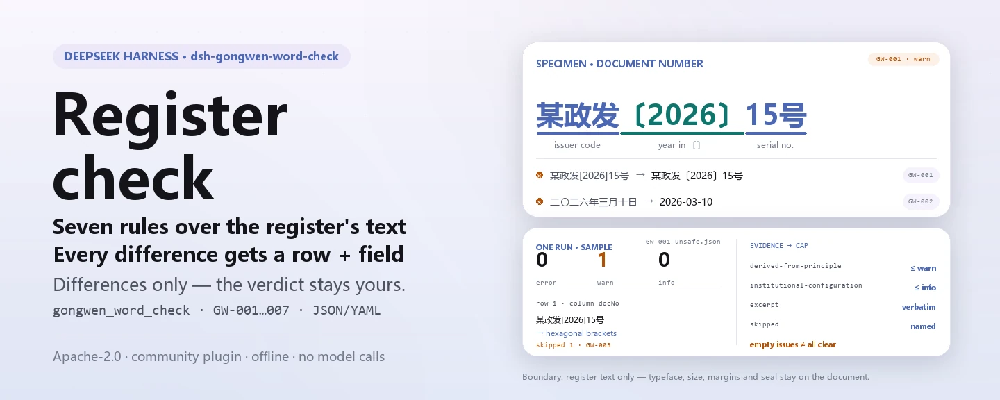

<div align="center">

<picture>
  <source media="(prefers-color-scheme: dark)" srcset="docs/assets/dsh-gongwen-word-check-hero-en-dark.webp">
  
</picture>

# dsh-gongwen-word-check

**Confira um registro de documentos oficiais item por item — você recebe a lista de qual linha, qual coluna e o que corrigir; o veredito fica com o revisor.**

Plugin verificador orientado a dados para o DeepSeek Harness: lê um registro de documentos oficiais (uma linha por documento emitido), aplica o pacote de regras versionado que acompanha o pacote (GW-001..GW-007) ao texto que o registro anota e lista apenas as divergências que consegue apontar dentro do material — nunca um parecer de conformidade, nunca uma atribuição de responsabilidade.

[Instalar](#instalação-em-três-passos) · [Configuração](#configuração) · [FAQ](#faq) · [简体中文](README.md) · [English](README.en.md) · [Español](README.es.md) · [Português](README.pt.md) · [हिन्दी](README.hi.md)

[](LICENSE)
[](#compatibilidade)
[](https://www.npmjs.com/package/dsh-gongwen-word-check)
[](https://github.com/PerryLink/dsh-gongwen-word-check/actions/workflows/ci.yml)
[](#compatibilidade)

[](https://github.com/PerryLink/dsh-gongwen-word-check/stargazers)
[](https://www.npmjs.com/package/dsh-gongwen-word-check)
[](https://dshfind.com/plugins/PerryLink/dsh-gongwen-word-check?ref=badge)
[](https://securityscorecards.dev/viewer/?uri=github.com/PerryLink/dsh-gongwen-word-check)
[](https://dsh.market/)
[](https://gitee.com/perrylink/dsh-gongwen-word-check)

```sh
dsh plugin --profile <name> add dsh-gongwen-word-check
```

</div>

<sub>Plugin da comunidade, sem vínculo com a DeepSeek. Repositório canônico: <https://github.com/PerryLink/dsh-gongwen-word-check> (o Gitee é um espelho).</sub>

## O que é

`dsh-gongwen-word-check` lê um registro de documentos oficiais — uma linha por documento emitido — e verifica o texto que esse registro anota, elemento por elemento: se `发文字号` (o número do documento) segue a forma 「sigla do órgão 〔ano〕 número de ordem」 com o ano entre colchetes hexagonais 〔〕; se `成文日期` (a data de assinatura) pode ser interpretada como data e não é posterior ao dia da verificação; se `文种` (a classe do documento) vem do vocabulário que a própria unidade configura; se `主送机关` (o destinatário principal) está preenchido; se `标题` (o título) fica dentro do comprimento configurado; se um número de documento se repete no registro; e se um título ainda carrega algum marcador de modelo não substituído.

Ele verifica **o texto que o registro anota, não a diagramação do documento original**: tipografia, corpo, margens e posição do selo só podem ser julgados no próprio documento.

Os nomes de coluna do registro são chineses no material para o qual este plugin foi feito; cada um corresponde a uma chave de campo sobre a qual as regras operam:

```text
coluna do registro   chave      o que a verificação pergunta
发文字号              docNo      sigla 〔ano〕 número de ordem; unicidade no registro
成文日期              signedAt   é interpretada e não é posterior à data da verificação
文种                  docKind    vem do vocabulário que a unidade configura
主送机关              recipient  está preenchido
标题                  title      dentro do comprimento configurado, sem marcadores
```

- **Para quem é**: para quem redige documentos oficiais, para a secretaria e para quem revisa em um órgão emissor; não é preciso linha de comando — basta entregar o material no chat.
- **O que você entrega**: o material de origem sobre o qual a verificação trabalha (uma tabela, um registro ou um documento); o original nunca é modificado. O Excel pode ser convertido antes para JSON/YAML, inclusive no chat se a plataforma permitir.
- **O que você recebe de volta**: uma lista de «qual linha, qual coluna, o que falta, como corrigir»; cada verificação que não pôde ser executada aparece em `skipped` com o motivo.

<picture>
  <source media="(prefers-color-scheme: dark)" srcset="docs/assets/dsh-gongwen-word-check-flow-v5-dark.svg">
  
</picture>

## Instalação em três passos

1. **Instalar** (escolha um canal):

   ```sh
   # canal git (última main; equivale a git+https://github.com/PerryLink/dsh-gongwen-word-check.git)
   dsh plugin --profile <name> add github:PerryLink/dsh-gongwen-word-check
   # canal npm (versões publicadas)
   dsh plugin --profile <name> add dsh-gongwen-word-check
   # canal tarball: após pnpm pack neste repositório
   dsh plugin --profile <name> add ./dsh-gongwen-word-check-<version>.tgz
   ```

2. **Configuração mínima** (os padrões já funcionam; uma linha de bundle sem `config` usa todos os padrões, com o caminho do pacote de regras apontando para o `rules/gongwen-word-check.yaml` incluído):

   ```yaml
   - insert:
       - id: dsh-gongwen-word-check
         name: dsh-gongwen-word-check
   ```

3. **Verificar que ele monta**:

   ```sh
   dsh --profile <name> --dump-config | grep 'dsh-gongwen-word-check'
   ```

   Depois execute o exemplo incluído (requer `pnpm run build` antes, para gerar `lib/`):

   ```sh
   node samples/quickstart/run.mjs
   ```

   Saída (o esperado está em `samples/quickstart/expected/result.json`; a entrada fica em `samples/quickstart/input/`):

   ```text
   gongwen_word_check: 1 issue(s) — error 0, warn 1, info 0
   skipped: 1
   ```

   `--json` imprime o mesmo resumo em JSON. Captura em `docs/assets/quickstart.png`.

**Desinstalar**: `dsh plugin --profile <name> remove dsh-gongwen-word-check` (ou remova a linha do patch do perfil).

<details>
<summary>Usar no WorkBuddy / Coze</summary>

Busque «Documents and Governance Suite» («文书与治理核对包») no WorkBuddy / Coze (esta verificação é uma das partes; disponibilidade conforme o catálogo) para chamar a mesma capacidade sem linha de comando.

</details>

<details>
<summary>Instalar pelo mercado do DSH Desktop</summary>

Todos os plugins PerryLink estão no mercado embutido do DSH Desktop: **Mercado → Fontes → Adicionar fonte → colar** `https://perrylink-dsh-catalog.perrylink.workers.dev/catalog-source.json` **→ selecionar**. A instalação ainda exige a verificação de identidade npm do mercado e a sua confirmação.

</details>

## Capacidades principais

`dsh-gongwen-word-check` registra a ferramenta `gongwen_word_check`: lê um registro de documentos (JSON ou YAML), aplica um pacote de regras versionado e devolve um relatório.

- **Sete regras num pacote de dados** — o pacote de regras é dado, não código (`rules/gongwen-word-check.yaml`); substituí-lo troca todo o conjunto sem tocar numa linha de TypeScript.
- **Somente leitura sobre o material** — aceita JSON ou YAML e nunca modifica o original; ESM puro, sem requisições de rede, sem chamadas ao modelo.
- **Citações não inventadas** — cada regra traz `document` / `number` / `clause` / `excerpt` / `kind` / `source`; `excerpt` precisa ser citação literal, e a regra cujo texto não foi citado literalmente diz isso no próprio `excerpt` e permanece marcada `derived-from-principle`.
- **A severidade segue a evidência** — `derived-from-principle` tem teto `warn` e a configuração institucional (`institutional-configuration`) teto `info`; um teste garante isso.
- **Lista de achados vazia não é «nada está errado»** — cada verificação que não pôde ser executada aparece em `skipped` com o motivo; uma regra cuja lista obrigatória não foi definida se declara em `skipped` em vez de passar em silêncio.
- **Sem redação que julgue** — o relatório enumera divergências e nunca opina sobre conformidade, responsabilidade ou correção; um guardião de redação impõe isso e todo relatório traz o aviso.

| Regra | Verificação | Severidade | Tipo de fundamento |
|---|---|---|---|
| `GW-001` | o número do documento segue a forma «sigla 〔ano〕 número de ordem», ano entre 〔〕 | warn | princípio |
| `GW-002` | a data de assinatura é interpretada e não é posterior à data da verificação | warn | princípio |
| `GW-003` | a classe do documento vem do seu vocabulário (vazio de fábrica) | info | local |
| `GW-004` | há um destinatário principal registrado | warn | princípio |
| `GW-005` | o título não passa do comprimento configurado | warn | princípio |
| `GW-006` | os números de documento são únicos no registro | warn | princípio |
| `GW-007` | o título não guarda marcadores de modelo | warn | princípio |

### Exemplos

Estes são os pontos de entrada reais do plugin; instale uma vez e chame um. O primeiro caso é o passo a passo detalhado; os demais são casos curtos.

**Exemplo detalhado** — ferramenta `gongwen_word_check`, entrada:

```json
{"rows":[{"发文字号":"某政发〔2026〕15号","成文日期":"二〇二六年三月十日"}]}
```

Saída:

```json
{
  "id": "dsh-gongwen-word-check.GW-002.de09b5a6",
  "ruleId": "GW-002",
  "severity": "warn",
  "locator": {
    "field": "signedAt",
    "row": 1
  },
  "found": "第 1 行「signedAt」的值「二〇二六年三月十日」无法解析为日期",
  "expected": "「signedAt」应为 2026-03-15 或 2026-03-15 09:30 这样的可解析日期",
  "fix": "核对日期写法；本条不会因为无法解析而跳过该行"
}
```

*Observed from `dsh-gongwen-word-check/tests/fixtures/GW-002/GW-002-unsafe.json`; `dsh-gongwen-word-check/tests/fixtures/GW-002/cases.json` expects GW-002 count 1; run via `dsh-gongwen-word-check/lib/index.mjs` against `dsh-gongwen-word-check/rules/gongwen-word-check.yaml`*

É a saída real do plugin sobre o seu próprio fixture de teste `GW-002`, não uma montagem. O texto dos achados sai em chinês porque o material está em chinês. O pacote de regras não inventa citações, então cada achado nomeia a cláusula aplicada e diz se o texto dela foi obtido nesta passagem.

| Você pergunta | O que ele responde |
|---|---|
| O número do documento foi digitado com colchetes quadrados em vez de 〔〕. | `GW-001` aponta essa linha: o padrão configurado exige colchetes hexagonais 〔〕 em volta do ano, portanto a forma 〔〕 é a que se deve escrever. A regra só verifica a forma do número; a sigla é definida pela sua unidade, então ela não julga se a sigla está certa nem se os números de ordem são consecutivos ou reutilizados. |
| A data de assinatura está escrita como o documento costuma trazê-la, com numerais chineses. | `GW-002` informa que não consegue interpretar esse valor. Ele lê `2026-03-15` e `2026-03-15 09:30`; uma data com numerais chineses precisa ser normalizada para uma dessas formas, ou a regra desativada. A regra também não confronta a data de assinatura com a de expedição: isso é interno ao fluxo de emissão. |
| Nunca configuramos a lista de classes de documento da nossa unidade. O `GW-003` passa em silêncio? | Não. O `GW-003` não traz lista embutida, então com `values` não definido ele aparece na seção `skipped` do relatório em vez de passar em silêncio. O regulamento enumera quinze classes principais, mas o pacote não as fixa no código: quais classes a sua unidade pode usar é decisão sua. A regra também não julga qual classe um documento deveria ter usado. |
| Uma linha deixa em branco a coluna do destinatário principal. | `GW-004` aponta essa linha, porque sem destinatário principal não há como confirmar a quem o documento foi enviado. Ele verifica se a coluna está preenchida, não se o alcance dos destinatários é o adequado: a quem se dirige e a quem se copia é decisão de redação. |
| Nosso título é longo. De onde vem o limite de comprimento? | `GW-005` aponta um título acima do limite configurado de 60 caracteres. Esse número é o padrão deste pacote de regras, não uma cifra da norma: a norma de formato fixa um corpo 2-hao para o título e não dá limite de caracteres, então, se a sua unidade escreve títulos mais longos, aumente `maxLength` ou desative a regra. A regra só conta caracteres — não julga a redação do título. |
| Duas linhas trazem o mesmo número de documento. | `GW-006` aponta o número repetido; ele compara os valores ignorando espaços, e um acerto costuma significar número reutilizado ou copiado errado, que uma pessoa precisa confirmar. Ele não decide qual dos dois documentos deveria usar aquele número. |

## Normas que segue

| Documento | Número | Regras que o citam |
|---|---|---|
| Formato dos documentos oficiais dos órgãos do Partido e do Estado (título chinês canônico em `rules/evidence/`) | GB/T 9704-2012 (norma nacional **recomendada**; texto completo lido literalmente em 2026-10-07, ver `rules/evidence/clause-verification-gbt9704.md`) | GW-001, GW-002, GW-004, GW-005, GW-007 |
| Regulamento de tramitação de documentos oficiais dos órgãos do Partido e do Estado (título chinês canônico em `rules/evidence/`) | Zhongbanfa [2012] nº 14 (em vigor desde 2012-07-01; texto completo lido literalmente) | GW-003, GW-006 |

**Limite:** este plugin verifica os **elementos de cabeçalho e de corpo de um registro de documentos** naquilo que um registro pode sustentar mecanicamente: que o número do documento siga a forma «sigla 〔ano〕 número de ordem» com o ano entre colchetes hexagonais, que a data de assinatura seja interpretável, que a classe do documento venha do seu vocabulário, que haja destinatário principal, que o título não seja longo demais, que os números não se repitam e que não reste marcador de modelo. Ele verifica **o texto que o registro anota, não a diagramação**: tipografia, corpo, margens e posição do selo (capítulo 5, 5.2.2, 5.2.3 e 7.3.5.1 da norma, entre outros) só podem ser julgados no próprio documento, e este plugin não verifica nenhum deles.

> ### ⚠️ Leia isto antes de confiar numa citação do relatório
>
> **O Regulamento foi obtido e lido literalmente**, e `rules/evidence/clause-verification.md` junto com
> `rules/evidence/clause-verification-gongwen-articles.md` registram quais artigos foram citados: o artigo 8
> (as quinze classes de documento, que começa com «principalmente»), o artigo 9 (os elementos de formato,
> incluindo as definições do número do documento e do destinatário principal), o artigo 10 (que remete a
> diagramação à GB/T 9704-2012), o artigo 25(2) (a etapa de registro da emissão) e o artigo 42 (em vigor desde
> 2012-07-01, que substituiu dois documentos anteriores que este pacote nunca cita).
>
> **O texto completo da norma de formato também foi obtido e conferido** (2026-10-07, ver
> `rules/evidence/clause-verification-gbt9704.md`, que substitui expressamente a conclusão anterior de «não
> obtido nesta passagem»): **os colchetes hexagonais 〔〕 que o `GW-001` exige agora são exigência escrita da
> cláusula 7.2.5**, não apenas convenção da norma de diagramação; o `GW-002` incorpora 7.3.5.4 (mês e dia sem
> zero à esquerda); o `GW-004` corresponde a 7.3.2. **A norma é uma norma nacional recomendada** (o número leva
> `/T`) e o capítulo 1 declara que os documentos de outros órgãos e unidades «podem ser aplicados por
> referência».
>
> **Mas o `excerpt` de cada regra continua dizendo que o texto não foi obtido nesta passagem, e cada regra
> continua `warn` ou `info`.** O motivo não é falta de texto, e sim que **os objetos diferem**: as cláusulas
> regulam a diagramação do documento em si, enquanto este plugin verifica *o texto que um registro anota*.
> Chamar uma coluna vazia de descumprimento `direct` da 7.3.2 seria vestir uma lacuna do registro de violação
> de diagramação. O cabeçalho do pacote e o `note` de cada regra dizem isso, e a seção 5 de
> `rules/evidence/clause-verification-gbt9704.md` registra o raciocínio regra por regra.
>
> Dois limiares são locais e o pacote diz isso. O teto de comprimento do título (`GW-005`, 60 caracteres) é **o
> padrão deste pacote de regras, não uma cifra da norma**: a 7.3.1 só fixa um corpo 2-hao para o título e **não
> aparece nenhuma contagem de caracteres em nenhum dos dois documentos**. E o vocabulário de classes de
> documento (`GW-003`) vem **vazio**, apesar de o artigo 8 enumerar quinze classes, porque o artigo diz
> «principalmente» e as unidades também usam nomes fora da lista. `GW-006` (unicidade) e `GW-007` (marcadores)
> **não** têm cláusula diretamente correspondente em nenhum dos dois documentos; o pacote os marca como
> inferências em vez de tomar emprestada a cláusula mais próxima.
>
> A verificação de marcadores **omite de propósito** o caractere usado como equivalente de «certo» na sua lista
> de termos: títulos de modelo costumam dizer «aviso sobre certo assunto», mas esse caractere também aparece em
> títulos legítimos como substituto de um assunto sigiloso.
>
> Também se declara o que segue sem obter: as figuras de exemplo do capítulo 11 (figuras 1–12, apenas imagens),
> a GB/T 15834 (pontuação), a GB/T 15835 (numeração em publicações) e as GB 3100/3101/3102 (grandezas e
> unidades). Por isso este plugin **não acrescenta nenhuma regra de «a pontuação está correta?»**: sairia do
> escopo do texto de um registro. A GB/T 9704-1999 e a GB/T 9704-1988 foram substituídas e nunca são citadas
> aqui.

Os extratos de cláusulas que o pacote cita (redação chinesa literal, conforme registrado em `rules/evidence/`):

```text
7.2.5 发文字号   年份、发文顺序号用阿拉伯数字标注；年份应标全称，用六角括号"〔〕"括入；
                 发文顺序号不加"第"字，不编虚位（即 1 不编为 01），在阿拉伯数字后加"号"字。
7.3.1 标题       一般用 2 号小标宋体字……（未规定字数上限）
7.3.2 主送机关   编排于标题下空一行位置，居左顶格……最后一个机关名称后标全角冒号。
7.3.5.4 成文日期 用阿拉伯数字将年、月、日标全，年份应标全称，月、日不编虚位（即 1 不编为 01）。
第九条（八）     主送机关。公文的主要受理机关。
第二十五条（二） 登记。对复核后的公文，应当确定发文字号、分送范围和印制份数并详细记载。
```

## Configuração

Todos os ajustes são campos Schemastery `Config` em `src/config.ts` (alteráveis pelo cordis.yml); os limiares de cada regra ficam no pacote de regras em `rules/`. Uma substituição por id troca a linha inteira: redeclare todas as chaves de que precisa.

| Chave | Tipo | Padrão | Descrição |
|---|---|---|---|
| `rulesFile` | string | `rules/gongwen-word-check.yaml` | Caminho do pacote de regras, relativo à raiz do pacote |
| `disabledRules` | string[] | `[]` | Ids de regras que deixam de rodar; cada uma aparece em `skipped` |
| `onlyRules` | string[] | `[]` | Rodar só estas regras; vazio roda todas |
| `skipNotes` | string | `""` | Observação acrescentada a cada motivo de `skipped` |
| `timeoutMs` | number | `120000` | Orçamento cooperativo de timeout da ferramenta |

Parâmetros por regra que vale conhecer:

- `GW-001` `pattern` — a forma do número do documento; o padrão exige o ano entre colchetes hexagonais 〔〕. Amplie-o para emissões conjuntas ou atas sem número, ou desative a regra.
- `GW-003` `values` — as classes de documento da sua unidade, por exemplo as quinze classes principais enumeradas pela norma (`决议`, `决定`, `命令` e assim por diante) mais os nomes que a sua repartição usa.
- `GW-005` `maxLength` / `minLength` — os limites de comprimento do título da **sua** unidade; o teto padrão de 60 é convenção local, não cifra da norma.
- `GW-007` `terms` — os marcadores procurados; o caractere equivalente de «certo» falta de propósito.

Exemplo de substituição no patch do perfil:

```yaml
- insert:
    - id: dsh-gongwen-word-check
      name: dsh-gongwen-word-check
      config:
        disabledRules: [GW-005]
        onlyRules: [GW-001, GW-002, GW-004]
        timeoutMs: 180000
```

## Formato do material

A ferramenta aceita JSON ou YAML:

```yaml
issuer: 某某机关
year: 2026
rows:
  - { 发文字号: 某政发〔2026〕15号, 标题: 某某机关关于印发某某管理办法的通知, 文种: 通知,
      发文机关: 某某机关, 成文日期: 2026-03-10, 主送机关: 各直属单位,
      抄送机关: 某某办公室, 密级: 公开, 紧急程度: 平件 }
```

Os nomes de coluna são comparados sem diferenciar maiúsculas e ignorando espaços, sublinhados e hífens; os nomes próprios do registro são preservados, então um achado nomeia a coluna que ele realmente leu. As datas podem ser `2026-03-10` ou `2026-03-10 09:30`; uma data com numerais chineses é informada como não interpretável de propósito. Os campos são opcionais na camada de leitura e validados pelo motor, então uma exportação parcial gera achados de «falta isto» em vez de quebrar.

## Fontes das regras

Os dados das regras ficam em `rules/gongwen-word-check.yaml`, separados do código: cada regra traz documento, número, cláusula na numeração própria da fonte, extrato literal e URL de origem. O cabeçalho do pacote expõe por inteiro a lacuna de citações, e o `note` de cada regra repete a parte que lhe cabe. O guardião de carga que normalmente exige «um extrato deve ser citação real de pelo menos oito caracteres» não distingue uma citação de uma descrição, então este pacote se apoia no cabeçalho, nos `note` por regra e num teste que afirma que todo `excerpt` reconhece a lacuna. Um pacote que exagera o seu fundamento falha ao carregar em vez de produzir um relatório de aparência sólida. Os limites confirmados na verificação e as conclusões deliberadamente **não** afirmadas acompanham o pacote em `rules/evidence/`.

## FAQ

<details>
<summary>Ele decide conformidade por nós?</summary>

Não. Ele só enumera as divergências que consegue apontar dentro do material (qual linha, qual coluna, o que falta, como corrigir) e não decide fatos nem conformidade: a conclusão fica sempre com quem revisa. Um guardião de redação impõe o texto do relatório e todo relatório traz o aviso. Um achado deve ser lido como «esta coluna está vazia / a forma do número está errada / o título é longo demais», nunca como «o formato do documento é irregular».

</details>

<details>
<summary>Por que toda regra tem teto `warn`? Onde está o `error`?</summary>

Porque o nível de evidência decide a severidade: uma regra apoiada num princípio e não numa cláusula diretamente aplicável (`kind: derived-from-principle`) tem teto `warn`, e uma verificação cujo limiar vem da sua instituição (`institutional-configuration`) tem teto `info`. O pacote recusa um `error` exagerado ao carregar e um teste garante esse teto.

</details>

<details>
<summary>Uma lista `issues` vazia pode ser lida como «nada está errado»?</summary>

Não. Cada verificação que não pôde ser executada aparece em `skipped` com o motivo (por exemplo `GW-003` com `values` não definido, ou uma regra desativada por `disabledRules`). Leia `issues` e `skipped` juntos antes de tirar qualquer conclusão.

</details>

<details>
<summary>É obrigatório reescrever datas com numerais chineses e números com colchetes?</summary>

Não necessariamente, mas essas formas são informadas com honestidade: o padrão do `GW-001` exige o ano entre colchetes hexagonais 〔〕, então um número com colchetes quadrados é apontado; o `GW-002` só lê `2026-03-15` e `2026-03-15 09:30`, então uma data com numerais chineses é informada como não interpretável. Se a sua unidade mantém as formas convencionais, amplie `pattern` ou desative a regra: o plugin não dita o estilo da sua casa.

</details>

<details>
<summary>Nosso registro é uma exportação do Excel. Podemos usá-lo direto?</summary>

Sim: converta antes para JSON ou YAML; no chat a plataforma pode fazer a conversão se permitir. A ferramenta só lê o material e nunca modifica o original. Os campos são opcionais na camada de leitura e validados pelo motor, então uma exportação parcial gera achados de «falta isto» em vez de quebrar.

</details>

<details>
<summary>Aguenta um ano inteiro de documentos de uma vez?</summary>

A ferramenta funciona nos modos `native` e `ptc`; para trabalho em lote (um ano de registros ou um diretório inteiro) use `ptc`, onde o custo do schema é pago uma vez. As verificações são casamento de colunas e aritmética de datas em local: sem requisições de rede, sem chamadas ao modelo; `timeoutMs` (120 s por padrão) é o orçamento cooperativo de timeout.

</details>

## Resolução de problemas

- **`GW-001` acusa um número que considero correto.** O padrão exige o ano entre **colchetes hexagonais 〔〕**; um número escrito com `[]`, `（）` ou hífen falha. Ajuste `pattern` ao estilo da sua casa.
- **`GW-002` acusa uma data com numerais chineses.** O leitor aceita `2026-03-10`; uma data escrita com numerais chineses é informada como não interpretável de propósito, para que você decida se normaliza a exportação.
- **`GW-003` nunca roda.** O vocabulário dele vem vazio. Quais nomes contam como classes é decisão da sua instituição e o plugin não adivinha.
- **`GW-005` acusa um título que cabe na página.** O teto é de 60 caracteres por padrão e é convenção local. Aumente-o ou desative a regra.
- **`GW-007` não acusa um título que contém o caractere de «certo».** É deliberado; acrescente o caractere a `terms` se os seus modelos realmente o usam como marcador.
- **O plugin instala mas a ferramenta nunca aparece.** Confirme que `main` resolve para `lib/index.mjs` e que `pnpm run build` o gerou; um `main` errado faz o carregador pular a entrada em silêncio.
- **`dsh plugin add` recusa o pacote como incompatível.** A faixa de peers cobre `0.1.x` e `0.2.x`; se o seu runtime estiver fora dela, conceda isenção explícita: `dsh plugin --profile <name> allow-version dsh-gongwen-word-check@0.1.0 --dsh-version <runtime> --accept-risk`
- **`check` informa `manifest-peers` como falha.** O verificador estático compara com uma faixa de peers fixa no código, anterior à geração 0.2. O runtime aplica a compatibilidade de peers na instalação, então a faixa declarada é a correta; é um problema conhecido do `dsh-plugin-dev`.
- **Os horários parecem deslocados.** Toda a aritmética é de hora local sobre as cadeias de entrada, sem conversão de fuso.

## Compatibilidade

| Superfície | Estado |
|---|---|
| Harness | Faixa de peers `>=0.1.2-rc.1 <0.2.0 \|\| >=0.2.0-0 <0.3.0` — verificado para aceitar tanto `0.2.0-rc.2` como `0.2.1-rc.2`. `engines.dsh` é declarado como `>=0.2.1-0 <0.3.0` e o host o aplica desde 0.2.1 |
| Node | `^22.19.0 \|\| >=24.0.0` |
| Plataformas | Todas (ESM puro; sem código nativo, sem rede, sem chamada ao modelo) |
| Modo de ferramenta | Funciona em `native` e `ptc`; para o registro de um ano inteiro use `ptc` |
| Aplicabilidade da norma | A GB/T 9704-2012 é norma nacional **recomendada** (o número leva `/T`); o capítulo 1 declara que os documentos de outros órgãos e unidades «podem ser aplicados por referência», então documentos de empresas e instituições ficam sob referência, não sob obrigação |

## Ecossistema e qualidade

- [Espelho no Gitee](https://gitee.com/perrylink/dsh-gongwen-word-check) (espelho sincronizado; o GitHub é o canônico)
- [Página do plugin no dshfind](https://dshfind.com/plugins/PerryLink/dsh-gongwen-word-check) (instalações e ranking)
- [Relatório OpenSSF Scorecard](https://securityscorecards.dev/viewer/?uri=github.com/PerryLink/dsh-gongwen-word-check) (gerado por [.github/workflows/scorecard.yml](.github/workflows/scorecard.yml))
- [DSH Market](https://dsh.market/) (listado)
- **Canal da loja 1024**: `npm i -g dsh1024` uma vez e depois `dsh1024 plugin --profile <name> add dsh-gongwen-word-check` (conta para o ranking de instalações do [deepseek1024.com](https://deepseek1024.com))
- [Base de conhecimento do ecossistema](https://perrylink.github.io/dsh-plugin-guide/): guia de desenvolvimento de plugins · dados de seleção medidos · critérios de manutenção

## Desenvolvimento

```sh
pnpm install                                        # node ^22.19 || >=24
pnpm run typecheck                                  # tsc --noEmit
pnpm test                                           # vitest: suíte compartilhada de tabelas + fixtures pareados
pnpm run build                                      # tsdown -> lib/index.mjs + lib/index.d.mts
pnpm run verify:self-contained                      # as dependências resolvem pelo registry
pnpm run check:lockfile                             # verificação de deriva do lockfile
pnpm run check:readmes                              # coerência dos READMEs em cinco idiomas
pnpm run check:citations                            # linha de base de citações do pacote de regras
node ../scripts/sync-shared.mjs dsh-gongwen-word-check   # atualizar src/shared a partir de ../_shared
pnpm pack                                           # o tarball publicado
```

O plugin é **só dados**: `src/model.ts` declara a forma da tabela, o kit compartilhado fornece o leitor e o motor de verificação, e o pacote de regras declara cada verificação; uma verificação que caiba num tipo existente só precisa de edição no pacote de regras. Execução local do exemplo (requer `pnpm run build` antes, para gerar `lib/`):

```sh
node samples/quickstart/run.mjs --json
# => {"tool":"gongwen_word_check","issueCount":1,"summary":{"error":0,"warn":1,"info":0},"skippedCount":1}
```

A entrada do exemplo fica em `samples/quickstart/input/`, a saída esperada em `samples/quickstart/expected/result.json` e uma captura em `docs/assets/quickstart.png`. As imagens do README são geradas por [`scripts/gen-readme-assets.py`](scripts/gen-readme-assets.py) de forma programática (o banner com Python + Pillow e a figura de estrutura como SVG escrito à mão) e podem ser reexecutadas: `python scripts/gen-readme-assets.py`; o diagrama de fluxo de pele única e as imagens de demonstração anteriores permanecem em `docs/assets/` para links externos, enquanto os READMEs citam o novo banner e o par claro/escuro da estrutura.

Tópicos: `deepseek-harness`, `dsh`, `dsh-plugin`, `cordis`, `gongwen`, `word`

## Família e agradecimentos

Este projeto faz parte da família de plugins DeepSeek Harness da [PerryLink](https://github.com/PerryLink) (todos Apache-2.0). Índice completo da família: [escolher um verificador por material](https://perrylink.github.io/zh/checkers/choose/) e [todos os plugins](https://github.com/PerryLink). Se for útil, **uma estrela ajuda a próxima pessoa a encontrá-lo**; nada fica bloqueado por isso.

- [@PerryLink](https://github.com/PerryLink) — criador e mantenedor: o pacote de regras só dados (GW-001..GW-007), a ferramenta `gongwen_word_check`, o registro de verificação de citações e a documentação em cinco idiomas.

<details>
<summary>Expandir todos os plugins</summary>

| Plugin | Estado |
|---|---|
| **[dsh-aqua-input-check](https://github.com/PerryLink/dsh-aqua-input-check)** |  |
| **[dsh-archive-check](https://github.com/PerryLink/dsh-archive-check)** |  |
| **[dsh-auto-review](https://github.com/PerryLink/dsh-auto-review)** |  |
| **[dsh-autotier](https://github.com/PerryLink/dsh-autotier)** | 🧊 CONGELADO — ver o README do repo |
| **[dsh-bid-ca-precheck](https://github.com/PerryLink/dsh-bid-ca-precheck)** |  |
| **[dsh-bid-qual-check](https://github.com/PerryLink/dsh-bid-qual-check)** |  |
| **[dsh-cert-mcp](https://github.com/PerryLink/dsh-cert-mcp)** | 🧊 CONGELADO — ver o README do repo |
| **[dsh-checkpoint-rewind](https://github.com/PerryLink/dsh-checkpoint-rewind)** |  |
| **[dsh-click](https://github.com/PerryLink/dsh-click)** |  |
| **[dsh-composer-history](https://github.com/PerryLink/dsh-composer-history)** |  |
| **[dsh-contract-stance](https://github.com/PerryLink/dsh-contract-stance)** |  |
| **[dsh-customs-doc-check](https://github.com/PerryLink/dsh-customs-doc-check)** |  |
| **[dsh-data-quality](https://github.com/PerryLink/dsh-data-quality)** | 🧊 CONGELADO — ver o README do repo |
| **[dsh-demurrage-ledger](https://github.com/PerryLink/dsh-demurrage-ledger)** |  |
| **[dsh-doublecheck](https://github.com/PerryLink/dsh-doublecheck)** |  |
| **[dsh-drill-script-check](https://github.com/PerryLink/dsh-drill-script-check)** |  |
| **[dsh-eia-guide-check](https://github.com/PerryLink/dsh-eia-guide-check)** |  |
| **[dsh-emergency-plan](https://github.com/PerryLink/dsh-emergency-plan)** |  |
| **[dsh-essay-rubric-check](https://github.com/PerryLink/dsh-essay-rubric-check)** |  |
| **[dsh-evidence-check](https://github.com/PerryLink/dsh-evidence-check)** |  |
| **[dsh-export-ctl-check](https://github.com/PerryLink/dsh-export-ctl-check)** |  |
| **[dsh-fast](https://github.com/PerryLink/dsh-fast)** |  |
| **[dsh-fmea-table-check](https://github.com/PerryLink/dsh-fmea-table-check)** |  |
| **[dsh-forecast-penalty](https://github.com/PerryLink/dsh-forecast-penalty)** |  |
| **[dsh-fund-research](https://github.com/PerryLink/dsh-fund-research)** |  |
| **[dsh-github](https://github.com/PerryLink/dsh-github)** |  |
| **[dsh-gongwen-flow-check](https://github.com/PerryLink/dsh-gongwen-flow-check)** |  |
| **[dsh-gongwen-word-check](https://github.com/PerryLink/dsh-gongwen-word-check)** |  |
| **[dsh-guard-plan-qc](https://github.com/PerryLink/dsh-guard-plan-qc)** |  |
| **[dsh-hazchem-check](https://github.com/PerryLink/dsh-hazchem-check)** |  |
| **[dsh-hazplan-check](https://github.com/PerryLink/dsh-hazplan-check)** |  |
| **[dsh-hidden-risk-map](https://github.com/PerryLink/dsh-hidden-risk-map)** |  |
| **[dsh-hs-classify](https://github.com/PerryLink/dsh-hs-classify)** |  |
| **[dsh-icd-rule-check](https://github.com/PerryLink/dsh-icd-rule-check)** |  |
| **[dsh-industry-research](https://github.com/PerryLink/dsh-industry-research)** |  |
| **[dsh-lawcite-adapter](https://github.com/PerryLink/dsh-lawcite-adapter)** |  |
| **[dsh-laya](https://github.com/PerryLink/dsh-laya)** |  |
| **[dsh-lc-doc-check](https://github.com/PerryLink/dsh-lc-doc-check)** |  |
| **[dsh-learning-gap-check](https://github.com/PerryLink/dsh-learning-gap-check)** |  |
| **[dsh-library](https://github.com/PerryLink/dsh-library)** |  |
| **[dsh-local-ai](https://github.com/PerryLink/dsh-local-ai)** |  |
| **[dsh-lsp-actions](https://github.com/PerryLink/dsh-lsp-actions)** |  |
| **[dsh-mask](https://github.com/PerryLink/dsh-mask)** |  |
| **[dsh-mcp-panel](https://github.com/PerryLink/dsh-mcp-panel)** |  |
| **[dsh-medrec-qc](https://github.com/PerryLink/dsh-medrec-qc)** |  |
| **[dsh-memento](https://github.com/PerryLink/dsh-memento)** | 🧊 CONGELADO — ver o README do repo |
| **[dsh-nsfc-form-check](https://github.com/PerryLink/dsh-nsfc-form-check)** |  |
| **[dsh-nurse-record-check](https://github.com/PerryLink/dsh-nurse-record-check)** |  |
| **[dsh-observe](https://github.com/PerryLink/dsh-observe)** |  |
| **[dsh-origin-rvc-check](https://github.com/PerryLink/dsh-origin-rvc-check)** |  |
| **[dsh-ota-review-check](https://github.com/PerryLink/dsh-ota-review-check)** |  |
| **[dsh-output-styles](https://github.com/PerryLink/dsh-output-styles)** |  |
| **[dsh-paper-doc-adapter](https://github.com/PerryLink/dsh-paper-doc-adapter)** |  |
| **[dsh-permission-rules](https://github.com/PerryLink/dsh-permission-rules)** |  |
| **[dsh-permit-report-check](https://github.com/PerryLink/dsh-permit-report-check)** |  |
| **[dsh-pipeline-check](https://github.com/PerryLink/dsh-pipeline-check)** |  |
| **[dsh-pleading-draft](https://github.com/PerryLink/dsh-pleading-draft)** |  |
| **[dsh-plugin-doctor](https://github.com/PerryLink/dsh-plugin-doctor)** | 🚫 APOSENTADO (repo arquivado) |
| **[dsh-plugin-guide](https://github.com/PerryLink/dsh-plugin-guide)** |  |
| **[dsh-plugin-kit](https://github.com/PerryLink/dsh-plugin-kit)** | 🚫 APOSENTADO (repo arquivado) |
| **[dsh-plugin-upgrade](https://github.com/PerryLink/dsh-plugin-upgrade)** | 🚫 APOSENTADO (repo arquivado) |
| **[dsh-policy-brief-draft](https://github.com/PerryLink/dsh-policy-brief-draft)** |  |
| **[dsh-power-loss-split](https://github.com/PerryLink/dsh-power-loss-split)** |  |
| **[dsh-power-ticket-check](https://github.com/PerryLink/dsh-power-ticket-check)** |  |
| **[dsh-ppap-check](https://github.com/PerryLink/dsh-ppap-check)** |  |
| **[dsh-protest-deadline](https://github.com/PerryLink/dsh-protest-deadline)** |  |
| **[dsh-railway-window](https://github.com/PerryLink/dsh-railway-window)** |  |
| **[dsh-repair-order-qc](https://github.com/PerryLink/dsh-repair-order-qc)** |  |
| **[dsh-research-report](https://github.com/PerryLink/dsh-research-report)** |  |
| **[dsh-review-reply-check](https://github.com/PerryLink/dsh-review-reply-check)** |  |
| **[dsh-rulefile-check](https://github.com/PerryLink/dsh-rulefile-check)** |  |
| **[dsh-safety-brief-check](https://github.com/PerryLink/dsh-safety-brief-check)** |  |
| **[dsh-score](https://github.com/PerryLink/dsh-score)** | 🧊 CONGELADO — ver o README do repo |
| **[dsh-session-sync](https://github.com/PerryLink/dsh-session-sync)** |  |
| **[dsh-site-log-check](https://github.com/PerryLink/dsh-site-log-check)** |  |
| **[dsh-skill-pack-security](https://github.com/PerryLink/dsh-skill-pack-security)** |  |
| **[dsh-soe-decision-check](https://github.com/PerryLink/dsh-soe-decision-check)** |  |
| **[dsh-soilwater-check](https://github.com/PerryLink/dsh-soilwater-check)** |  |
| **[dsh-sop-sync-check](https://github.com/PerryLink/dsh-sop-sync-check)** |  |
| **[dsh-spc-gbt-adapter](https://github.com/PerryLink/dsh-spc-gbt-adapter)** |  |
| **[dsh-talk](https://github.com/PerryLink/dsh-talk)** |  |
| **[dsh-tender-extract](https://github.com/PerryLink/dsh-tender-extract)** |  |
| **[dsh-tender-matrix](https://github.com/PerryLink/dsh-tender-matrix)** |  |
| **[dsh-test-drive](https://github.com/PerryLink/dsh-test-drive)** |  |
| **[dsh-ticktick](https://github.com/PerryLink/dsh-ticktick)** | 🚫 APOSENTADO (repo arquivado) |
| **[dsh-translate](https://github.com/PerryLink/dsh-translate)** |  |
| **[dsh-warranty-calc](https://github.com/PerryLink/dsh-warranty-calc)** |  |
| **[dsh-budget](https://github.com/PerryLink/dsh-budget)** | 🧊 CONGELADO — ver o README do repo |
| **[dsh-claude-move](https://github.com/PerryLink/dsh-claude-move)** | 🧊 CONGELADO — ver o README do repo |
| **[dsh-defend](https://github.com/PerryLink/dsh-defend)** | 🧊 CONGELADO — ver o README do repo |
| **[dsh-draw](https://github.com/PerryLink/dsh-draw)** | 🧊 CONGELADO — ver o README do repo |
| **[dsh-reach](https://github.com/PerryLink/dsh-reach)** | 🧊 CONGELADO — ver o README do repo |
| **[dsh-background-agents](https://github.com/PerryLink/dsh-background-agents)** | 🚫 APOSENTADO (repo arquivado) |
| **[dsh-session-pin](https://github.com/PerryLink/dsh-session-pin)** | 🚫 APOSENTADO (repo arquivado) |
| **[dsh-team-rooms](https://github.com/PerryLink/dsh-team-rooms)** | 🚫 APOSENTADO (repo arquivado) |

</details>

## Licença

[LICENSE](LICENSE) (Apache License 2.0) © 2026 dsh-gongwen-word-check contributors

<p align="center"><sub>Apache-2.0 · Plugin da comunidade, sem vínculo com a DeepSeek.</sub></p>
